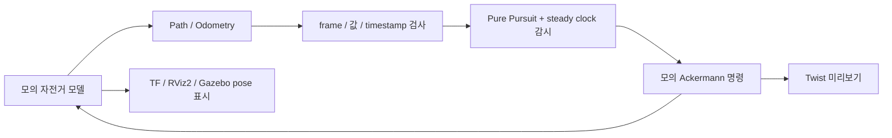

# ROS2 아키텍처와 파일 책임

현행 구현은 `ros2_ws/src/mrider_autonomy`의 ament CMake/Python 패키지다.
ROS1 코어를 재사용하고 실행 계층을 rclpy·ROS2 메시지·launch_testing으로 교체했다.

| 파일 | 책임 |
|---|---|
| `mrider_autonomy/core.py` | ROS 없는 Pure Pursuit·제한·감속·원본/수신 시각 감시 |
| `mrider_autonomy/ros_adapter.py` | ROS2 Time·평면 pose·frame·수치 계약 |
| `mrider_autonomy/nodes.py` | rclpy 제어·모의 차량·Twist 미리보기, QoS, steady timer |
| `mrider_autonomy/simulation.py` | 결정론적 경로·자전거 모델·ROS 없는 폐루프 |
| `mrider_autonomy/visualization.py` | TF·차량/궤적 Marker·Gazebo service 비동기 호출 |
| `launch/` | 알고리즘·demo·시각화·scan·agent 실행 구성 |
| `config/simulation.yaml` | ROS2 ros__parameters 형식의 가상 제원 |
| `test/` | core/boundary pytest와 실제 토픽 launch_testing |

`base_link`는 지면 후륜축 중심이며 기본 Path/Odometry 좌표계는 `map`이다.
실차 EKF가 `odom` 기준 pose를 발행하면 map pose 제공/변환 계층을 구현해야 하며 frame 이름만 바꾸면 안 된다.
Path와 Odometry의 source age·monotonic receive age를 모두 검사한다.
`create_timer(..., clock=STEADY_TIME)`으로 `/clock` 정지 중에도 정지 출력을 발행한다.
현재 모의 제어는 입력 정상화 후 자동 복구한다. 실차의 STOPPED latch/운영자 재허가는 별도 최종 게이트에서 구현할 계약이다.

공식 요구 출처는 [architecture](https://jrkwon.github.io/mrider/design/architecture/),
[DBW](https://jrkwon.github.io/mrider/design/dbw/), [방향 A 계획](camera-lidar-navigation-plan.md)에 기록한다.
Teensy 인터페이스는 [별도 계약](teensy-ros2-integration.md)을 따르며 공식 mitt_msgs를 이 패키지에서 재정의하지 않는다.

최초 범위의 수업 출처는 [공식 w07](https://github.com/jrkwon/mrider/blob/main/docs/course/weeks/w07.md)와
[팀 역할](https://github.com/jrkwon/mrider/blob/main/docs/course/teams.md)이다. 업로드본 대신 사용한 공식 대체 출처를 유지한다.
초기 ROS1 요구는 2026-11-17 사용자의 ROS2 전체 전환 지시로 대체되었으며, 모의/실차 경계와 검증 요구는 유지한다.

## 센서 시뮬레이션 확장

`mrider_navigation_sim`의 `world.py`는 scan·map·정답 odometry·TF·충돌 기준값을 발행하고 가감속 운동을 적분한다.
`mission.py`는 Nav2 lifecycle 준비 확인 및 계획/추종/cancel action을 관리한다.
`safety.py`는 ROS 없는 frame·시각·곡선 footprint·정지 latch 규칙, `gate_node.py`는 ROS 경계와 arm/disarm 서비스다.
`geometry.py`는 raycast·차체/장애물 교차·거리 계산, `checks.py`는 자동 시나리오/정량 보고서다.
Nav2는 후보 Twist만 발행하며 실제 모의 명령 publisher는 safety gate 하나다.
`map→odom`은 모의 정적 항등 변환, `odom→base_link`는 world 단일 발행자다.
시각화의 `publish_tf=false`로 중복 TF를 막는다. [구조도·계약](navigation-simulation-guide.md)을 참조한다.

## 실내 시뮬레이션 확장

- `mrider_navigation_sim/indoor.py`: 6개 공간의 벽·출입구·가구, 시간 기반 이동 장애물 궤적.
- `geometry.py`: 실내 정적 물체를 기존 광선 교차·차체 거리 계산에 제공.
- `world.py`: 이동 물체를 scan·충돌/거리 판정·RViz 마커에 함께 반영. 정적 지도에는 포함하지 않음.
- `launch/indoor_demo.launch.py`: 실내 동적 시나리오와 RViz2를 기본 선택.
- `test/test_indoor.py`, `test/test_indoor*_launch.py`: 출입구·이동 궤적 및 실제 Nav2 완주/정지/재허가 검사.

설계와 실행·검증은 [실내 설명서](indoor-simulation-guide.md)를 따른다.
