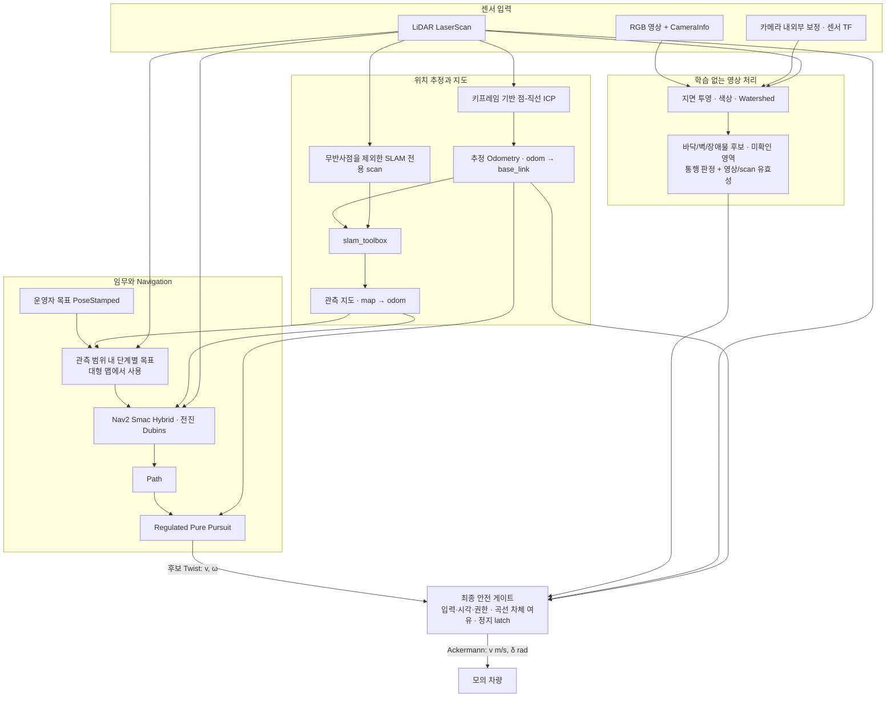

# 현재 자율주행 구조와 파일 책임

팀 W·S의 현행 경로는 **ROS2 Humble + 카메라 + RPLiDAR A2M4-R2 + 규칙 기반 Navigation**이다.
학습 모델·encoder·IMU를 주행 입력으로 요구하지 않는다. 첫 유효 LiDAR 관측을 로컬 원점으로 두고
위치를 추정하며, 정답 지도·위치·속도를 제어 입력으로 받지 않는다.
시뮬레이터의 정답은 평가 노드에서 오차·충돌을 검사할 때만 사용한다.

## 입출력 구조

`mission.py`가 Nav2의 `ComputePathToPose`와 `FollowPath` action을 관리한다.
Nav2 BT Navigator를 실행하는 구성은 아니다. 지도와 scan은 Nav2 costmap에도 들어간다.
소형 센서 시험에서는 최종 목표를 직접 계획하며, 대형 맵에서는 관측된 연결 공간 안의 목표를 단계적으로 선택한다.
좌회전 조향각은 양수이고 후진·제자리 회전은 허용하지 않는다.

## 토픽과 TF 계약

| 입력/출력 | 메시지 | 발행자 → 소비자 |
|---|---|---|
| `/scan` | `sensor_msgs/msg/LaserScan`, `laser` frame | 합성 센서 → ICP·SLAM 입력 변환·분할·Nav2·안전 게이트 |
| `/camera/image_raw`, `/camera/camera_info` | `Image`, `CameraInfo`, `camera_optical_frame` | 합성 카메라 → 영상 분할 |
| `/perception/labels`, `/perception/overlay` | `Image` | 영상 분할 → RViz·검증 |
| `/mrider_sim/camera_status` | JSON `String` | 영상 분할 → 안전 게이트 |
| `/mrider_sim/odometry` | `nav_msgs/msg/Odometry`, `odom` → `base_link` | LiDAR 추정기 → Nav2·안전 게이트·검증 |
| `/mrider_sim/slam_scan` | `sensor_msgs/msg/LaserScan`, `laser`, 원본 scan 시각 | LiDAR 노드의 전용 복사본 → SLAM |
| `/map` | `nav_msgs/msg/OccupancyGrid` | SLAM → Nav2·지역 목표 선택·RViz |
| `/goal_pose`, `/mrider_sim/local_goal` | `geometry_msgs/msg/PoseStamped`, `map` | 운영자 → mission / mission → 관측·검증 |
| `/mrider_sim/planned_path` | `nav_msgs/msg/Path` | mission → 시각화·검증 |
| `/mrider_sim/candidate_cmd_vel` | `geometry_msgs/msg/Twist` | Nav2 → 안전 게이트 |
| `/mrider_sim/command` | `ackermann_msgs/msg/AckermannDriveStamped` | 안전 게이트 단일 발행자 → 모의 차량 |
| `/evaluation/ground_truth`, `/mrider_sim/collision`, `/mrider_sim/clearance` | 평가용 정답 지표 | world → 검사 노드만 |

`map→odom`은 SLAM, `odom→base_link`는 LiDAR 추정기가 발행한다.
`base_link`는 후륜축 중심의 지면 좌표계다. 현재 합성 LiDAR는 이 축 위 0.2 m에 있으며,
`base_link→laser`의 평면 이동·회전은 0이고 z 이동은 +0.2 m다.
실제 센서 위치·방향을 이 가정으로 대체할 수 없다. 장착 TF와 카메라 보정은 실측해야 한다.

안전 게이트는 scan·odom·영상의 누락/지연/잘못된 frame·비정상 값을 검사한다.
후보 Twist에는 header가 없어 수신 시각과 수치로 검사한다.
센서 고장은 정지 latch를 유지하고 운영자 재허가가 필요하다.
장애물 제거 후 자동 재개는 `auto_resume:=true`에서만 허용된 장애물 정지 원인과 연속 여유 확인을 거친다.
대형 맵의 `WAYPOINT` 완료 후 `/mrider_sim/continue`는 정상 구간 완료만 이어 주며 고장·운전자 disarm을 해제하지 않는다.

## 파일별 책임

아래 경로는 `ros2_ws/src/mrider_navigation_sim/` 기준이다.

| 파일 | 책임 |
|---|---|
| `mrider_navigation_sim/sensor_core.py` | 키프레임 ICP, 잔차·퇴화·이동량 검사 |
| `mrider_navigation_sim/sensor_nodes.py` | scan → odometry/TF, 영상·보정·시각 계약, 분할 노드 |
| `mrider_navigation_sim/segmentation.py`, `camera_contract.py` | 지면 투영·Watershed 후보 분할, 카메라 상태 검증 |
| `mrider_navigation_sim/local_goal.py` | 관측 공간 팽창·연결 성분·지역 목표 선택 |
| `mrider_navigation_sim/mission.py` | action·목표·정지·조건부 재개·단계 전환 |
| `mrider_navigation_sim/safety.py`, `gate_node.py` | ROS 독립 안전 규칙 / ROS 입출력·허가 서비스 |
| `mrider_navigation_sim/world.py`, `synthetic_camera.py` | 합성 scan·영상·차량 운동, 분리된 평가 정답 |
| `mrider_navigation_sim/geometry.py`, `indoor.py`, `large_office.py` | 환경 기하·광선 교차·이동 장애물 |
| `config/` | Nav2·SLAM·카메라·가상 차량 설정 |
| `launch/sensor_only_demo.launch.py` | 센서 전용 노드 연결 |
| `launch/sensor_turns_demo.launch.py`, `large_office_demo.launch.py` | 좌우 우회·횡단 / 대형 실내 시험 |
| `test/`, `mrider_navigation_sim/checks.py` | 단위 시험·실제 ROS 토픽 시험·정답 격리 검사 |

`mrider_autonomy`는 별도의 초기 Pure Pursuit 경로 추종 패키지다.
`core.py`가 ROS 없는 제어·제한·목표 감속, `ros_adapter.py`가 frame·timestamp 계약,
`nodes.py`가 rclpy 실행·steady-clock watchdog, `simulation.py`가 폐루프 모의를 담당한다.
`visualization.py`는 표시용으로 재사용하며 센서 경로에서는 TF를 중복 발행하지 않는다.

## 실행 구성과 검증 범위

| 구성 | 위치·지도 입력 | 설명서 |
|---|---|---|
| 센서 기본·좌우 우회·횡단 | LiDAR 추정 + 온라인 SLAM | [센서 기본](sensor-only-navigation.md), [좌우·횡단](sensor-turns-simulation.md) |
| 60×40 m 대형 실내 | LiDAR 추정 + 온라인 SLAM + 단계별 목표 | [환경](large-office-simulation.md), [주행·검증](large-office-navigation.md) |
| `indoor_demo`, `turns_demo`, 초기 Navigation 시험 | 알려진 지도와 모의 정답 위치 | [실내 기준 시험](indoor-simulation-guide.md), [좌우 기준 시험](turns-simulation-guide.md) |
| 공식 Gazebo twin | 공식 `mitt_bringup`·차량 overlay | [공식 twin 절차](run-the-twin.md) |
| 실차 | 실센서·DBW 통합 필요 | [실환경 시험](real-world-test-guide.md) |

기준 시험의 PASS를 센서 자율주행의 PASS로 옮겨 적지 않는다.
합성 영상 분할도 실카메라에서의 의미 인식·낮은 물체·유리·단차 검출을 보장하지 않는다.

## W·S 역할과 실차 인계

차량 1의 실측 축거 0.533 m, 윤거 0.435 m, 바퀴 반경 0.101 m, 최소 회전반경 2.10 m는
[차량 측정 기록](build/vehicle1-measurements-2026-11-23.md)과 `vehicle1.yaml`에 있다.
공식 Nav2는 반경에 5%를 더하고 cm 단위로 올림하여 2.21 m를 사용한다.
팀 센서 시험은 더 큰 계획 반경을 사용하므로 공식 twin과 같은 설정이라고 표현하지 않는다.

W는 `mitt_hardware`·micro-ROS·Teensy DBW와 실제 명령 권한·상태를 연결해야 한다.
현재 센서 전용 경로와 그 통합, 실제 제동/조향, `DbwStatus` 기반 odometry는 완료되지 않았다.
S는 공식 twin의 controller 활성화·실측 geometry·조향 제한·sim-real 차이를 검증해야 한다.
팀 2D 센서 시험 통과만으로 공식 twin·실차 또는 전체 CI 통과를 선언하지 않는다.
공통 메시지·frame·domain 규칙·공식 launch 인자는 [.github 팀 규칙](../.github/README.md)을 따른다.
모의 `/mrider_sim/command`를 차량에 직접 연결하지 않는다.

## 요구사항 출처

- 사용자 확정: ROS2 Humble 전환, 학습 없는 카메라+A2M4-R2, 제어에 Ground Truth 사용 금지, vehicle 1 실측값.
- [공식 아키텍처](design/architecture.md), [DBW](design/dbw.md), [센서](design/sensors.md), [캘리브레이션](design/calibration.md).
- [M2 조향](learn/m2-dbw-steering.md), [M3 권한·안전](learn/m3-teleop-safety.md), [M4 인지](learn/m4-perception.md).
- 최초 과제의 업로드본 대신 사용한 [공식 Week 7](course/weeks/w07.md)·[팀 역할](course/teams.md).
- 우선 기준으로 제공한 `README (1).md`의 팀 규칙은 [.github/README.md](../.github/README.md)에 보존한다.
- 예전 ViNT·ROS1 기록은 이전 팀 저장소에 남아 있으며 현행 실행의 선행 조건이 아니다.
