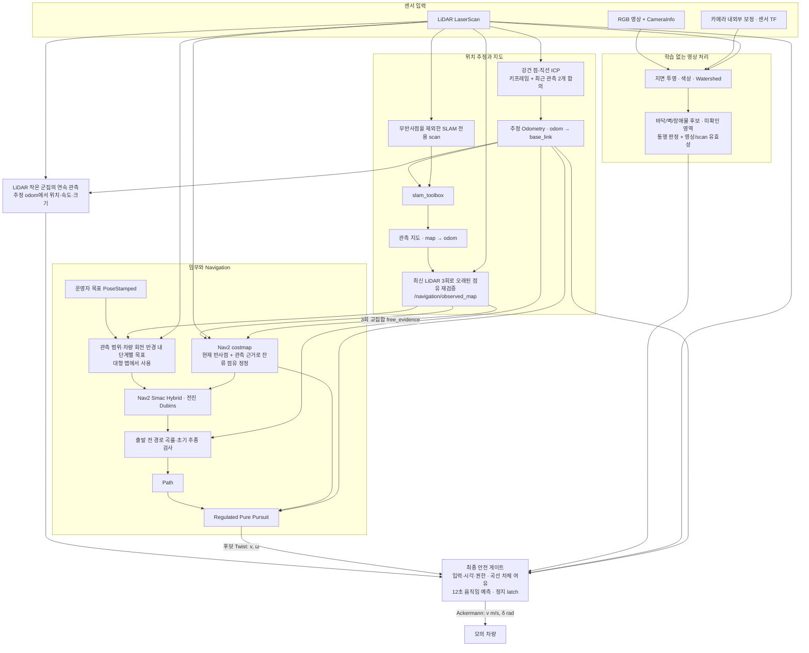

# 현재 자율주행 구조와 파일 책임

팀 W·S의 현행 경로는 **ROS2 Humble + 카메라 + RPLiDAR A2M4-R2 + 규칙 기반 Navigation**이다.
학습 모델·encoder·IMU를 주행 입력으로 요구하지 않는다. 첫 유효 LiDAR 관측을 로컬 원점으로 두고
위치를 추정하며, 정답 지도·위치·속도를 제어 입력으로 받지 않는다.
시뮬레이터의 정답은 평가 노드에서 오차·충돌을 검사할 때만 사용한다.
현재 통과/실패와 실행 소스는 [실험 기록](experiment-log.md)에 누적한다.

## 입출력 구조

`mission.py`가 Nav2의 `ComputePathToPose`와 `FollowPath` action을 관리한다.
Nav2 BT Navigator를 실행하는 구성은 아니다. 지도와 scan은 Nav2 costmap에도 들어간다.
원본 SLAM `/map`은 보존하며, 계획·지역 목표에는 `/navigation/observed_map`을 사용한다.
이 노드는 서로 다른 최신 scan 3개의 유효 beam 사이에서 모두 빈 공간으로 관측된 셀만 갱신한다.
최신 수신 scan과 최신 TF 확인 관측은 각각 0.35초 이내여야 하며, 앞선 두 확인 근거만 최대 0.6초 이력에서 선택한다. 세 scan 모두 해당 시각의 TF가 필요하다. 반사점 주변과 그 뒤 가려진 공간은 clearing하지 않는다.
3개가 모이지 않으면 새 지도를 발행하지 않으며, 원본 SLAM 시각을 유지하므로 오래된 지도가 새 입력으로 둔갑하지 않는다.
발행 직전에도 연산에 걸린 시간을 포함해 위 시각 한계를 다시 검사한다.
LiDAR 최대 관측 범위 안의 셀만 계산하고 int8 배열로 메시지를 전달하여, 큰 지도의 변환 비용이 scan/TF 수신을 밀어내는 것을 줄인다.
`map_validation.processing_ms`와 `newest_confirmed_age_at_publish`로 실제 처리 시간을 확인한다.
합성 센서의 유효 최대거리 반환 계약은 명시적으로 켰다. 실센서에서는 이 계약·scan 간격·TF·얇은 물체 검출을 별도 검증해야 한다.
표면 특징 선택과 별개로, `range_max`보다 짧은 유효한 유한 반사값 앞의 공간은 관측 근거로 사용한다. 예를 들어 15 m 센서의 14.99 m 반사를 버리지 않으며, 반사점 주변·너머는 기존 여유를 적용해 제외한다.
소형 센서 시험에서는 최종 목표를 직접 계획하며, 대형 맵에서는 관측된 연결 공간 안의 목표를 단계적으로 선택한다.
대형 맵의 후보는 남은 거리와 계획 반경으로 환산한 방향 정렬 비용을 함께 평가한다. 즉시 위치 진전만으로 과도한 회전을 선택하지 않도록 한다.
좌회전 조향각은 양수이고 후진·제자리 회전은 허용하지 않는다.
센서용 costmap은 SLAM과 같은 0.05 m 해상도로 초기화한다. 시작 후 지도의 해상도가 바뀌면 경로를 거부한다.
기본 평활화가 회전 제약을 바꾸지 않도록 Dubins 경로를 보존하고,
`mission.py`에서 실제 경로의 곡률과 현재 추정 자세에서의 초기 Pure Pursuit 곡률을 확인한 뒤에만 `FollowPath`를 보낸다.
현재 검사는 물리 조향 한계에 5% 반경 여유를 두며, 실행 중 추정·추종 오차는 기존 안전 게이트가 계속 검사한다.
지도 해상도·좌표·자세가 잘못되거나 경로가 지나치게 꺾이면 차량이 출발하기 전에 실패를 보고한다.

## 토픽과 TF 계약

| 입력/출력 | 메시지 | 발행자 → 소비자 |
|---|---|---|
| `/scan` | `sensor_msgs/msg/LaserScan`, `laser` frame | 합성 센서 → ICP·SLAM 입력 변환·분할·Nav2·안전 게이트 |
| `/camera/image_raw`, `/camera/camera_info` | `Image`, `CameraInfo`, `camera_optical_frame` | 합성 카메라 → 영상 분할 |
| `/perception/labels`, `/perception/overlay` | `Image` | 영상 분할 → RViz·검증 |
| `/mrider_sim/camera_status` | JSON `String` | 영상 분할 → 안전 게이트 |
| `/mrider_sim/odometry` | `nav_msgs/msg/Odometry`, `odom` → `base_link` | LiDAR 추정기 → Nav2·안전 게이트·검증 |
| `/mrider_sim/estimator_status` | JSON `String`, scan 시각·마지막 유효 시각·정합 잔차·거부 사유 | LiDAR 추정기 → 진단 |
| `/mrider_sim/moving_obstacles` | JSON `String`, `odom`, 원본 scan 시각, 군집 중심·반경·속도 | LiDAR 관측 추적 → 예측 안전 검사 |
| `/mrider_sim/slam_scan` | `sensor_msgs/msg/LaserScan`, `laser`, 원본 scan 시각 | LiDAR 노드의 전용 복사본 → SLAM |
| `/map` | `nav_msgs/msg/OccupancyGrid` | SLAM → 점유 재검증·선택적 원본 표시 |
| `/navigation/free_evidence` | `OccupancyGrid`, `map`, 최신 기여 scan 시각 | 반복 scan 확인 → Nav2 장애물 층 정정 |
| `/navigation/observed_map` | `nav_msgs/msg/OccupancyGrid`, 원본 SLAM 시각 | 관측 재검증 → Nav2·지역 목표 선택·RViz |
| `/goal_pose`, `/mrider_sim/local_goal` | `geometry_msgs/msg/PoseStamped`, `map` | 운영자 → mission / mission → 관측·검증 |
| `/mrider_sim/planned_path` | `nav_msgs/msg/Path` | mission → 시각화·검증 |
| `/mrider_sim/path_validation` | JSON `String`, 승인 여부·곡률·실패 사유 | mission → 검증·진단 |
| `/mrider_sim/map_validation` | JSON `String`, 입력 나이·확인 수·발행 여부 | 관측 재검증 → 진단 |
| `/mrider_sim/goal_validation` | JSON `String`, 후보·탈락 사유 | mission → 진단 |
| `/mrider_sim/candidate_cmd_vel` | `geometry_msgs/msg/Twist` | Nav2 → 안전 게이트 |
| `/mrider_sim/command` | `ackermann_msgs/msg/AckermannDriveStamped` | 안전 게이트 단일 발행자 → 모의 차량 |
| `/evaluation/ground_truth`, `/mrider_sim/collision`, `/mrider_sim/clearance` | 평가용 정답 지표 | world → 검사 노드만 |

`map→odom`은 SLAM, `odom→base_link`는 LiDAR 추정기가 발행한다.
`base_link`는 후륜축 중심의 지면 좌표계다. 현재 합성 LiDAR는 이 축 위 0.2 m에 있으며,
`base_link→laser`의 평면 이동·회전은 0이고 z 이동은 +0.2 m다.
실제 센서 위치·방향을 이 가정으로 대체할 수 없다. 장착 TF와 카메라 보정은 실측해야 한다.

ICP는 정합에 사용한 거리 내 대응점으로 최종 품질을 평가한다. 전체 점의 70% 이상이면서 최소 60개,
퇴화하지 않은 기하를 요구하고, 그 대응점 안에서 거리 상위 20%를 절삭한 RMSE ≤0.08 m를 검사한다. 움직이는 전경점이 품질 계산에 다시 들어가지 않게 하되,
작은 일치 조각만으로 위치가 확정됐다고 판단하지 않는다. 이는 다수의 표면이 정적이라는 가정이며
군중·반복 구조·유리 환경의 위치 정확도를 보장하지 않는다. 실패 시 명령이나 정답으로 pose를 대체하지 않는다.
키프레임은 0.5 m 이동·0.15 rad 회전 또는 원본 scan 시각 기준 `keyframe_max_age`(기본 2초) 경과 후,
유효 정합에 성공한 경우만 새 관측으로 갱신한다. 정지 중 지나간 전경을 무기한 기준으로 보관하지 않으며,
좌표 원점·추정 pose와 네 scan의 속도 차분 방식을 유지한다.
정합 초기 2회는 기존 최소제곱으로 이동량을 잡고, 이후 Tukey 가중치로 큰 점-직선 잔차의 영향을 줄인다.
처음부터 좁은 잔차 범위를 쓰면 복도의 실제 전진을 놓칠 수 있어, 잔차 범위를 단계적으로 줄인다.
위 최종 대응점 비율·개수·RMSE·기하 검사는 그대로 적용한다.

[E32 분석](experiment-log.md#live-icp-cause)에서 확인한 동적 가림 변화에 대응하여,
유효한 최근 scan 3개와 각각의 추정 pose를 별도로 보관한다. 주 키프레임 정합이 실패하면
0.35초 이내의 최근 유효 scan 2개에 현재 scan을 각각 정합한다. 두 정합 모두 기존 품질 기준을 통과하고,
odom에서 얻은 위치 차이 ≤0.02 m·방향 차이 ≤0.01 rad일 때만 새 기준으로 갱신한다.
각 최근 기준과의 이동은 ≤0.25 m·회전은 ≤0.2 rad이고, 마지막 추정 pose와의 변화도 같은 제한을 검사한다.
scan이 부족하거나 오래됐거나 결과가 불일치하면 pose·기준·유효 시각을 갱신하지 않는다.
`estimator_status.registration_mode`, `primary_failure`, `recent_fits`, `consensus_*`로 이 경로를 구분한다.
두 기준의 pose는 같은 odometry 계열이므로 독립적인 절대 위치 센서가 아니다.
긴 입력 중단 후 전역 재위치 추정이나 정적 submap 정합은 구현하지 않았으며,
ROS 입력 간격 0.35초를 넘으면 기존 `scan_gap_manual_restart_required` 정지를 유지한다.

안전 게이트는 scan·odom·영상의 누락/지연/잘못된 frame·비정상 값을 검사한다.
후보 Twist에는 header가 없어 수신 시각과 수치로 검사한다.
센서 고장은 정지 latch를 유지하고 운영자 재허가가 필요하다.
센서 launch는 작은 LiDAR 군집의 이동 예측도 요구한다(`require_motion_prediction=true`).
추정 odom에서 5회 이상·0.35초 이상 관측한 군집의 위치를 직선 속도로 근사하고,
속도 0.15~1.5 m/s·최대 적합 잔차 0.08 m를 만족하는 관측만 이동 후보로 사용한다.
군집 연결 거리 0.45 m, 점 3~80개, 축별 최대 크기 1.2 m 조건을 사용하며, 보이지 않는 면에 대한 반경 여유 0.25 m를 더한다.
고정 물체의 보이는 면이 늘어나도 중심은 이동할 수 있다. 군집 최소·최대 경계의 속도 차이가 `max(0.10 m/s, 추정 속도의 35%)`를 넘으면 크기 변화로 보고 이동 예측에 사용하지 않는다. 현재 scan의 장애물 검사는 계속 적용한다.
후보 명령의 곡선 차체와 물체의 일정 속도 예측이 12초 이내 겹치면 `obstacle_stop`으로 더 일찍 정지한다.
0.35 m/s·실측 최소 반경에서 90도 전진 회전이 약 9.4초 걸리는 점을 반영한 시뮬레이션 설정이다. 긴 일정 속도 가정은 보수적인 대기를 늘릴 수 있다. 실제 센서·보행자 환경에 대한 검증값으로 사용하지 않는다.
0.1초 예측 표본의 틈은 상대 속도 여유로, 시간에 따른 불확실성은 0.05 m/s의 추가 여유로 포함한다.
현재 장애물 검사·제동 거리·카메라 정지는 계속 적용한다. 예측 토픽이 누락·지연·잘못된 frame/시각이면 수동 복구가 필요한 고장으로 정지한다.
이는 객체 인식이나 사람의 행동 예측이 아니며, 가림·급가속·군집 합침·얇은 물체·대형 이동 물체의 안전을 보장하지 않는다.
앞으로 계속 다가오는 물체와 접촉할 수 있다는 사실을 정지 자체의 성공으로 처리하지 않는다.
장애물 제거 후 자동 재개는 `auto_resume:=true`에서만 허용된 장애물 정지 원인과 연속 여유 확인을 거친다.
자동 재허가에는 마지막 이동 후보 명령으로 계산한 예측 충돌도 없어야 한다. 새 예측 입력 고장은 자동 재허가가 해제하지 않는다.
LiDAR 장애물 때문에 감속하던 중 controller가 zero Twist를 보내면 장애물 정지로 latch하고, 뒤따르는 abort가 그 원인을 지우지 않게 한다. 장애물 증거가 없거나 새 센서 고장이 발생한 경우에는 일반 실패를 자동 복구로 바꾸지 않는다.
대형 맵의 `WAYPOINT` 완료 후 `/mrider_sim/continue`는 정상 구간 완료만 이어 주며 고장·운전자 disarm을 해제하지 않는다.
장애물 전용 자동 재허가 후에도 Nav2가 아직 경로를 찾지 못하면, 속도 0을 유지하며 0.5초 간격·최대 15초 재계획한다.
유효 경로 확보 후에만 추종하며, 일반 계획 실패·새 센서 고장·허가 취소·곡률 오류는 이 재시도의 대상이 아니다.
이 재허가 안에서 새 경로가 거부되면 이전 승인 경로의 남은 부분도 검사한다. 목표가 같아야 하며 현재 위치·방향·경로 곡률, 최신 지도·scan·TF, 남은 경로와 초기 추종 곡선의 차체 전체를 다시 검증한다. 조건을 모두 만족해야 기존 RPP 추종을 재개한다. 계획 padding을 줄이거나 오래된 장애물 관측을 무시하지 않는다.
`path_validation.retained_after_obstacle`로 구분한다. 조향·센서 신선도·재개 15초 제한은 계속 적용한다.
Nav2의 obstacle layer에도 과거 동적 물체의 점유가 따로 남을 수 있어 `ObservedObstacleLayer`로 확장했다.
`/navigation/free_evidence`는 최신 세 scan의 자유 공간 교집합만 0, 그 밖은 -1인 `OccupancyGrid`다.
SLAM 정답 지도가 아니며, 기존 `/map`과 `/navigation/observed_map`의 시각은 바꾸지 않는다.
근거 지도 시각은 가장 최근 기여 scan의 원본 시각이다. 나머지 두 scan은 기존 0.6초 이력 범위를 따른다.
플러그인은 0.35초 이내 근거와 그 시각의 좌표 변환을 확인하고, 오래된 lethal 셀의 중심·네 모서리가 모두 자유 공간일 때만 정정한다.
이후 기존 Nav2의 **현재 scan marking**을 적용하므로 새 반사점이 우선한다. 정적 층·inflation·raytrace·원래 센서 freshness 검사도 유지한다.
근거가 없거나 오래됐거나 TF가 없으면 추가 clearing을 하지 않는다. 노드 재시작이나 일괄적인 주행 공간 삭제는 사용하지 않는다.
`/mrider_sim/costmap_evidence_status`에서 frame·근거 시각·정정한 셀 수를 확인한다.
이는 [Humble ObstacleLayer 확장 인터페이스](https://github.com/ros-navigation/navigation2/blob/humble/nav2_costmap_2d/include/nav2_costmap_2d/obstacle_layer.hpp)를 사용하는 팀 플러그인이다.
최초 목표가 일시적인 관측 부족으로 거부되면 `WAITING`에서 최대 5초 보류한다. 허가 취소·만료 시 자동 출발하지 않는다.
영상·scan은 수신 순서가 달라도 최대 0.12초 기다려 가장 가까운 시각끼리 짝짓는다.
허용 시각 차이 0.12초와 입력 나이 0.35초는 그대로 검사하며, 끝내 짝을 찾지 못하면 유효하지 않은 입력으로 보고한다.
소형 우회 시험에서는 계획 차체 padding 0.40 m와 추종 padding 0.15 m 사이에 0.25 m의 추종 여유를 둔다.
최종 안전 게이트의 0.15 m와 물리 조향 한계는 유지한다.
계획 결과의 참조 경로를 준비한 뒤 현재 TF를 검사한다. 아직 신선한 TF가 없으면 `PLANNING`·속도 0을 유지하며 최대 1초 기다리고, 끝내 0.35초 이내 입력을 얻지 못하면 실패 정지한다.
센서 launch의 Nav2 제어기는 `managed_controller_node`로 실행한다. 설치된 RPP·goal/progress checker를 사용하며,
costmap 갱신을 기다리는 동안에도 취소·종료를 확인하고 0 명령을 발행한다. 대기가 0.35초를 넘으면 FollowPath를 중단한다.
이는 기존 안전 게이트와 독립적인 제어 루프 종료 보완이며, 오래된 관측을 새 입력처럼 취급하지 않는다.
래퍼는 비활성 configure 단계에서 실행 콜백만 교체하고 원래 action server와 실행기의 수명을 유지한다.

## 파일별 책임

아래 경로는 `ros2_ws/src/mrider_navigation_sim/` 기준이다.

| 파일 | 책임 |
|---|---|
| `mrider_navigation_sim/sensor_core.py` | 강건 키프레임 ICP, 최근 두 기준의 합의 복구, 잔차·퇴화·이동량 검사 |
| `mrider_navigation_sim/sensor_nodes.py` | scan → odometry/TF, 영상·보정·시각 계약, 분할 노드 |
| `mrider_navigation_sim/moving_obstacles.py` | LiDAR 군집 연속 관측·속도 적합, 예측 입력 계약, 곡선 차체와 미래 교차 검사 |
| `src/observed_obstacle_layer.cpp`, `src/free_evidence.hpp` | Nav2 장애물 층의 과거 셀을 신선한 반복 scan 근거로 정정; 현재 반사점 우선 |
| `mrider_navigation_sim/synchronization.py` | 영상·scan 시각별 버퍼와 제한된 수신 대기 |
| `mrider_navigation_sim/observed_map.py` | 최신 scan 3회 교집합으로 원본과 별도의 navigation 지도 갱신 |
| `src/managed_slam_node.cpp` | 설치된 Humble SLAM 라이브러리 실행, 종료 전에 지도·TF worker join |
| `src/managed_controller_node.cpp` | Humble Nav2 제어 흐름의 stale costmap 대기를 취소·종료 가능하게 보완 |
| `licenses/Apache-2.0.txt` | Nav2에서 파생한 제어 흐름 코드의 라이선스; 원저작자 고지는 소스에 보존 |
| `mrider_navigation_sim/segmentation.py`, `camera_contract.py` | 지면 투영·Watershed 후보 분할, 카메라 상태 검증 |
| `mrider_navigation_sim/local_goal.py` | 관측 공간 팽창·연결 성분·원호 전체의 방향별 차체 충돌·끝 위치/방향·최종 접근 목표 선택 |
| `mrider_navigation_sim/path_recovery.py` | 승인 경로의 남은 부분과 초기 추종 곡선을 최신 관측에서 재검증 |
| `mrider_navigation_sim/path_feasibility.py` | 해상도 일치, 경로 곡률·출발 위치·초기 추종 가능 여부 검사 |
| `mrider_navigation_sim/mission.py` | action·목표·정지·조건부 재개·단계 전환 |
| `mrider_navigation_sim/safety.py`, `gate_node.py` | ROS 독립 안전 규칙 / ROS 입출력·허가 서비스 |
| `mrider_navigation_sim/world.py`, `synthetic_camera.py` | 합성 scan·영상·차량 운동, 분리된 평가 정답 |
| `mrider_navigation_sim/geometry.py`, `indoor.py`, `large_office.py` | 환경 기하·광선 교차·이동 장애물 |
| `config/` | Nav2·SLAM·카메라·가상 차량 설정 |
| `launch/sensor_only_demo.launch.py` | 센서 전용 노드 연결 |
| `launch/sensor_turns_demo.launch.py`, `large_office_demo.launch.py` | 좌우 우회·횡단 / 대형 실내 시험 |
| `test/`, `mrider_navigation_sim/checks.py` | 단위 시험·실제 ROS 토픽 시험·정답 격리 검사 |
| `mrider_navigation_sim/trace_navigation.py` | 평가용 목표 후보·costmap·예측 궤적·TF·scan·추정 거부 기록; 주행 입력을 발행하지 않음 |

`mrider_autonomy`는 별도의 초기 Pure Pursuit 경로 추종 패키지다.
`core.py`가 ROS 없는 제어·제한·목표 감속, `ros_adapter.py`가 frame·timestamp 계약,
`nodes.py`가 rclpy 실행·steady-clock watchdog, `simulation.py`가 폐루프 모의를 담당한다.
`visualization.py`는 표시용으로 재사용하며 센서 경로에서는 TF를 중복 발행하지 않는다.

## 실행 구성과 검증 범위

| 구성 | 위치·지도 입력 | 설명서 |
|---|---|---|
| 센서 기본·좌우 우회·횡단 | LiDAR 추정 + 온라인 SLAM | [센서 기본](sensor-only-navigation.md), [좌우·횡단](sensor-turns-simulation.md) |
| 60×40 m 대형 실내 | LiDAR 추정 + 온라인 SLAM + 단계별 목표 | [환경](large-office-simulation.md), [주행·검증](large-office-navigation.md) |
| `indoor_demo`, `turns_demo`, 초기 Navigation 시험 | 알려진 지도와 모의 정답 위치 | [실내 기준 시험](indoor-simulation-guide.md), [좌우 기준 시험](turns-simulation-guide.md) |
| 공식 Gazebo twin | 공식 `mitt_bringup`·차량 overlay | [공식 twin 절차](run-the-twin.md) |
| 실차 | 실센서·DBW 통합 필요 | [실환경 시험](real-world-test-guide.md) |

기준 시험의 PASS를 센서 자율주행의 PASS로 옮겨 적지 않는다.
합성 영상 분할도 실카메라에서의 의미 인식·낮은 물체·유리·단차 검출을 보장하지 않는다.

## W·S 역할과 실차 인계

차량 1의 실측 축거 0.533 m, 윤거 0.435 m, 바퀴 반경 0.101 m, 최소 회전반경 2.10 m는
[차량 측정 기록](build/vehicle1-measurements-2026-11-23.md)과 `vehicle1.yaml`에 있다.
공식 Nav2는 반경에 5%를 더하고 cm 단위로 올림하여 2.21 m를 사용한다.
팀 센서 시험은 더 큰 계획 반경을 사용하므로 공식 twin과 같은 설정이라고 표현하지 않는다.

W는 `mitt_hardware`·micro-ROS·Teensy DBW와 실제 명령 권한·상태를 연결해야 한다.
현재 센서 전용 경로와 그 통합, 실제 제동/조향, `DbwStatus` 기반 odometry는 완료되지 않았다.
S는 공식 twin의 controller 활성화·실측 geometry·조향 제한·sim-real 차이를 검증해야 한다.
팀 2D 센서 시험 통과만으로 공식 twin·실차 또는 전체 CI 통과를 선언하지 않는다.
공통 메시지·frame·domain 규칙·공식 launch 인자는 [.github 팀 규칙](../.github/README.md)을 따른다.
모의 `/mrider_sim/command`를 차량에 직접 연결하지 않는다.

## 요구사항 출처

- 사용자 확정: ROS2 Humble 전환, 학습 없는 카메라+A2M4-R2, 제어에 Ground Truth 사용 금지, vehicle 1 실측값.
- [공식 아키텍처](design/architecture.md), [DBW](design/dbw.md), [센서](design/sensors.md), [캘리브레이션](design/calibration.md).
- [M2 조향](learn/m2-dbw-steering.md), [M3 권한·안전](learn/m3-teleop-safety.md), [M4 인지](learn/m4-perception.md).
- 최초 과제의 업로드본 대신 사용한 [공식 Week 7](course/weeks/w07.md)·[팀 역할](course/teams.md).
- 우선 기준으로 제공한 `README (1).md`의 팀 규칙은 [.github/README.md](../.github/README.md)에 보존한다.
- 예전 ViNT·ROS1 기록은 이전 팀 저장소에 남아 있으며 현행 실행의 선행 조건이 아니다.
