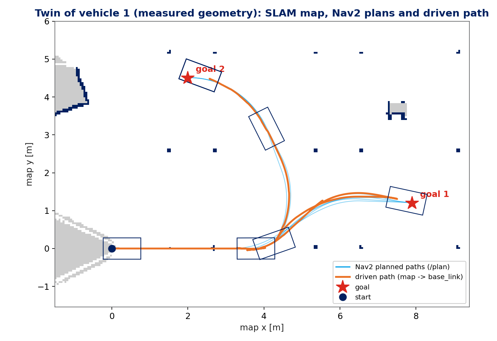
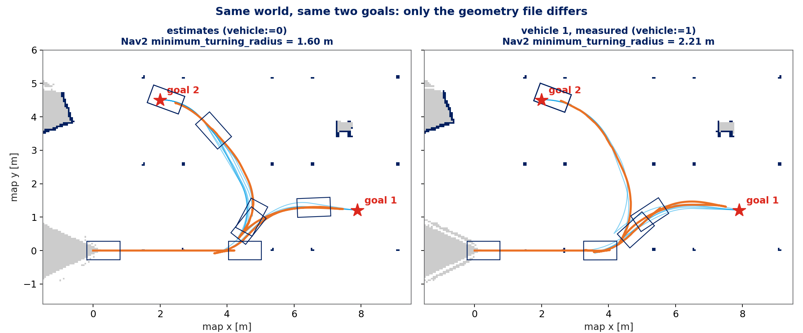
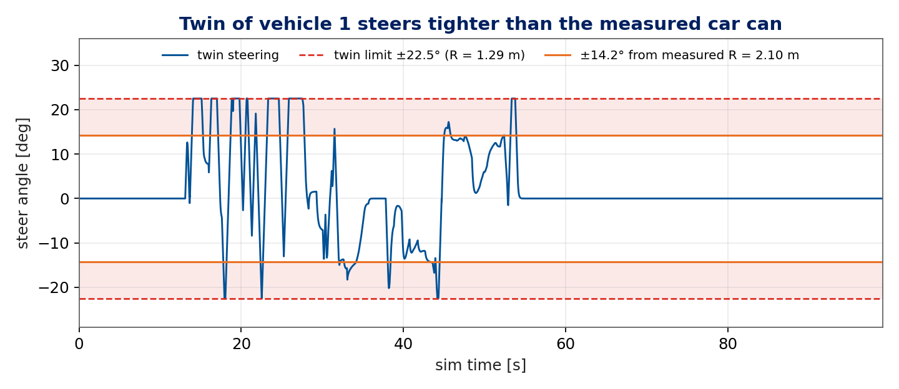

# Merge 2 근거: 측정 치수로 도는 twin, functional test, CI

**vehicle 1 · Simulation track · 2026-11-28 측정**

Week 12의 Merge 2 표 다섯 항목에 대해, 이 날짜에 실제로 확인한 것과 확인하지 못한 것을 적는다.
숫자는 모두 이 폴더의 로그와 기록에서 나온 것이고, 다시 만드는 방법은 맨 아래에 있다.

| Merge 2 항목 | 결과 | 근거 |
|---|---|---|
| 측정 geometry로 twin 실행 | **됨** | `sim.launch.py vehicle:=1`, 컨트롤러 2개 active, URDF와 컨트롤러 값이 `vehicle1.yaml`과 일치 |
| 회전 반경 측정, Nav2가 5% 위로 계획 | **됨** | 측정 2.10 m → `minimum_turning_radius: 2.21`, goal 2개 주행 성공 |
| functional test | **됨** | linter가 아닌 테스트 40개(통과 37, skip 2, xfail 1) |
| CI에서 build와 test | **작성함, 원격 실행 전** | `workspace.yml`에 단계 추가. push 후 Actions 결과로 확인해야 함 |
| sim과 real 10% 이내 | **일부만** | 치수 4개는 비교함. 조향 범위는 **불일치를 찾음**. 조향 속도와 명령 지연은 미측정 |

## 1. 측정 geometry로 twin 실행

```bash
ros2 launch mitt_bringup sim.launch.py vehicle:=1 gz_args:="-r -s"
```

- launch 로그: `vehicle 1: controller parameters from /tmp/mitt_vehicle1_controllers_root.yaml`
- `joint_state_broadcaster`, `ackermann_steering_controller` 둘 다 `active` ([logs/sim_vehicle1_head.log](logs/sim_vehicle1_head.log))
- 센서: `/scan` 8.7 Hz, `/camera/image_raw` 19.4 Hz (headless, WSL2)

생성된 값과 `vehicle1.yaml`의 대조:

| 값 | `vehicle1.yaml` | URDF (`xacro vehicle:=1`) | 컨트롤러 파일 |
|---|---:|---:|---:|
| wheelbase | 0.533 m | 앞 조향 joint x = 0.533 | 0.533 |
| track width | 0.435 m | 좌우 joint y = ±0.2175 | 0.435 / 0.435 |
| wheel radius | 0.101 m | 바퀴 cylinder 0.101, 축 z = 0.101 | 0.101 / 0.101 |

이 대조는 사람이 한 번 본 것이 아니라 테스트(`test_vehicle_geometry.py`)가 매번 확인한다.

## 2. 회전 반경과 Nav2

```bash
python3 scripts/check_vehicle_dims.py
ros2 launch mitt_navigation nav2.launch.py vehicle:=1
```

- `check_vehicle_dims.py`: `vehicle 1: 4 measured` / `Nav2 plans at 2.21 m, 5% above its measured radius` ([logs/check_vehicle_dims.txt](logs/check_vehicle_dims.txt))
- 생성된 Nav2 파라미터: `minimum_turning_radius: 2.21`, footprint `[[0.76, 0.28], [0.76, -0.28], [-0.23, -0.28], [-0.23, 0.28]]`, `inflation_radius: 0.85`
- Nav2 로그: `vehicle check: the running robot has the body of vehicle 1.` (WRONG VEHICLE 경고 없음)
- goal 2개: (7.9, 1.2)와 유턴이 필요한 (2.0, 4.5). **둘 다 `Goal succeeded`**, 같은 시나리오를 두 번 돌려 두 번 모두 성공 ([logs/nav2_vehicle1.log](logs/nav2_vehicle1.log))
- 주행 거리 20.2 m, 두 번째 goal에서는 **후진 구간**이 포함된다



영상: [twin_v1_nav2.mp4](twin_v1_nav2.mp4) (33초, 3배속).

> **이 영상은 화면 녹화가 아니다.** headless로 돌린 twin에서 `/tf`, `/scan`, `/plan`, `/map`,
> `/cmd_vel`, `/joint_states`, `/camera/image_raw`를 기록한 뒤 그 데이터로 다시 그린 것이다.
> 오른쪽 위 화면은 시뮬레이터의 카메라 topic 그대로다.
>
> 영상의 배경은 slam_toolbox의 지도가 아니라 **그 시점까지 쌓인 LiDAR 반사점**이다. 기록에는 마지막
> `/map` 하나만 남아 있어서, 그것을 처음부터 깔면 아직 보지 못한 벽이 보이게 된다. 시작 직후부터
> 기둥 대부분이 보이는 것은 실제로 그렇기 때문이다. depot world는 트인 공간이고 LiDAR는 360도라서
> 첫 scan에서 이미 대부분이 잡힌다. 위의 그림(`twin_v1_trajectory.png`)은 주행이 끝난 뒤의 최종
> `/map`이다.

### 추정값 twin과의 비교

같은 world에서 같은 goal 2개를 `vehicle:=0`(추정값)과 `vehicle:=1`(측정값)로 돌렸다.



| | `vehicle:=0` | `vehicle:=1` |
|---|---:|---:|
| Nav2 `minimum_turning_radius` | 1.60 m | **2.21 m** |
| footprint 앞/뒤 | +0.81 / −0.18 m | +0.76 / −0.23 m |
| inflation radius | 0.90 m | 0.85 m |
| goal 2개 | 성공 | 성공 |
| 주행 거리 | 22.3 m | 20.2 m |

`vehicle:=0`은 처음 세 번은 쓸 수 있는 결과가 나오지 않았다. 원인은 geometry가 아니라 시나리오였다.
지도 작성용 직진이 끝난 위치가 선반 기둥(y = 0 줄의 x = 2.7 m, 5.35 m) 바로 앞이어서, footprint
안에 기둥이 들어갔다.

- 두 번은 x = 2.63 m에서 멈췄고, planner가 `Starting point in lethal space!`로 두 goal을 모두
  거부했다(software.md 4.7에 기록된 동작과 같다).
- 한 번은 x = 4.90 m에서 멈췄고, 로봇이 **움직이지 않았는데** `Goal succeeded`가 찍혔다. 원인은
  확인하지 못했다. 열린 항목으로 남긴다.

직진 시간을 바꿔 기둥에서 떨어진 곳(x = 4.22 m)에서 멈추게 하자 두 goal 모두 성공했다. 위 표와
그림은 그 실행의 값이고 로그는 [logs/nav2_vehicle0.log](logs/nav2_vehicle0.log)다. 앞의 세 번의
로그는 저장소에 넣지 않았다.

## 3. Functional test

`ros2_ws/src/mitt_bringup/test/`에 두 파일을 추가했다. Gazebo와 GPU 없이 약 2초에 돈다.

| 파일 | 확인하는 것 | 결과 |
|---|---|---|
| `test_vehicle_geometry.py` | vehicle 0~3 각각: URDF가 생성되는가, wheelbase·track·wheel radius가 overlay와 같은가, 조향 한계와 속도가 맞는가, **컨트롤러 파일의 geometry가 URDF와 같은가**, Nav2가 측정 회전 반경보다 5% 위로 계획하는가, inflation이 footprint 끝까지 닿는가, 회전 반경을 안 잰 실차는 거부되는가, 없는 차 번호는 거부되는가 | 33 통과, 2 skip |
| `test_launch_refusal.py` | `sim.launch.py vehicle:=7`, `nav2.launch.py vehicle:=7`이 아무것도 띄우지 않고 exit 1로 끝나는가. `real.launch.py`가 domain이 틀리면 이유를 말하고 띄우지 않는가 | 4 통과, 1 xfail |

skip 2개는 vehicle 2와 3이 아직 회전 반경을 올리지 않아서다. 값이 들어오면 자동으로 실행된다.

`mitt_controllers.yaml`에는 "mitt_bringup checks the two agree at launch"라는 주석이 있는데 그런
검사는 없었다(teams.md가 지적한 빈틈). `test_controller_geometry_matches_urdf`가 그 검사다.

### 테스트가 찾아낸 것

**`real.launch.py`는 실행을 거부하고도 exit status 0으로 끝난다.**

```
[bringup] NOT STARTING THE VEHICLE.
[bringup]   - vehicle 1 lives in ROS domain 11, but this shell has ROS_DOMAIN_ID='0'. ...
$ echo $?
0
```

`sim.launch.py`와 `nav2.launch.py`는 exit 1로 끝난다(이번 주 공지의 변경). `real.launch.py`만
`Shutdown(...)`으로 끝내서 0이 나온다. 스크립트나 CI가 "차가 떴다"로 읽게 된다. 이 파일은 세
팀이 함께 쓰는 것이라 fork에서 고치지 않았고, 테스트를 `xfail(strict=True)`로 두었다. upstream에서
고쳐지면 이 테스트가 실패로 바뀌어 표시를 지우라고 알려 준다. **upstream에 알릴 항목이다.**

### Linter는 지금 통과하지 않는다

`colcon test` 전체를 돌리면 linter가 실패한다. `sim.launch.py`와 `real.launch.py`에서 flake8 E402
16건, pep257 10건이고, upstream main 그대로의 상태다. 함께 쓰는 파일이라 fork에서 고치지 않았다.
CI는 functional test를 통과 조건으로 하고, linter는 결과만 보여 주는 별도 단계로 두었다.
새로 추가한 테스트 파일 두 개는 flake8, pep257, copyright를 통과한다.

출력: [logs/colcon_test.txt](logs/colcon_test.txt)

## 4. CI

`.github/workflows/workspace.yml`의 `build` job 끝에 두 단계를 추가했다.

1. `functional tests (colcon test)`: 위 두 테스트를 돌리고, 실패하면 job이 실패한다.
2. `linters (reported, not enforced)`: 나머지 테스트를 돌리되 `continue-on-error`.

**이 문서를 쓰는 시점에는 로컬에서만 돌렸다.** GitHub Actions에서 통과하는지는 push한 뒤에 확인해야
한다. CI 컨테이너(`ros:humble-ros-base`)는 이 PC와 패키지 구성이 달라서 로컬 통과가 CI 통과를
보장하지 않는다.

## 5. Sim과 real 비교

기준은 "10% 이내이거나, 차이를 밝힌다"이다.

| 항목 | twin (`vehicle:=1`) | 실차 vehicle 1 | 차이 | 판정 |
|---|---:|---:|---:|---|
| wheelbase | 0.533 m | 0.533 m (줄자) | 0% | 일치. 추정값 0.63 m였다면 +18% |
| track width | 0.435 m | 0.435 m (줄자) | 0% | 일치. 추정값 0.46 m였다면 +6% |
| wheel radius | 0.101 m | 0.101 m | 0% | 일치. 추정값 0.09 m였다면 −11%. **측정 방법 기록 없음** |
| **조향 범위** | **±22.5°** (추정값 그대로) | **약 ±14.2°** (계산값) | **+58%** | **불일치** |
| **최소 회전 반경** | **1.29 m** (22.5°에서) | **2.10 m** (측정) | **−39%** | **불일치** |
| 조향 속도 한계 | 1.0 rad/s (추정값) | 미측정 | | firmware가 실차에서 돈 뒤 측정 |
| 명령 지연 | 측정 안 함 | 미측정 | | 위와 같음 |

### 찾아낸 불일치: twin이 실차보다 훨씬 작게 돈다

- 실차의 최소 회전 반경은 2.10 m로 측정됐다. wheelbase 0.533 m에서 이 반경이 나오려면 조향각은
  atan(0.533 / 2.10) = **14.2°**다.
- twin의 조향 한계는 `steer_limit_deg: 22.5`로, 측정하지 않은 추정값 그대로다. 이 각도에서 twin은
  0.533 / tan(22.5°) = **1.29 m**로 돈다.
- 기록한 주행에서 twin은 실제로 22.5°까지 꺾었다. 조향한 38.6초 중 **13.2초(34%)**가 14.2°를 넘었다.



즉 Nav2의 **planner**는 측정값(2.21 m)으로 경로를 짜지만, 그 경로를 따라가는 **controller와 twin의
바퀴**는 실차가 낼 수 없는 각도를 쓴다. twin에서 성공한 goal이 실차에서 그대로 성공한다고 볼 수
없다.

14.2°는 측정한 것이 아니라 회전 반경에서 **계산한** 값이다. 실제 조향 한계는 Chassis가 양쪽 끝에서
바퀴 각도를 재야 확정된다. `steer_limit_deg`는 `mitt_dimensions.yaml`에 있는 key라서, 측정하면
`vehicle1.yaml`에 한 줄 추가하는 것으로 twin에 반영된다. 반영 후 같은 goal이 여전히 성공하는지 다시
돌려야 한다.

## 열린 항목

| 항목 | 누가 | 필요한 것 |
|---|---|---|
| 조향 한계 실측 → `vehicle1.yaml`의 `steer_limit_deg` | Chassis | 양쪽 끝에서 바퀴 각도 측정 |
| 반영 후 twin 재실행 | Simulation | 위 값 |
| 조향 속도 한계, 명령 지연 비교 | Electrical → Simulation | firmware가 실차에서 동작 |
| `wheel_radius` 측정 방법(하중 상태) | Chassis | `vehicle1.yaml` 주석 보완 |
| `real.launch.py`의 exit status 0 | upstream에 보고 | |
| 움직이지 않고 `Goal succeeded`가 나온 실행 | Simulation | 재현과 원인 확인 |
| CI에서 테스트 통과 확인 | Simulation | push 후 Actions 결과 |
| twin 기동 자체를 확인하는 launch test | Simulation | CI 컨테이너에서 Gazebo headless가 도는지 확인 필요 |

## 다시 만드는 방법

```bash
# 빌드 (gz_ros2_control은 docs/course/environment.md 6절대로 src에 clone)
cd ros2_ws && colcon build --symlink-install && source setup_env.sh

# 테스트
colcon test --packages-select mitt_bringup \
  --ctest-args -R 'test_vehicle_geometry|test_launch_refusal'
colcon test-result --test-result-base build/mitt_bringup --verbose

# twin 실행과 기록: <차 번호> <출력 폴더> [직진 시간(초)]
bash docs/build/evidence/merge2-sim-2026-11-28/tools/run_twin.sh 1 /tmp/twin_v1
bash docs/build/evidence/merge2-sim-2026-11-28/tools/run_twin.sh 0 /tmp/twin_v0 9.5

# 그림과 영상 (matplotlib, numpy, Pillow, ffmpeg 필요)
cd docs/build/evidence/merge2-sim-2026-11-28/tools
python3 render.py /tmp/twin_v1/run.pkl 1 /tmp/out \
  "[[0.76,0.28],[0.76,-0.28],[-0.23,-0.28],[-0.23,0.28]]" "vehicle 1 (measured geometry)" video
python3 steer_fig.py /tmp/twin_v1/run.pkl /tmp/out/twin_v1_steering.png
python3 compare.py /tmp/twin_v0/run.pkl /tmp/twin_v1/run.pkl /tmp/out/twin_v0_vs_v1.png
```

`run_twin.sh`는 시작과 끝에 실행 중인 Gazebo, SLAM, Nav2 프로세스를 종료한다. 다른 시뮬레이션이
돌고 있는 PC에서는 주의한다.

기록 원본(`run.pkl`, 실행당 약 250 MB)은 커서 저장소에 넣지 않았다. 환경은
[logs/environment.txt](logs/environment.txt)에 있다. 이 PC의 `gz_ros2_control`은 commit `c88a5fd`이고
CI가 고정한 commit과 다르다.
