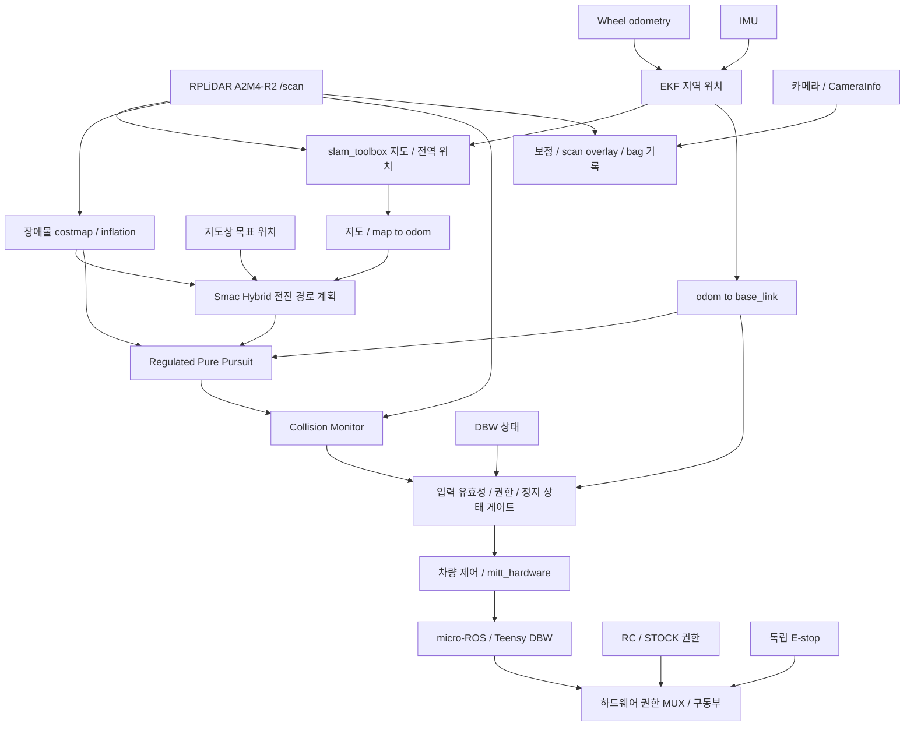

# 방향 A — 학습 없는 RPLiDAR A2M4-R2 기반 Navigation 계획

2026-11-22: [공식 차량별 Nav2 업데이트](upstream-merge-2026-11-22.md)를 반영했다. 실차는 공식 `vehicle:=<n>` 인터페이스와 실측 overlay를 사용하며, 팀 가상 센서 시뮬레이션과 구분한다.

결정일: 2026-11-16. **현재 개발 방향은 A이며 학습 알고리즘을 사용하지 않는다.**
여기서 Rule-Based는 명시적 운용 규칙과 기하·운동학 기반 SLAM, 탐색, 제어를 의미한다.
SLAM의 수치 최적화나 EKF 상태 추정은 신경망 학습이 아니며, 데이터셋·가중치·GPU 학습을 요구하지 않는다.
ViNT와 단안 depth network는 현행 실행 경로에서 제외한다. 기존 연구 코드·학습 설정·결과는 보존한다.

**ROS2 Nav2·센서 모의 환경·모의 정지/재허가 게이트까지 구현했다. 실센서 융합·실차 최종 안전 게이트·실차 launch는 아직 미완료다.**
현재 기본 Pure Pursuit 데모 외에 Smac Hybrid/RPP·모의 scan·지도·가감속 모델을 연결한 센서 시뮬레이션을 제공한다. Gazebo 시각화는 실센서/물리 기반 검증을 대체하지 않는다.

## 1. 구성과 역할

| 구성 | 선택 방식 | 검증할 사항 |
|---|---|---|
| 거리 센서 | RPLiDAR A2M4-R2, ROS2 `sllidar_ros2` A2M4 구성(115200 baud, 실기 호환성 미검증) | 실측 거리·각도·주기·timestamp, 유효 scan 비율 |
| 지역 위치 추정 | wheel odometry + IMU, EKF | 단위·부호·covariance, drift, 중단·시간 역행 |
| 지도·전역 위치 추정 | `slam_toolbox` 지도 작성 및 저장 지도 localization | 지도 재현성, 위치 오차, 재위치 추정 실패·불연속 |
| 경로 계획 | Nav2 Smac Hybrid, 전진 Dubins 모델 | 실측 최소 회전반경·차량 footprint, 후진/제자리 회전 배제 |
| 경로 추종 | Nav2 Regulated Pure Pursuit | 속도·곡률·조향 제한, 목표 접근 감속·정지 |
| 장애물 처리 | scan 기반 costmap, inflation, 재계획 | 정적/동적 장애물, 통로 차단, 오래된 관측 처리 |
| 최종 명령 감시 | Collision Monitor + 입력/권한/상태 게이트 | 감속·정지 구역, stale 입력, 명령 우회 차단 |
| 카메라 | 내부/외부 보정, scan overlay, 관측·bag 기록 | 동기·투영 오차·조명 변화·사각지대 기록 |
| 차량 제어 | 차량 제어 계층 → `mitt_hardware` → micro-ROS → Teensy DBW | 실제 속도/조향 응답과 독립 하드웨어 E-stop |

카메라 영상만으로 거리를 얻거나 장애물이 없다고 판단하지 않는다. 색상·윤곽·ROI 등 전통적 영상 처리는
구체적인 표식/차선 요구가 정해질 때 별도 검증 후 추가한다. 현재 과제는 지도상의 목표 위치까지 이동하는 navigation이며
차선 추종으로 한정하지 않는다. 낮은 물체·유리·돌출물 등 A2 스캔 평면의 사각지대는 남는다.
운용 구역을 제한하거나 추가 직접 거리 센서를 검토해야 하며, RGB 관측으로 사각지대 문제가 해결됐다고 보지 않는다.

## 2. 제안 구조도

`map→odom`은 단일 전역 위치 추정 주체가, 연속적인 `odom→base_link`는 지역 추정 주체가 발행한다.
공식 `base_link`는 지면상의 후륜축 중심이다. ROS1 `rear_axle`과 실제 원점·축이 일치하는지 확인하며 이름만 변경하지 않는다.
카메라 optical frame과 LiDAR extrinsic은 실측한다. 차량 길이·조향 한계·축거·센서 장착 위치를 가상 설정에서 복사하지 않는다.

Nav2 속도 명령과 차량 조향 명령 사이의 변환은 차량 제어 계층의 책임이다.
축거 L, 전진 속도 v와 각속도 ω에 대해 δ=atan(Lω/v)를 사용하더라도 v≈0의 처리,
조향각/조향 변화율 제한 및 제자리 회전 차단이 필요하다. 모의 Ackermann 출력을 실차에 직접 연결하지 않는다.
하드웨어 E-stop과 RC 우선권은 위 소프트웨어 게이트와 독립적으로 동작해야 한다.

## 3. 명시적 운용 규칙

아래는 실차에도 적용할 계약이다. 새 센서 시뮬레이션은 입력/장애물 STOPPED latch와 수동 재허가를 구현하며, DBW 권한·실차 fault는 아직 모델링하지 않는다.

| 상태 | 진입 조건 | 출력·해제 조건 |
|---|---|---|
| DISARMED | 시작, 권한 없음 | 구동 허가 없음; 필수 입력 정상 및 운영자 허가 후 READY |
| READY | 보정/지도/위치/센서/DBW 확인 완료 | 정지 유지; 유효 목표와 경로가 있으면 TRACKING |
| TRACKING / SLOW | 유효 경로와 충분한 여유 거리 / 감속 구역 또는 목표 접근 | 실측 한계 내 전진; 곡률·정지 거리 기준으로 속도 제한 |
| STOPPED | 장애물 정지 구역, 경로 없음, 필수 입력 stale/invalid, 위치 추정 실패 | 정지 요청 및 원인 고정; 정상 관측·위치·경로 재확인과 운영자 재허가 후 READY |
| GOAL | 목표 위치·방향 허용 오차와 실측 정지 속도 조건 충족 | 정지 유지; 새 목표와 허가 후 READY |

필수 입력은 scan·odometry·TF·DBW 상태·권한이다. 빈 scan, NaN/Inf, 유효 관측 부족, 미래/역행 시각,
센서 중단과 TF 불일치의 판정 기준을 설정에 명시한다. 영상 기록용 카메라 중단은 경고·기록하고,
시험에서 카메라를 필수 조건으로 선언한 경우 해당 시험을 중단한다. 영상 실패를 정상 장애물 관측으로 대체하지 않는다.

정지 여유는 **측정한 센서/처리/통신 지연 동안의 이동 거리 + 최악 조건 제동 거리 + 여유 거리**로 정한다.
정면 한 점/좁은 부채꼴만 보지 않고 곡선 주행 시 차량 footprint가 통과할 영역까지 검사한다.
관측 만료로 costmap이 비었다고 안전하다고 판단하지 않는다. map 위치 점프 시 정지·재계획·재허가한다.
후진·제자리 회전 recovery와 자동 재출발은 초기 범위에서 제외한다.
소프트웨어 정지 요청과 실제 정지는 구분하며, USB 단절 시 MCU가 자체 정지할 수 있어야 한다.

## 4. 구현 순서와 launch 인계물

1. **M2/M3 선행 시험:** 조향 센서·servo, RC 권한, E-stop, USB 단절, reset/hang, neutral 복구를 검증한다.
2. **M4 센서 준비:** A2·wheel/IMU·카메라 보정, TF·시각 검사, 구동 차단 상태에서 bag 수집/재생을 수행한다.
3. **ROS2 센서·지도 구성:** 센서 launch, EKF, mapping/localization launch와 실측 vehicle/sensor YAML을 작성한다.
4. **센서 모의/재생 시험:** Nav2 전진 계획·RPP·최종 게이트를 연결하고 장애물/센서 고장을 주입한다.
5. **실차 저속 시험:** 선행 합격 증거와 독립 정지 담당자를 갖추고 지도 목표 주행을 검증한다.

현재 `mrider_navigation_sim/navigation_sim.launch.py`(Nav2·모의 scan/지도), `sensors.launch.py`(A2M4-R2 단독), `teensy_agent.launch.py`(통신 전용), 제어·모의 실행 launch를 제공한다.
후속 인계물은 `mapping.launch.py`, `localization.launch.py`,
`perception_replay.launch.py`, `vehicle_navigation.launch.py` 및
차량·센서·Nav2·정지 정책 설정이다. **이 후속 launch는 아직 제공되지 않는다.**
실차 launch는 기본 구동 차단 상태로 시작하고 명시적 허가를 요구하도록 구현한다.
ROS2 workspace의 rosdep·colcon build/test·실행 절차를 제공하며, 후속 통합 시 bag 검사 명령을 확장한다.
현재 [새 PC 설명서](new-pc-setup.md)의 colcon 빌드는 ROS2 제어·모의 실행을 제공한다. Nav2 센서 시뮬레이션을 포함하며 SLAM/EKF·실차 게이트는 아직 포함하지 않는다.
[A2 준비 설명서](rplidar-a2-setup.md)의 독립 센서 workspace로 드라이버 검증부터 수행할 수 있다.

## 5. 검증 계획과 합격 근거

모든 수치 한계는 실측 차량·시험 구역 기준으로 **시험 전에** 고정한다. 미측정 항목을 PASS로 처리하지 않는다.

| 시험 | 방법 | 기록할 결과 |
|---|---|---|
| 학습 의존성 배제 | Plan A launch/dependency/프로세스 검사; 모델·GPU 없이 실행 | torch/ViNT/depth 추론 없이 동작하는 증거 |
| 지도·위치 | 동일 경로 반복, 알려진 표적과 독립 계측 비교 | 위치/yaw 오차·drift·재위치 추정 실패 |
| 직선·곡선·목표 정지 | 동일 출발점/목표로 반복 | 횡오차·목표 오차·속도/조향 한계·정지 유지 |
| 장애물·막힌 통로 | 정적/이동 모의 표적, 전방·회전 내측 장애물 | 누락/오검출, 여유 거리, 재계획 실패 시 정지 |
| 입력 실패 | replay에서 scan/odom/TF/DBW 중단, 시계 역행·미래 시각·invalid 주입 | 감지/정지 지연·최종 출력·원인·우회 불가 |
| 복구 | 입력 복구, 위치 점프, 장애물 제거 | 자동 재출발 없음, 재허가 및 새 경로 확인 |
| 카메라 보정 | scan overlay, yaw 오류, 조명·사각지대 비교 | 투영 오차·관측 한계; 자율 장애물 검출 증거로 사용하지 않음 |
| 하드웨어 | M2/M3 절차로 별도 벤치 및 제한 구역 시험 | 실제 정지거리·E-stop·RC 우선·watchdog·복구 |

[공통 M2/M3/M4 검증](perception-safety-dbw-validation.md)과 [실환경 기록 양식](real-world-validation-template.md)을 사용한다.
모의 제어 테스트 통과는 새 ROS2 구성이나 실차 주행의 합격 증거가 아니다. 이번 변경은 문서 방향 확정이며 위 시험은 NOT RUN이다.
A의 장점은 규칙과 실패 원인을 추적하기 쉽다는 점이다. 실차 비교 없이 ViNT보다 사고율/성공률이 우수하다고 단정하지 않는다.

## 6. 출처와 보존하는 연구 기록

- [MRider 공식 software](https://jrkwon.github.io/mrider/design/software/): ROS2 SLAM·EKF·Nav2 구조의 기준.
- [M2 DBW/Steering](https://jrkwon.github.io/mrider/learn/m2-dbw-steering/): 조향 센서·servo 검증.
- [M3 Teleop/Safety](https://jrkwon.github.io/mrider/learn/m3-teleop-safety/): 하드웨어 권한과 고장·복구 검증.
- [M4 Perception](https://jrkwon.github.io/mrider/learn/m4-perception/#lecture): 센서 보정·overlay·사각지대 시험.
- [센서 ADR](https://jrkwon.github.io/mrider/design/sensors/#22-adr-lidar-recommendation-for-min-and-full-tiers): 공식 tier 추천과 팀 A2 선택 구분.
- [slam_toolbox](https://github.com/SteveMacenski/slam_toolbox), [Nav2 Humble](https://github.com/ros-navigation/navigation2/tree/humble): 선택 구성요소. 실제 Humble 설치 버전의 파라미터/기능은 구현 시 확인한다.

위 자료를 바탕으로 한 팀 선택은 **학습 없는 방향 A**다. 공식 문서 전체가 학습 방식을 배제한다는 뜻은 아니다.
기존 ViNT 연결과 학습 기록은 **이전 팀 저장소**(`kimdonggue/-Hansla-MRider-Autonomous-Driving`)의
`ros1_ws/`·`training/`과 그쪽 문서에 과거 연구 자료로 보존하며, 이 fork로 옮기지 않았다.
현행 Plan A의 설치·실행 선행 조건이 아니다. 기존 epoch/episode 설정을 변경하거나 모델·데이터를 삭제하지 않는다.

## 7. 이전 문서 변경 검증 (2026-11-16)

2026-11-16: Markdown 20개, 로컬 링크 150개, Bash 코드 블록 57개의 구문 검사,
코드 블록 구분자 및 `git diff --check` 검사를 통과했다.
문서만 수정했으며 ROS/Catkin/colcon 실행 테스트, Mermaid 렌더링, 센서·실차 시험은 이번에 수행하지 않았다.

2026-11-17 ROS2 실행 계층 이식 결과는 [ROS2 검증 기록](ros2-validation.md)을 참조한다. 위 실차/센서 게이트의 NOT RUN 판정은 유지한다.

2026-11-17 센서 시뮬레이션 확장: [실행·고장 주입](navigation-simulation-guide.md), [실제 검증 결과](navigation-simulation-validation.md).
현재는 알려진 지도·정답 위치로 시험하며 Nav2 Collision Monitor 대신 팀의 모의 swept-footprint 게이트를 사용한다. 실차 안정성 결론으로 확대하지 않는다.
