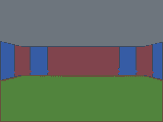

# 카메라·LiDAR 비학습 영역 분할 — 2026-11-25

사용자 결정: **학습 모델 없이 유지**. 이 구현은 semantic segmentation 신경망이 아니라
보정된 카메라 투영·LiDAR 기하·영상 영역 분할을 결합한 실험용 perception이다.
바닥/장애물/벽을 의미적으로 확정하지 않고 **후보**와 **미확인**으로 출력한다.
실환경 적용을 위한 입력 계약을 추가했지만 실제 카메라·A2M4-R2에서 동작을 검증한 것은 아니다.

## 참고한 선례와 선택

| 방법 | 공식 출처 | 판단 |
|---|---|---|
| Marker-based Watershed | [OpenCV 설명](https://docs.opencv.org/4.5.4/d3/db4/tutorial_py_watershed.html) | 이미지 경계를 따라 씨앗 영역을 분할. 현재 채택. 물체 의미는 별도의 기하 근거로 제한 |
| GrabCut | [OpenCV segmentation API](https://docs.opencv.org/4.10.0/d3/d47/group__imgproc__segmentation.html) | 전경/배경 분리 대안. 이것만으로 바닥·벽 의미를 알 수 없으며 현재 미사용 |
| 카메라 투영·보정 | [OpenCV calib3d](https://docs.opencv.org/4.x/d9/d0c/group__calib3d.html) | CameraInfo의 내부 행렬, 설치 높이·각도와 평면 가정으로 픽셀의 지면 교점 계산 |
| SegFormer | [저자 구현](https://github.com/NVlabs/SegFormer) | 학습 기반 semantic segmentation 선례. 사용자 조건에 따라 사용하지 않음 |

OpenCV 예제 자체가 차량 주행을 보장하는 것은 아니다. 아래 LiDAR 씨앗 생성·판정·정지 계약은 팀 구현이며,
논문 성능을 재현했다는 주장이 아니다. 사전학습 가중치·학습 데이터셋·정답 마스크를 주행에 입력하지 않는다.

## 입출력과 알고리즘

1. `/camera/image_raw`의 RGB와 `/camera/camera_info`의 K를 받는다. 현 구현은 **왜곡 보정된 rgb8**을 요구한다.
   D가 0이 아닌 raw 카메라 입력은 거부한다. 실제 카메라는 rectification을 거쳐 연결해야 한다.
2. 영상과 `/scan` timestamp 차이가 0.12 s 이내인지 검사한다. 원본 시각은 바꾸지 않는다.
3. 카메라 높이·pitch와 K로 영상 광선과 평평한 바닥의 교점을 계산한다. 해당 방향 LiDAR 거리보다
   0.15 m 앞쪽인 영역만 바닥 후보의 기하 지지 영역으로 사용한다. 범위 밖·잘못된 광선은 통행 근거로 쓰지 않는다. 합성 raycaster에 한해 유한한 최대 거리의 의미가 확인돼 `max_range_is_clear=true`를 적용했다. [입력 계약과 검증](large-office-navigation.md)을 참고한다.
4. 지지가 있는 하단 넓은 영역에서 Lab 색상 중앙값을 구한다. **고정 회색·절대 밝기 기준은 제거**했다.
   주변 색 차이와 watershed가 경계를 보완한다. 씨앗 영역 대부분이 실제 바닥이라는 가정이 남아 있다.
5. LiDAR 근접점들의 국소 직선성·길이로 긴 표면 후보를 만든다. 알려진 scan 높이의 관측점을 영상에 투영해
   비바닥 씨앗을 생성한다. 긴 평면 관측은 벽 후보일 뿐, 벽/상자/가구의 의미를 확정하지 않는다.
6. Marker Watershed 결과를 기하 지지·영상 색상 조건으로 다시 제한한다. 경계·근거 없는 영역은 미확인으로 남긴다.
7. 전방 하단 ROI의 바닥 후보 비율이 0.65를 넘어야 카메라 통행 조건을 허용한다. 거리 기반 최종 충돌 검사는
   기존 LiDAR 안전 게이트가 별도로 수행한다. 미확인·실패·지연 시 정지 latch를 유지한다. 명시적으로 자동 재개를 켠 경우의 장애물 정지 해제 조건은 [횡단 시험 안내](sensor-turns-simulation.md)를 따른다.

| 출력 | 내용 |
|---|---|
| `/perception/labels` | mono8: 0 미확인, 1 바닥 후보, 2 장애물 후보, 3 벽/긴 표면 후보 |
| `/perception/overlay` | RGB 원본과 후보 마스크 혼합. 회색/녹색/빨강/파랑 순서 |
| `/mrider_sim/camera_status` | valid, clear, reason, 각 후보 비율, processing_ms, source_age_s, scan_image_offset_s |
| `/mrider_sim/safety_state` | 정지 이유와 최신 camera 진단, 수신 경과 시간 |

정지 이유를 `camera_missing`, `camera_invalid_input`, `camera_invalid_stamp`, `camera_future_stamp`,
`camera_input_stale`, `camera_status_timeout`, `camera_obstacle`, `camera_unknown`으로 분리했다.
`camera_invalid_input`의 세부 이유는 camera.reason에서 확인한다.
지연 한도 0.35 s를 늘려 통과시키지 않는다. 처리 중 최신 프레임만 받도록 영상 QoS depth=1로 제한한다.

계산량을 줄일 때 영상 폭을 160으로 축소하면서 **fx/fy/cx/cy도 함께 축소**한다. 라벨은 nearest-neighbor로
원래 해상도에 복원한다. 센서 노드의 BLAS/OMP 스레드는 1개로 제한하고, ROS 영상은 `array('B')` 버퍼로 전달해 픽셀별 Python 타입 검사 비용을 줄인다. 시뮬레이터의 raycast는 벡터화했으며 기존 함수와 수치 동일성을 검사한다.

## 실환경 가정과 적용 전에 필요한 것

- CameraInfo는 실제 렌즈의 보정값이어야 한다. 합성 카메라 K를 실제 카메라에 복사하지 않는다.
- 현재 외부 보정 모델은 카메라 높이·pitch와 scan 높이, 공통 x/y 원점, yaw/roll=0을 가정한다.
  실제 장착이 다르면 일반 TF 투영을 구현·검증해야 하며 `extrinsics_verified=true`만 설정하면 해결되는 문제가 아니다.
- `perception_simulation.yaml`의 높이 0.6 m와 laser 높이 0.2 m는 **가상 센서 설정**이다.
  실측 vehicle1의 차체 치수와는 별개이며 카메라/센서 실측값으로 간주하지 않는다.
- 실사용 전 영상-스캔 시간 동기, 바닥 평면/경사, 설치 흔들림, 렌즈 왜곡, 노출/반사/역광을 검사해야 한다.
- 낮은 물체·유리·단차·낭떠러지는 2D scan으로 관측되지 않을 수 있다. 바닥과 같은 색의 낮은 물체가
  scan에도 안 잡히면 이 방법으로 분리할 근거가 없다. **범용 안전 주행이 보장된다고 주장하지 않는다.**
- 실제 로봇 배포 launch는 제공하지 않는다. 실환경 영상·rosbag 재생 검사와 폐쇄 구역 정지 시험이 선행되어야 한다.

## 실행과 재현

기존 시뮬레이션을 종료한 뒤 컨테이너에서:

```bash
cd /root/mrider-team
source ros2_ws/setup_env.sh
source ros2_ws/install-docker/setup.bash
cd ros2_ws
colcon --log-base log-docker build --build-base build-docker --install-base install-docker \
  --symlink-install --packages-select mrider_navigation_sim --cmake-args -DBUILD_TESTING=ON
source install-docker/setup.bash
export ROS_DOMAIN_ID=192
ros2 launch mrider_navigation_sim sensor_only_demo.launch.py vehicle:=1 \
  floor_rgb:='[175,120,65]' image_gain:=0.7
```

다른 터미널도 같은 환경을 설정한다. 영상 분할과 지연을 먼저 확인한다.

```bash
ros2 topic echo /mrider_sim/camera_status
# 별도 터미널에서 RGB overlay 확인 (필요하면 설치된 RViz Image display로 /perception/overlay 선택)
ros2 run image_tools showimage --ros-args -r image:=/perception/overlay
```

단위 시험과 ROS 폐루프 시험:

```bash
export MRIDER_TEST_VEHICLE=1
export MRIDER_SIM_REPORT_DIR=/root/mrider-team/docs/build/evidence/segmentation-2026-11-25/manual
colcon --log-base log-docker test --build-base build-docker --install-base install-docker \
  --packages-select mrider_navigation_sim --event-handlers console_direct+ \
  --ctest-args -R 'camera_contract|segmentation|test_sensor_only_launch' --output-on-failure
```

색/조도 폐루프 시험은 `MRIDER_TEST_FLOOR_RGB='[175,120,65]'`, `MRIDER_TEST_IMAGE_GAIN=0.7`을 추가한다.
라벨·RGB·오버레이 PNG와 시간별 camera 진단 JSON을 저장한다. PNG 한 장은 마지막 프레임이며 실패 순간 영상과 동일하다고 단정하지 않는다.

## 반드시 별도로 확인할 평가 항목

| 시험 | 측정 및 판정 |
|---|---|
| 색·조명 변화 | 바닥 후보 유지 및 false-free/unknown 비율. 정답 마스크는 평가에만 사용 |
| 저상·동색·반사 장애물 | 통행 가능으로 오판하는 사례 수. 발견한 한계를 삭제하지 않고 기록 |
| 단차·경사·카메라 흔들림 | 평면 가정 파괴 시 오판·정지 여부 |
| 보정 오차 | 외부 회전·높이·초점거리 오차 sweep, 잘못된 보정은 fail-closed 또는 운용 금지 |
| 동기·CPU 부하 | 처리 지연 p50/p95/max, source age, 영상·scan 중단 시 정지시간 |
| 실영상/실scan | 실제 A2M4-R2와 카메라 rosbag으로 재생, 수동 라벨과 후보 분할 비교 |

합성 fixture 통과는 실환경 segmentation 정확도의 증명이 아니다.

## 이번 실행 결과 (2026-11-25 KST)

ROS 2 Humble Docker `ros2_humble`, vehicle1 실측 차체 overlay로 실행했다.
`colcon build` 성공 후 최종 시험 **68개 통과**: 카메라 입력 계약 11, 분할 13,
안전 게이트 35, 실내 기하 7, ROS launch 2. [XML 원본](build/evidence/segmentation-2026-11-25/typed-buffer/xml/)과
[통합 로그](build/evidence/segmentation-2026-11-25/typed-buffer/launch.log)를 보존했다.

| 조건 | 실제 결과 |
|---|---|
| 기본 회색 바닥, 스레드 제한 적용 | GOAL, 최종 목표 오차 0.117 m, 추정 위치 오차 0.170 m |
| 최종 코드: 갈색 `[175,120,65]`, 밝기 0.7 | GOAL, 최종 목표 오차 **0.063 m**, 추정 위치 오차 **0.262 m** |
| 목표 도달 후 카메라 입력 중단 | 정지 latch 확인, 최종 `camera_status_timeout`, 출력 속도 0 |
| 최종 유효 프레임 처리 시간 | p50 15.60 ms / p95 18.68 ms / 최대 304.36 ms (초기 프레임 포함) |

오차는 검사 종료 시점 값이다. 목표 도달 후 입력 중단 검사에 필요한 추가 이동이 포함되므로
최초 GOAL 순간의 오차로 해석하지 않는다. Ground Truth는 검사 노드의 오차 계산에만 사용한다.
[최종 JSON](build/evidence/segmentation-2026-11-25/typed-buffer/sensor_only.json)에 진단 이력이 있다.

초기 `default`, `optimized`, `vectorized`, `colored` 실행은 `camera_input_stale`로 실패했다.
스레드 수 제한만으로는 색/조도 시험의 지연이 해결되지 않았으며, 영상 버퍼 전달 비용까지 줄인 뒤 통과했다.
실패 로그도 같은 증거 폴더에 보존했다. 0.35 s 안전 제한은 변경하지 않았다.
초기화 지연과 실제 컴퓨터 부하에 따른 지연 재검증은 여전히 필요하다.



위 영상은 합성 환경의 마지막 프레임이다. 벽 후보와 장애물 후보가 같은 표면에 나뉘는 경우가 있으며,
의미 분류 정확도를 보장하지 않는다. 이번 폐루프 시험은 목표 도달·센서 단절 정지 검증이다.
동적 보행자·좌우회전 전 시나리오 재검증, 실제 영상의 수동 정답 대비 정밀도/재현율,
실제 카메라 및 A2M4-R2 rosbag, 일반 외부 TF 보정, Gazebo의 실사에 가까운 영상 시험은 남아 있다.
