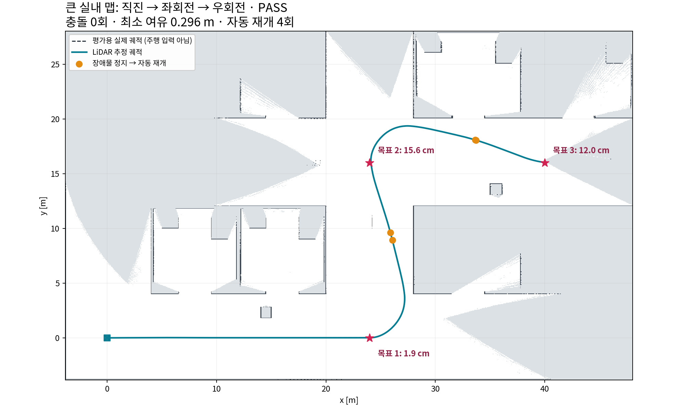
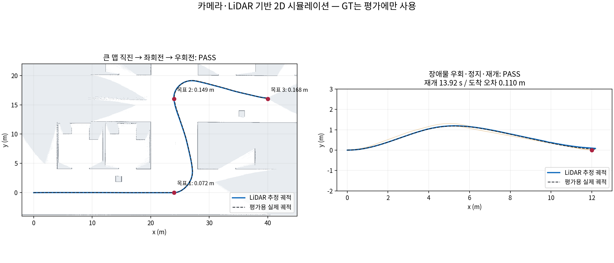
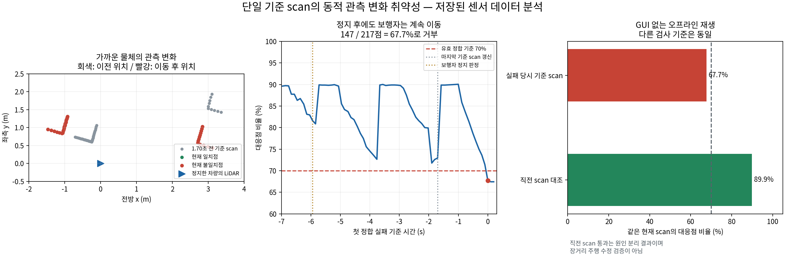

# 시뮬레이션 시행착오 기록

마지막 갱신: **2026-11-27 KST**. 팀 W·S의 센서 기반 시뮬레이션에서 중요한 실패·수정·재검증을 이 파일에 누적한다.
원본 로그·XML·측정값은 `docs/build/evidence/`에 보존한다. 수업·공식 설계 문서를 대신하는 문서가 아니다.

<a id="current-validation"></a>

## 현재 판정

**동일한 수정본에서 선택한 회귀 282/282 PASS, 기존 RViz를 연결한 세 목표 주행도 PASS다.**
`regression-03` 한 번의 전체 실행에서 실패·오류·skip 0개였다. 29개 묶음은 단위 259개와 실제 ROS 주행·고장·종료 검사 23개로 구성된다.
별도 GUI 주행은 같은 검사 항목의 반복 검증이며 282개에 합산하지 않는다. 두 실행의 [118개 소스 해시](build/evidence/registration-recovery-2026-11-27/regression-03/source-sha256.json)가 일치한다.

| 실제 실행 | 판정·측정값 |
|---|---|
| 기본 8 m / 큰 맵 24 m | PASS, 도착 오차 **0.170260 / 0.101178 m** |
| 큰 맵 기본 위상: 직진 → 좌회전 → 우회전 | PASS, 목표 오차 **0.018721 / 0.152372 / 0.074608 m** |
| 큰 맵 보행자 위상 227초: 세 목표 | PASS, 목표 오차 **0.020214 / 0.190595 / 0.034877 m**, 정지·자동 재개 **4회**, 충돌 없음 |
| 작은 맵 우회·보행자 정지·자동 재개 | PASS, 목표 오차 **0.123548 m**, 재개 **11.840953초**, 최소 여유 **0.348196 m** |
| 주행 중 LiDAR 중단 | PASS, 정지 판정 **0.279581초**, action 종료 **0.718418초** |
| 기존 RViz 연결: 세 목표 | PASS, 목표 오차 **0.018992 / 0.155734 / 0.119914 m**, 주행 기록 **228.632440초** |
| GUI 실행의 동적 장애물·차량 제한 | 정지·자동 재개 **4회**, 충돌 없음, 최소 여유 **0.296186 m**, 최대 후보 조향 **0.233221 rad** < 물리 한계 **0.248561 rad** |
| 센서 frame/시각·TF·카메라 고장 latch·GT 격리·CTest 정상 종료 | 선택한 검사 모두 PASS |

주행 입력은 카메라·LiDAR와 그 추정 결과뿐이며 **GT는 평가 노드만 구독**한다. 차량 치수와 물리 조향 한계, 입력·TF 0.35초 제한은 유지했다.
동적 가림에 대한 ICP 최근 관측 합의, 관측 군집의 예측 정지, 오래된 costmap 점유 재검증, 장애물 정지 뒤 기존 경로 재검사를 추가했다. 상세 시행착오는 E33–E38에 남긴다.

**범위와 남은 문제:** 합성 카메라·LiDAR + 실제 SLAM/Nav2의 **2D 센서 시뮬레이션** 결과다. Gazebo 물리 twin·실센서·Teensy 통합·건물 전체 탐색의 통과를 뜻하지 않는다.
시작 중 0.360초 scan 간격으로 출발하지 못한 실행(E36)이 있었고, GUI 평가 종료·disarm 후 약 96초간 백엔드가 남아 있던 구간에서는 정차 중 정합 손실이 발생했다(E38).
따라서 부하 조건의 반복 기동과 장시간 정차 관측의 안정성은 아직 통과로 판정하지 않는다. GUI 실행의 백그라운드 정리는 별도 조치가 필요했으며, 이를 CTest의 정상 종료 PASS와 혼동하지 않는다.
현재 이번 시험의 백엔드는 모두 종료했고 **기존 RViz PID 87150은 그대로 유지**했다.

근거: [최종 집계](build/evidence/registration-recovery-2026-11-27/final-summary.json), [전체 XML 집계](build/evidence/registration-recovery-2026-11-27/regression-03/summary.json),
[GUI 주행 원본](build/evidence/registration-recovery-2026-11-27/live-rviz/live_large_office_dynamic.json.gz), [실제 화면](build/evidence/registration-recovery-2026-11-27/live-rviz/rviz-final.png),
[GUI 범위·후처리 기록](build/evidence/registration-recovery-2026-11-27/live-rviz/scope.json), [실행 환경](build/evidence/registration-recovery-2026-11-27/regression-03/environment.json.gz).



## 수정 전 GUI·회귀 기록 — 2026-11-27

**수정 전 추가 GUI 실행은 완주 실패였다.** RViz 표시와 첫 24 m 목표는 통과했지만,
좌회전 중 `insufficient_static_matches`로 LiDAR odometry 갱신이 멈추고 `sensor_timeout`으로 정지했다.
도착 오차 0.106559 m, 실패까지 131.269초, 그때까지 충돌 없음·최소 평가 여유 0.035021 m다.
입력 scan은 계속 들어왔으며 대응점 비율이 70% 기준 아래 약 67%로 내려갔다. 임계값을 낮추거나 강제 재출발하지 않았다.
[추가 실행 보고서](build/evidence/navigation-recovery-2026-11-27/live-rviz/result.json)와 E31을 참고한다.
후속 [오프라인 원인 분석](#live-icp-cause)에서 당시 정합 실패를 동일한 147/217점으로 재현했다.
두 이동 보행자와 그 뒤 새로 드러난 배경이 단일 기준 scan과 달라진 것이 직접 원인이다. 이 원인 분석 시점에는 주행 코드를 아직 수정하지 않았다.

**직전 헤드리스 회귀에서 선택한 검사 212개 항목의 최종 결과는 모두 PASS였다.**
전체 회귀 `navigation-recovery/regression-08`은 **211/212 PASS**, 주행/종료는 모두 통과했고 설정 검사 로더 1건이 실패했다.
새 위치 추정 파라미터를 차량 제한 생성자에 넘기던 **시험 코드만 수정**하여 `fix-20`에서 안전 검사 **46/46 PASS**를 확인했다.
두 실행 사이 주행 소스·설정은 동일하다. 최종 집계는 안전 묶음 결과를 교체한 것이며, 한 번에 212개가 통과했다고 주장하지 않는다.
23개 검사 묶음은 단위 191개와 ROS 주행·고장·종료 21개로 구성된다. 재실행을 포함한 258회를 서로 다른 258개 시험으로 세지 않는다.

| 당시 소스의 실제 실행 | 판정·측정값 |
|---|---|
| 기본 8 m 센서 주행 | PASS, 도착 오차 **0.174796 m** |
| 큰 맵 24 m 센서 주행 | PASS, 도착 오차 **0.118335 m**, 충돌 없음 |
| 큰 맵 직진 → 90도 좌회전 → 90도 우회전 | PASS, 도착 오차 **0.071677 / 0.149088 / 0.168477 m**, 방향 오차 **0.002565 / 0.146600 / 0.106304 rad** |
| 큰 맵 주행 여유·조향 | 충돌 없음, 최소 평가 여유 **0.512848 m**, 최대 후보 조향 **0.217242 rad** < 물리 한계 **0.248561 rad** |
| 작은 맵 우회·보행자 정지·자동 재개 | PASS, 정지부터 재개 **13.921913 s**, 도착 오차 **0.109970 m**, 최소 평가 여유 **0.340385 m** |
| 주행 중 LiDAR 중단 | PASS, 정지 판정 **0.289536 s**, action 종료 **0.709170 s**, scan을 복구하지 않고 프로세스 정상 종료 |
| 센서 frame/시각·TF·카메라 중단 latch·소스 격리·정상 종료 | 선택한 ROS 시험 모두 PASS |

ROS2 Humble Docker에서 vehicle 1을 사용한 **합성 카메라·LiDAR + 실제 SLAM/Nav2의 2D 센서 시뮬레이션**이다.
GT는 평가 노드만 구독한다. RViz를 새로 실행하거나 기존 창을 재시작하지 않았다.
고정된 시험 배치의 통과이며 건물 전체 탐색·임의의 보행자 예측 회피·Gazebo 물리 twin·실센서·Teensy 통합 주행의 성공을 뜻하지 않는다.

근거: [최종 항목별 집계](build/evidence/navigation-recovery-2026-11-27/final-summary.json),
[전체 실행 원본·XML](build/evidence/navigation-recovery-2026-11-27/regression-08/),
[안전 검사 수정 후 재검증](build/evidence/navigation-recovery-2026-11-27/fix-20/),
[최종 소스 해시](build/evidence/navigation-recovery-2026-11-27/fix-20/source-sha256.json).
[집계 코드](build/evidence/navigation-recovery-2026-11-27/final_summary.py)는 수정 파일이 시험 로더 하나뿐이고 같은 46개 시험인지 확인한다.



## 수정 전 기준 결과 — 2026-11-26

**당시 일부 시험은 성공했지만 전체 시뮬레이션은 성공 상태가 아니었다.**
아래 묶음은 `path-curvature/regression-02`이며, 조향 제약·scan 시각 TF 선택·추종 여유를 보완한 뒤 같은 시나리오를 다시 검사한 결과다.
과거 버전에서 성공한 장애물 정지·자동 재개를 현재 버전의 성공으로 간주하지 않는다.

| 이번 실행 | 판정 | 확인한 값·실패 내용 |
|---|---|---|
| 단위 시험 | PASS | 안전 43, 지역 목표 10, 경로 곡률 17, 경로 메시지 9, 차량 overlay 2: **81개** |
| 센서 기본 8 m 주행 | PASS | 목표 도착 오차 `<0.5 m` assertion, 카메라 중단·복구 후 정지 latch 통과. JSON의 0.160576 m는 **고장 주입 후 최종 거리**이며 도착 순간 수치가 아님 |
| 큰 맵 24 m 주행 | PASS | **도착 오차 0.091858 m**, 중간 목표 4개, 충돌 없음, 카메라 고장 latch 통과. 고장 주입 후 최종 거리는 0.207639 m |
| 큰 맵 직진 → 90도 좌회전 → 90도 우회전 | **FAIL** | 첫 `(24,0)` 목표 오차 0.063460 m. 다음 목표는 `no_observed_progress_goal`로 거부. 이번 실행에서는 두 회전 목표 미완료 |
| 작은 맵 좌우 우회·횡단 정지·자동 재개 | **FAIL** | 우회 초반에 controller patience 초과, `planning_or_tracking_failed` 정지. 목표까지 10.046949 m 남아 보행자 정지·재개 단계 미완료 |
| 이전 정답 지도·위치 기반 Navigation 기준 시험 | PASS | 센서 자율주행의 성공 근거와 분리 |
| 위 ROS 시험의 프로세스 정상 종료 | **4 PASS / 1 FAIL** | 큰 맵 회전 시험 종료 중 SLAM `karto::Exception`, exit code −6 |

개별 XML 기준 **91개 중 88개 PASS, 3개 FAIL, 오류·skip 0개**다.
실패 3개는 주행 2개와 종료 검사 1개다.
CTest 묶음 기준으로는 10개 중 8개 통과·2개 실패이며, 이 묶음 수를 개별 테스트 수에 더하지 않는다.
`colcon test` 명령 종료 코드만으로 합격을 판단하지 않는다.

실행 환경은 기존 Docker `ros2_humble:/root/mrider-team`, ROS2 Humble, vehicle 1,
카메라·LiDAR 합성 입력과 실제 slam_toolbox/Nav2를 연결한 **2D 센서 시뮬레이터**다.
GT는 평가 노드만 사용한다. 이번 시험은 RViz 없이 수행했고 시험 프로세스는 종료했다.
공식 Gazebo 물리 twin·실제 카메라/A2M4-R2·Teensy 통합 주행의 통과를 뜻하지 않는다.

근거: [집계 JSON](build/evidence/path-curvature-2026-11-26/regression-02/summary.json),
[빌드 로그](build/evidence/path-curvature-2026-11-26/regression-02/build.log.gz),
[테스트 로그](build/evidence/path-curvature-2026-11-26/regression-02/test.log.gz),
[개별 XML](build/evidence/path-curvature-2026-11-26/regression-02/xml/),
[실행 소스 SHA256](build/evidence/path-curvature-2026-11-26/regression-02/source-sha256.json).
[실행 당시 소스](build/evidence/path-curvature-2026-11-26/regression-02/source.tar.gz)도 보존했다.
[원본 JSON 압축본](build/evidence/path-curvature-2026-11-26/regression-02/reports/)에는 궤적·명령·관측 지도가 포함된다.

직전 [regression-01](build/evidence/path-curvature-2026-11-26/regression-01/summary.json)은 88개 중 86개 통과·2개 실패였다.
당시 24 m 도착 오차는 0.030437 m, 큰 맵 회전 시험은 TF 시각 부족, 작은 맵은 `obstacle_stop` 후 재개 대기 초과로 실패했다.
이번에는 TF 시각 부족이 재현되지 않았지만 목표 선택의 다른 거부 원인과 SLAM 종료 실패가 드러났다. 이전 결과도 그대로 보존한다.

## 기록·갱신 규칙

1. **이후 중요한 실험·실패·수정·회귀 발견 때마다 이 파일을 갱신한다.** 실험을 시작하기 전에 현재 미해결 항목을 확인하고, 종료 후 결과와 증거 링크를 추가한다.
2. 관찰한 사실, 원인 가설, 확인된 원인, 적용한 수정, 재검증 결과를 구분한다. 코드 수정만으로 `해결`이라고 쓰지 않는다.
3. 실패 기록은 삭제하거나 성공으로 덮어쓰지 않는다. 새 결과를 추가하고 맨 위의 현재 판정을 갱신한다.
4. 날짜·환경·차량·시나리오·실행 소스·재현 명령을 남긴다. 미커밋 실행이면 소스 해시와 수정 상태를 보존한다.
5. 도착 순간 오차와 고장 주입 후 최종 거리를 구분한다. 단위 시험, ROS 주행, GUI, Gazebo, 실차, GT 기준 시험의 결과도 구분한다.
6. 제한을 완화하거나 테스트를 바꾸면 이유와 변경 전후를 기록한다. 실패를 감추기 위한 조향 한계·센서 지연 허용치 확대, GT 입력 추가, 무조건적인 재시작으로 통과시키지 않는다.
7. 재현하지 않은 항목은 `미검증`, 원인이 확정되지 않은 항목은 `조사 중`으로 표시한다. README와 시나리오 문서가 서로 다른 최신 상태를 안내하지 않도록 링크를 함께 갱신한다.

## 주요 이력

### E01. 정답 위치로 움직이는 기준 시험과 센서 자율주행의 혼동

- **문제:** 초기 `indoor_demo`·`turns_demo`는 알려진 지도와 모의 정답 위치를 받는 계획·제어 시험이었다. 사용자의 카메라·LiDAR만 사용하는 요구사항을 검증한 것이 아니었다.
- **변경:** `sensor_only=true` 경로에서 world의 제어용 지도·odom TF 발행을 끄고, LiDAR odometry와 온라인 SLAM을 연결했다. 정답 토픽은 `/evaluation/ground_truth`로 분리했다.
- **검증:** 센서 ROS 시험에서 지도·odom 발행자와 GT 구독자 격리를 검사한다. GT 격리 통과와 목표 주행 성공은 별도 판정한다.
- **상태:** 입력 구조 분리 적용. 실센서 정확도 검증은 남음.
- **근거:** [센서 Navigation](sensor-only-navigation.md), [현재 구조](architecture.md).

### E02. 큰 맵의 무반사 LiDAR 값과 잘못된 SLAM 정합 — 2026-11-25

- **증상:** 큰 공간에서 카메라가 시작 영역을 미확인으로 판단해 출발 거부. 이후에는 GOAL 상태에도 실제 목표 오차가 약 22 m인 실패가 발생했다.
- **확인된 원인:** 합성 LiDAR의 유한한 최대 거리 값은 무반사를 뜻했으나, 정합에는 차량과 함께 움직이는 가짜 표면처럼 들어갔다.
- **실패한 시도:** SLAM range threshold 축소와 loop closure 비활성화만으로 해결되지 않았다.
- **변경:** 의미가 확인된 합성 센서에서만 최대 거리까지 자유 공간 근거를 사용한다. SLAM 전용 scan 복사본에서는 무반사·비정상 점을 제외하고, 원본 scan과 좌표·시각을 보존한다.
- **검증·한계:** 이후 장거리 도착 검증을 통과했다. 실제 A2 드라이버의 반환 의미를 확인하지 않고 같은 설정을 적용할 수 없다.
- **근거:** [입력 계약·개발 실패 기록](large-office-navigation.md), [당시 결과](build/evidence/large-office-progress-2026-11-25/verified/summary.json).

### E03. `Failed to compute odom pose` 반복 — 2026-11-25~26

- **증상:** slam_toolbox에서 odom pose 계산 경고가 반복됐다.
- **확인된 원인:** ROS Header 객체 공유로 SLAM용 scan의 `laser` frame이 다른 메시지를 만드는 과정에서 바뀌었다.
- **변경:** Header를 깊은 복사하여 원본 frame·timestamp를 보존했다. TF 지연 한계를 늘리는 방식으로 처리하지 않았다.
- **재검증:** 해당 수정의 네 SLAM 실행에서 경고 0회. 이후 별도로 발견한 scan/TF 콜백 순서 문제(E09)와는 다른 원인이다.
- **근거:** [헤더 수정·검증](sensor-only-navigation.md#slam-tf-fix), 커밋 `618fa0c`.

### E04. 24 m 도착 후 교차로에서 조향 초과 — 2026-11-26

- **최초 관찰:** 24 m 목표 오차 0.145956 m로 도착한 뒤 북쪽 목표에서 `untrackable_curvature` 정지. 오른쪽 회전은 미실행이었다.
- **추가 재현으로 확인한 원인:** SLAM 해상도는 0.05 m인데 costmap 초기값은 0.10 m였다. Smac이 셀 단위로 저장한 회전 반경이 StaticLayer의 해상도 변경 후 실제 길이로는 절반이 됐다. 설정 반경 3.5 m가 경로에서는 약 1.75 m였다.
- **측정:** 재현 후보 곡률 약 0.58447 m⁻¹, 필요 조향 약 0.302 rad. vehicle 1의 모의 물리 한계는 약 0.248561 rad다.
- **변경:** 처음부터 해상도를 일치시키고 설정/실행 중 해상도 불일치를 거부한다. 실제 경로 곡률과 초기 추종 곡률도 검사한다.
- **상태:** 원인 수정 및 단위 검사 통과. 연속 좌·우회전까지 통과한 것으로 간주하지 않는다.
- **근거:** [최초 주행](large-office-navigation.md#live-large-office-2026-11-26), [경로 생성 수정](large-office-navigation.md#path-curvature-fix).

### E05. 평활화가 회전 제약을 다시 깨뜨림 — 2026-11-26

- **관찰:** 해상도를 수정하고 원호 목표를 선택한 뒤에도 평활화된 경로 곡률이 약 0.501575 m⁻¹로 나왔다. 출발 전 검사 한계는 약 0.453515 m⁻¹다.
- **변경:** 센서용 Smac의 단순 평활화를 끄고 전진 Dubins 경로를 유지한다. 설정값뿐 아니라 실제 좌표의 곡률을 검사한다.
- **재검증:** 과도한 곡률·역방향·불연속 경로가 `FollowPath`에 전달되지 않는 검사를 통과했다.
- **회귀:** 평활화를 끈 이후 작은 맵 우회의 추종 여유 문제가 드러났다(E10). 이 변경만으로 전체 성공이라고 결론 내리지 않는다.

### E06. 중간 목표의 위치와 방향 불일치 — 2026-11-26

- **관찰:** XY 거리만 줄이는 목표는 차 옆에 놓이거나, 최종 목표 가까이에서 급격한 도착 방향을 요구했다. 실제 경로 계획 실패와 `original_goal_missed`로 이어졌다.
- **시도:** 큰 방향 전환에만 원호 목표를 적용하고 최종 접근 범위를 8 m로 늘렸으나, 다른 중간 목표의 도착 방향이 여전히 전진 기하와 맞지 않았다.
- **변경:** 모든 중간 목표의 위치와 방향을 같은 전진 원호의 끝 자세로 선택한다. 원호 전체가 관측된 자유 공간 안에 있어야 한다.
- **후속 보완:** 최종 목표가 아직 미확인/막힘 상태이면 중간 원호 끝에서 계획 회전 반경만큼의 최종 접근 거리를 남긴다. 이 보수적인 조건도 E12의 후보 거부 원인을 분리할 때 확인해야 한다.
- **재검증:** 막힌 최종 목표 주변에서도 중간 목표 방향이 해당 원호의 접선인지 검사하는 단위 시험을 추가했다. 최신 24 m 단계별 주행은 통과했다. 큰 맵의 전체 회전 미션은 미완료다.

### E07. 최소 반경 경계와 과도한 여유 반경 — 2026-11-26

- **관찰 1:** 중간 목표를 계획 최소 반경 경계에 정확히 맞추면 격자·방향 반올림으로 약 6 m 원호 대신 26 m 이상의 우회 원이 생성되는 사례가 있었다.
- **시도 1:** 중간 목표 원호 반경에 20% 여유를 주었다. 이번에는 복도 코너 쪽으로 너무 넓게 접근하여 Nav2의 전방 충돌 예측으로 멈췄다. 실제 충돌은 없었다.
- **현재 변경:** 중간 목표 선택 여유를 5%로 조정했다. 물리 조향 한계와 안전 게이트 여유는 그대로다. 큰 맵 계획 반경은 최소 3.0 m, 작은 좌우 우회 시험은 최소 3.5 m다.
- **상태:** 최소 반경 여유만 키운다고 모든 공간에서 성공하지 않음을 확인했다. 차량 제약·장애물 여유·추종을 함께 검증해야 한다.

### E08. 경로 결과와 최신 TF 수신 순서 — 2026-11-26

- **관찰:** 경로 계산 결과가 TF 콜백보다 먼저 처리되어 `path_start_transform_stale`로 출발 전 거부됐다.
- **변경:** PLANNING/정지 상태에서 최대 1초 동안 최신 TF 수신을 기다리도록 했다. TF 나이 0.35초 제한은 유지한다.
- **재검증:** TF가 신선해지면 실행하고, 기한 내 신선해지지 않으면 `FollowPath` 없이 실패하는 단위 검사 통과.
- **한계:** 이 보완은 경로 계산 **이후** 검사다. 다음 항목의 목표 선택 시 scan 시각 TF 문제까지 해결한 것은 아니다.

### E09. 다음 목표 요청 시 scan 시각 TF 부족 — 보완 후 다른 거부 원인 확인

- **regression-01:** 큰 맵 첫 목표 도착 뒤 북쪽 목표를 요청했지만 `Lookup would require extrapolation into the future`로 거부됐다.
- **로그:** 요청 scan 시각 `1795687089.044892`, 최신 TF 시각 `1795687088.944894`. 차이는 약 0.1초다. 차량은 READY/속도 0 상태였고 시험은 5초 대기 후 실패했다.
- **진단:** 최신 scan이 도착한 시점에 그 scan의 odometry/TF 처리가 아직 끝나지 않은 경우다. 좌·우회전을 성공했다고 보고할 수 없다.
- **다음 검증:** 동일 시각의 TF가 준비된 신선한 scan을 선택하거나, 목표 처리를 제한된 시간 동안 대기시킨다. 오래된 scan을 허용하거나 다른 시각 TF를 무조건 대신 사용하지 않는다. 그 뒤 같은 목표 미션을 다시 실행한다.
- **regression-02:** 최근 scan 버퍼에서 나이 0.35초 이하이고 해당 scan 시각의 TF가 준비된 관측을 선택하도록 수정했다. 최신 입력의 누락·잘못된 frame을 과거 입력으로 숨기지 않는 검사까지 통과했다. 이번 큰 맵에서는 TF 외삽 오류 대신 `no_observed_progress_goal`이 발생했다. 다음 목표를 수행하지 못한 문제는 남아 있다.

### E10. 기존 우회·자동 재개 회귀 실패 — 당시 미해결, 후속 E35

- **관찰:** 작은 `sensor_turns`에서 고정 장애물에 접근하다 정지했고, 자동 재개 조건이 충족되지 않았다. 이번 정지는 성공해야 할 보행자 횡단 대기와 구분해야 한다.
- **regression-01의 사실:** mission FAILED, safety `obstacle_stop`, 충돌 없음, 최소 이격 약 0.602027 m, 목표까지 9.923040 m 남음. 재개 대기 35초 초과.
- **조사 중:** 해상도·평활화 수정으로 달라진 계획 경로와 RPP의 안쪽 절단, 차체 여유의 상호 작용. 현재 자료만으로 하나의 원인으로 확정하지 않는다.
- **다음 검증:** 계획 경로·추종 명령·실제 궤적을 함께 기록하고 계획 여유를 보완한다. 물리 한계나 정지 조건을 완화하지 않고 기존 횡단 정지·재개·목표 도착·카메라 고장 시험을 모두 다시 통과해야 한다.
- **regression-02:** 계획용 footprint padding을 0.25 m에서 0.40 m로 늘리고 경로·명령·평가 궤적을 기록했다. 최소 이격은 0.734122 m였지만, 우회 초반 Nav2 전방 충돌 예측과 controller patience 초과로 `planning_or_tracking_failed` 정지했다. **여유 확대만으로 해결되지 않았다.** 실제 충돌은 없었고 물리·정지 한계는 유지했다.

### E11. 실행 격리·종료 확인도 실험의 일부 — 2026-11-26

- **관찰:** 한 개발 시험에서 앞선 launch 종료와 다음 동일 domain 시험 시작이 잠깐 겹쳤다. 새 시험은 `manual_arm_required`로 시작에 실패했다.
- **조치:** 해당 실행을 유효한 주행 성능 측정에서 제외하고 실패 원본을 보존했다. 이후 모든 시험 노드의 종료를 확인한 뒤 순차 실행했다.
- **별도 기록:** 개발 실행에서 관측한 SLAM 종료 중 `karto::Exception`이 regression-02의 큰 맵 회전 시험 종료에서도 재현됐다(exit code −6). regression-01의 정상 종료 5회와 구분한다. regression-02는 정상 종료 4개·실패 1개이며, 종료 예외를 무시하거나 합격으로 바꾸지 않았다.
- **원칙:** 테스트별 domain을 분리하고 종료를 확인한다. RViz 반복 재시작을 원인 수정으로 간주하지 않는다.

E04~E11의 개발 원본: [개발 실행 압축본](build/evidence/path-curvature-2026-11-26/development-runs.tar.gz).
폴더명 `raw`, `clean` 등은 개발 단계 이름이며 성공 표시가 아니다.

### E12. 관측된 자유 공간과 다음 회전 목표 — 2026-11-26 미해결 기록

- **regression-02 관찰:** 24 m 첫 목표 도착 후 북쪽 목표에서 `no_observed_progress_goal`이 발생했다. 주행기는 READY/속도 0이었으며 새 경로를 실행하지 않았다.
- **확정 범위:** 해당 시점의 관측 지도·scan·차체 여유·전진 원호 조건을 함께 만족하는 후보를 목표 선택기가 반환하지 않았다. 모든 경우에 경로가 물리적으로 없다는 증명은 아니다.
- **조사할 내용:** 관측 지도 경계·미확인 셀·이동 장애물 흔적과 목표 원호 제한이 각각 후보를 어디서 제외하는지 기록해야 한다. 현재 자료만으로 한 원인을 확정하지 않는다.
- **다음 검증:** 후보 거부 사유를 분리하고 관측 갱신/목표 처리 정책을 검증한다. 미확인 영역을 강제로 자유 공간으로 바꾸거나 정답 지도로 후보를 만드는 방식은 사용하지 않는다.

### E13. 후보·costmap 진단으로 확인한 장애물 흔적과 추종 여유 문제 (2026-11-27)

- **진단 실행:** 목표 후보별 탈락 사유, Nav2 예측 궤적·lookahead·footprint·costmap·TF를 기록했다. 주행 로직은 regression-02와 같으며 GUI는 실행하지 않았다.
- **큰 맵:** 첫 목표 오차 0.039170 m 후 좌회전하여 추정 위치 `(25.426,13.270)`까지 진행했다. 이후 697개 원호 모두 clearance에서 탈락했다. 지도에는 이동 보행자 경로인 `y≈15.8`에 오래된 점유 셀이 줄지어 남아 있었고 `(24,16)` 목표의 점유 셀까지 거리는 0.158114 m였다. SLAM 기록 지도와 최근 관측을 그대로 최대 결합하면서 지난 장애물 흔적을 영구 장애물처럼 다루는 문제가 확인됐다. 이전 첫 좌회전 거부 지점과는 다르며, 모든 과거 실패의 동일 원인으로 단정하지 않는다.
- **작은 맵:** 현재/예측 footprint, odometry, 계획 경로를 같은 좌표계에서 비교했다. RPP 추종이 계획 원호 안쪽으로 들어갔고 0.40 m padding을 포함한 예측 차체가 장애물에 걸렸다. 계획과 추종 양쪽에 같은 padding을 사용하면 계획 경계까지 추종 오차를 흡수할 여유가 없다. 실제 차체 최소 여유는 0.737903 m, 실제 충돌은 없었다.
- **종료:** 큰 맵 종료에서 `karto::Exception`이 다시 발생했다. 스택 확인은 아직 필요하다.
- **수정 중:** 원본 `/map`은 보존하고, 서로 다른 최신 scan 3개가 모두 빈 공간으로 확인한 셀만 갱신하는 `/navigation/observed_map`을 추가했다. 유효 beam 사이·반사점 이전만 clearing하고, 미확인/가려진 공간과 잘못된 frame·시각에서는 추정으로 지우지 않는다. 작은 맵은 계획 padding 0.40 m, 추종 padding 0.15 m로 나누어 0.25 m의 추종 여유를 둔다. 안전 게이트 0.15 m·물리 조향 한계는 유지한다. 첫 목표의 일시적 관측 부족도 최대 5초 보류 후 재검사한다.
- **검증 상태:** 수정 후 동일 두 시나리오 재검증 진행 중. 아직 해결 판정하지 않는다.
- **증거:** [진단 원본·실행 소스](build/evidence/navigation-recovery-2026-11-27/diagnostic-01/), [큰 맵 셀](build/evidence/navigation-recovery-2026-11-27/diagnostic-01/large-detail.png), [작은 맵 궤적 비교](build/evidence/navigation-recovery-2026-11-27/diagnostic-01/small-detail.png).

### E14. 작은 맵 복구 성공과 영상·scan 수신 순서 문제 (2026-11-27)

- **fix-01 결과:** 작은 맵의 좌우 우회 → 보행자 정지 → 자동 재개 → 목표 도착 → 카메라 중단 latch를 통과했다. 도착 오차 **0.127642 m**, 최소 차체 여유 **0.346415 m**, 정지부터 재개까지 15.020454초, 조향 범위 −0.118454~+0.131697 rad, 충돌 없음. 고장 주입 후 거리는 0.158876 m이며 도착 오차와 구분한다.
- **남은 실패:** 큰 맵은 첫 목표 이전 x≈20.50 m에서 `scan_image_unsynchronized`로 정지했다. 새 영상의 source age는 0.02456초였지만 선택된 scan의 시각 차이는 당시 오류 로그에 없었다. 따라서 센서가 실제로 빠졌는지, callback 순서 때문에 맞는 scan을 놓쳤는지는 이 로그만으로 확정할 수 없다.
- **확인한 취약점:** 영상 처리기가 scan 하나만 보관하여 가장 가까운 시각의 scan을 선택하지 않았고, image callback 순간 짝이 없으면 즉시 고장 처리했다.
- **보완:** scan 5개와 대기 영상 버퍼를 사용하고 최대 0.12초만 기다린다. 허용 동기 오차 0.12초·입력 나이 0.35초는 늘리지 않는다. 기다린 뒤에도 짝이 없으면 invalid 입력을 발행하여 정지한다. 지도의 3회 관측 증거가 모이지 않은 순간에는 원본 점유로 깜빡이게 되돌리지 않고 발행을 보류한다.
- **검증:** 수신 순서 역전·누락·기한 초과·버퍼 상한 단위 시험 및 동일 큰 맵 재실험 진행 중. 원인별 최종 회귀는 아래 최신 판정에서 확인한다.
- **증거:** [fix-01 원본·실행 소스](build/evidence/navigation-recovery-2026-11-27/fix-01/).

### E15. 외접원 근사로 인한 코너 출발 거부와 SLAM 종료 스택 (2026-11-27)

- **fix-02-gdb:** 첫 목표 오차 0.043200 m. 좌회전 후 추정 `(27.048,3.644,1.634 rad)`에서 다음 목표를 거부했다. 이번에는 원호 검사 이전 `start_not_clear`: 요구 원형 여유 0.995294 m, 지도상 여유 0.984886 m였다. 실제 최소 차체 여유는 0.578833 m였고 충돌은 없었다.
- **확인:** 북쪽을 보는 긴 직사각형 차체를 외접원으로 검사하여 옆 벽까지 긴 앞부분 길이를 요구했다. 추종 오차 약 수 cm로 원 경계 밖에 서면 안전한 전진도 거부하는 과도한 제약이다.
- **변경:** 연결 성분은 후보 필터로만 쓰고, 전진 원호의 모든 자세에서 방향을 가진 차체+0.15 m 여유 전체를 반 셀 간격으로 검사한다. 내부 점유·미확인 셀도 포함하고 셀 반올림 여유를 추가한다. 실제 차체가 벽에 걸리는 출발은 계속 거부한다.
- **종료 스택:** SIGINT 뒤 `publishVisualizations → updateMap → SMapper::getOccupancyGrid → karto::Exception → abort`. 같은 시각 main thread는 `exit → dlclose`를 진행했다. 주행 실패와 별개로 지도 worker와 프로세스 전역 해제가 겹친 것이 확인됐다.
- **종료 수정:** [Humble SLAM의 worker 수명·소멸자](https://github.com/SteveMacenski/slam_toolbox/blob/humble/src/slam_toolbox_common.cpp)와 설치 헤더를 확인하고, 설치된 SLAM 라이브러리를 그대로 실행하는 작은 C++ 진입점을 추가했다. `rclcpp::shutdown()` 뒤 보호된 worker들을 명시적으로 join한 뒤 main이 반환한다. 예외를 무시하거나 실패 exit code를 합격으로 바꾸지 않는다. 원본 `slam_toolbox` 패키지는 수정하지 않는다.
- **빌드 시행착오:** 단순 `-lasync_slam_toolbox`는 ROS prefix를 찾지 못했다. 전체 export 목록을 직접 링크하니 불필요한 의존성이 대량 중복되어 링커가 지연됐다. 최종적으로 발견한 ROS prefix 아래 `async_slam_toolbox`, `toolbox_common`, Karto와 헤더에서 사용하는 Boost thread/serialization·TBB를 명시적으로 연결했다.
- **증거:** [gdb 원본·실행 소스](build/evidence/navigation-recovery-2026-11-27/fix-02-gdb/). 이 진단에서는 debugger가 프로세스를 감싸므로 종료 PASS 근거로 사용하지 않는다. 정상 실행의 종료 검사를 다시 해야 한다.

### E16. 정상 종료 확인, 반복 관측 창과 최신 입력의 구분 (2026-11-27)

- **fix-03:** 빌드 통과. SLAM을 포함해 모든 주행 프로세스가 정상 종료했고 `karto::Exception`은 발생하지 않았다. 큰 맵은 첫 목표 오차 0.032552 m, 이전 코너를 통과했으나 추정 `(25.60,9.82)`에서 `map_stale`로 멈췄다. 원본 SLAM 지도는 갱신되고 있었고 관측 재검증 지도가 다음 목표 시점에 오래됐다.
- **확인·보완:** 세 확인 scan을 모두 0.35초 안에 요구하고 scan 시각 TF까지 기다리면, 10 Hz scan에서 보통의 ICP/TF 처리 지연만으로 확인 개수가 2개에 머물 수 있다. 최신 수신 및 최신 TF 확인 관측은 0.35초 제한을 그대로 검사한다. 이전 두 확인 근거만 최대 0.6초 이력에서 가져오도록 분리했다. 가장 최신 근거가 stale이면 이전 근거만으로 clearing하지 않는다. 새 `/mrider_sim/map_validation`에 원본 지도 나이·최신 scan 나이·확인 수·발행 여부를 기록한다.
- **검증 보완:** 최신 scan 중단·미래 시각·원본 지도 지연·오래된 TF만 남은 경우 발행하지 않는 검사를 추가했다. 새 차체 회귀 fixture는 벽 시작 좌표를 잘못 놓아 원형 검사도 통과했으므로 벽을 의도한 위치로 바로잡았다. 실제 주행 목표·합격 기준은 유지했다.
- **계산:** 원본 실패 지도 재생에서 방향을 반영한 목표 `(25.827,9.497,1.919 rad)`를 찾았다. 넓은 자유 공간은 원으로 먼저 합격시키고 벽 주변만 직사각형 전체를 검사하는 최적화 전후 결과가 같았다(이 재생에서는 1.156 → 0.909초). 모든 공간을 원으로 거부하던 예전 방식으로 돌아간 것이 아니다.
- **증거:** [fix-03 주행·종료 로그·소스](build/evidence/navigation-recovery-2026-11-27/fix-03/). 전체 회귀 재검증 진행 중.

### E17. 큰 맵 세 목표 통과, 작은 맵 재개 시점의 재계획 실패 (2026-11-27)

- **regression-01:** 개별 검사 **177개 중 176 PASS, 1 FAIL**, 오류·skip 0. 단위 13개 묶음과 기본 8 m·scan TF·24 m·큰 맵 좌우회전·이전 기준 시험 및 모든 종료 검사는 통과했다. 작은 맵의 자동 재개 검사만 실패했다.
- **큰 맵 성공:** `(24,0,0) → (24,16,π/2) → (40,16,0)`의 도착 오차 0.068466 / 0.085281 / 0.111425 m. 방향 오차 0.002526 / 0.117505 / 0.136612 rad. 충돌 없음, 최소 차체 여유 0.236300 m, 후보 조향 최대 0.188017 rad로 물리 상한 0.248561 rad 이내. 실행 195.064초, 검증 경로 10개.
- **작은 맵 실패:** `(4.70,1.23)` 근처 보행자 정지 후 안전 게이트가 직선 전방 2 m 여유를 확인하여 재개를 허가했다. 그러나 Nav2는 곡선 경로를 아직 찾지 못했다(`no valid path found`). 첫 재계획 실패를 즉시 영구 실패로 처리하여 보행자가 지나간 뒤에도 재개하지 못했다. 전방 직선 여유와 전체 경로 계획 가능 여부가 같은 조건이 아니었다.
- **보완:** 기존의 장애물 전용 자동 허가를 받은 경우에만, Nav2의 일시적인 ABORTED 결과를 속도 0의 `WAITING`으로 처리한다. 0.5초 간격·최대 15초 재계획하고 유효한 경로를 얻은 뒤에만 추종한다. 새 고장·허가 취소·시간 초과·경로 곡률 오류는 계속 실패 정지한다. 일반 계획 실패를 자동 복구 대상으로 바꾸지 않는다.
- **증거:** [177개 검사 집계](build/evidence/navigation-recovery-2026-11-27/regression-01/summary.json), [원본·실행 소스](build/evidence/navigation-recovery-2026-11-27/regression-01/). 소스·차량 설정 102개를 호스트와 Docker에서 해시 비교해 불일치 0개였다.

### E18. 재개 재계획 수정의 집중 검증 (2026-11-27)

- **fix-05:** 경로 메시지 단위 검사 20개와 작은 맵 주행·정상 종료 2개, **22/22 PASS**. 장애물 정지 후 12.015초에 자동 재개했으며, 목표 도착 오차 0.141236 m, 충돌 없음, 카메라 중단·복구 후 정지 latch도 통과했다.
- **검증 범위:** 실제 주행에서는 재개 후 첫 경로가 바로 만들어졌다. 일시적 `ABORTED`의 허가·시간 한계 및 `FollowPath` 미호출은 단위 검사로 확인했다. 이 주행이 모든 no-path 재시도 상황을 재현한 것으로 쓰지 않는다.
- **증거:** [집계](build/evidence/navigation-recovery-2026-11-27/fix-05/summary.json), [주행·로그·실행 소스](build/evidence/navigation-recovery-2026-11-27/fix-05/). 이어서 같은 소스로 기본 주행·TF·큰 맵·종료까지 19개 시험 묶음을 다시 실행한다.

### E19. 큰 지도 처리 지연으로 최신 관측이 다시 끊긴 사례 (2026-11-27)

- **regression-02:** 동일 소스로 **182개 중 181 PASS, 1 FAIL**. 기본·24 m·작은 맵 자동 재개·모든 종료는 통과했으나, 큰 맵은 첫 목표 오차 0.117849 m 후 북쪽 `(24.12,14.76)` 근처에서 RPP 충돌 예측·controller patience 초과로 멈췄다. 경로 7개는 모두 곡률 검사를 통과했고 실제 충돌은 없었다.
- **관찰:** 큰 맵의 관측 지도는 마지막 발행 뒤 약 9초 동안 갱신되지 않았다. 지도 처리 중 scan/TF callback이 밀려 최신 scan의 수신 나이가 0.5~0.9초가 되거나 확인 개수가 1~2개에 머물렀다. 이 기록만으로 RPP가 검사한 정확한 셀을 확정하지는 않는다. 다음 실행부터 큰 맵의 costmap·충돌 예측 궤적도 기록한다.
- **시간 측정:** 실패 당시 905×637 지도로 재생한 전체 격자 scan mask 계산은 1회 0.215초, 3회 0.646초였다. OccupancyGrid에 Python list를 대입하는 변환도 0.147초가 걸렸다. 이 노드의 처리 지연이 수신을 밀어내는 원인을 확인했다.
- **보완:** 동일한 scan 의미를 유지하며 LiDAR 최대 범위 안쪽의 격자만 계산하고 불필요한 삼각함수·전체 좌표 배열을 제거했다. 같은 재생에서 0.042~0.044초, 기존 mask와 다른 셀 0개. ROS 데이터는 같은 int8 배열로 직접 전달하여 메시지 복사·대입은 0.000419초였다. 발행 직전에도 최신 관측 0.35초·이전 확인 0.6초·지도 2초 제한을 다시 검사하고 처리 시간을 기록한다. 제한을 늘린 수정이 아니다.
- **증거:** [182개 검사 집계](build/evidence/navigation-recovery-2026-11-27/regression-02/summary.json), [원본·실행 소스](build/evidence/navigation-recovery-2026-11-27/regression-02/). 연산 후 지연과 큰 맵 범위 밖 clearing을 거부하는 회귀 검사를 추가하고 재검증한다.

### E20. 경로 준비 후 TF 검사와 대기 처리의 일관성 (2026-11-27)

- **fix-06:** local goal 12개·관측 지도 19개·작은 맵 주행과 종료를 포함해 **35개 중 34 PASS, 1 FAIL**. 작은 맵은 다시 완료했으나 큰 맵 첫 출발 전 `path_start_transform_stale`로 거부했다. 실제 이동 전 안전 정지이며 조향/충돌 실패는 아니다. 최신 관측 지도 처리 시간은 초기 로그에서 약 36~89 ms로 줄었다.
- **관찰·코드 검토:** 평가 노드에는 새 TF가 계속 도착했다. 기존 mission은 경로 준비 전 TF 검사와 준비 후 검사를 따로 했다. 첫 검사만 통과한 뒤 두 번째 시점에서 0.35초를 넘으면 기존 1초 대기를 건너뛰고 즉시 실패하는 경로가 있었다. 이번 실패의 정확한 두 검사 시각은 기록되지 않았으므로 이 간격만이 원인이라고 단정하지 않는다.
- **보완:** 실제 참조 경로를 준비한 뒤 한곳에서 freshness와 대기 여부를 결정한다. 처리 중 입력이 오래되면 executor에 제어를 돌려 TF callback을 받고, 기존 최대 1초 안에서 다시 검사한다. 허용 입력 나이는 여전히 0.35초다. 끝내 신선한 TF를 얻지 못하면 출발하지 않는다.
- **증거:** [집계·원본·실행 소스](build/evidence/navigation-recovery-2026-11-27/fix-06/). 같은 TF 중단/복구 단위 검사와 두 회전 시나리오를 다시 실행한다.

### E21. 큰 맵 재통과와 시험 시작 시 ROS 그래프 준비 (2026-11-27)

- **fix-07:** 경로 메시지 20개·큰 맵 주행과 정상 종료 PASS. 큰 맵 세 목표 오차 **0.032442 / 0.127902 / 0.145883 m**, 방향 오차 0.005117 / 0.118170 / 0.142402 rad. 최신 관측 처리와 TF 대기 보완을 적용한 주행 결과다.
- **별도 실패:** 이어진 작은 맵은 출발 전 odometry 발행자 이름 검사에서 실패했다. 실패 메시지에 endpoint 이름이 없어 이름 미확인 상태인지 다른 발행자인지는 확정할 수 없다. Nav2 구성 도중 시험이 종료되면서 lifecycle manager도 SIGTERM(-15)로 끝났다. **24개 중 22 PASS, 2 FAIL**로 보존한다.
- **확인:** 종료 후 domain 213에서 odometry·map·command 발행자 및 주행 노드가 남지 않았다. 다른 사용자의 RViz는 건드리지 않았다.
- **시험 보완:** Nav2 active 확인 뒤, 출발 허가 전에 발행자·소비자의 완전한 ROS 그래프를 최대 5초 기다려 검사한다. 지도/odom은 기대한 **단일 발행자**, GT는 평가 노드만, Nav2/mission은 관측 재검증 지도만 받아야 한다. 시간이 지나도 맞지 않으면 실제 endpoint 목록과 함께 실패한다. 기존 즉시 검사보다 단일 발행자 조건도 엄격하게 유지하며 주행 입력에 GT를 허용하지 않는다. 이 변경은 시험 준비 순서이며 주행 알고리즘 변경이 아니다.
- **증거:** [집계·원본·실행 소스](build/evidence/navigation-recovery-2026-11-27/fix-07/). 같은 소스의 19개 묶음 전체를 재검증한다.

### E22. 최대 거리 근처 유효 반사값과 장애물 정지 원인 유실 (2026-11-27)

- **regression-03:** **187개 중 184 PASS, 3 FAIL**, 종료 6개 모두 PASS. 24 m는 첫 중간 목표 뒤 후보를 거부했고, 큰 맵 회전은 첫 목표 오차 0.067907 m 뒤 차체 안 미확인 셀 때문에 재출발하지 못했다. 작은 맵은 보행자 앞 감속 후 controller zero 명령에서 정지 원인을 잃었다.
- **확인된 지도 원인:** 큰 맵 실패의 정확한 goal_grid에는 차량 바로 앞 `(24.023,0.037)`, `(24.273,0.137)`에 미확인 셀 두 개가 남았다. 해당 방향의 이상적 반사 거리는 약 14.985 m였고 24 m 실패에서도 실제 scan에 14.992162 m가 있었다. 코드가 `range_max - 0.02`보다 긴 반사값을 전부 버려, 유효 반사점 앞의 공간까지 미확인 쐐기로 만들고 있었다. 이는 맵이 크거나 조향이 어렵기 때문이 아니었다.
- **지도 수정:** 유한한 `range_min ≤ r < range_max`는 유효 반사로 취급한다. 반사점 이전의 기존 여유는 그대로 적용하고, 정확한 최대 거리 반환은 명시적 무반사 계약이 있을 때만 쓴다. 최대 거리 근처 반사·반사점 뒤 미확인 유지 검사를 추가했다.
- **확인된 정지 원인:** 작은 맵 상태는 `SLOW/obstacle_slowdown`을 지속하다 RPP의 zero Twist를 받으면 조향 곡률이 0이 되어 `READY/clear`로 바뀌었다. 직후 FollowPath ABORTED가 도착하여 장애물 정지를 일반 실패로 잘못 분류했다. 실제 정지 위치 `(4.69,1.26)`, 충돌 없음, 최소 여유 0.344693 m였다.
- **정지 수정:** 이미 LiDAR 장애물로 감속 중일 때 controller가 0을 요청하면 장애물 정지로 latch한다. 뒤따르는 abort가 그 원인을 지우지 않게 한다. 장애물 증거 없이 받은 zero/일반 실패나 새 센서 고장은 자동 복구하지 않는다. 재개에는 기존의 신선한 센서·차량 정지·전방 2 m의 3초 연속 여유를 그대로 요구한다.
- **증거:** [187개 검사 집계](build/evidence/navigation-recovery-2026-11-27/regression-03/summary.json), [정확한 목표 격자·costmap·TF·실행 소스](build/evidence/navigation-recovery-2026-11-27/regression-03/), [24 m 실패 당시 별도 지도·scan](build/evidence/navigation-recovery-2026-11-27/regression-03/straight-failure/). 두 확인 원인을 단위·실제 토픽으로 재검증한다.

### E23. 벽을 향하는 중간 목표와 과도한 가상 계획 반경 (2026-11-27)

- **regression-04:** **193개 중 192 PASS, 1 FAIL**. 24 m 도착 오차 0.034426 m, 작은 맵 장애물 정지·자동 재개·목표·고장 latch 및 모든 종료 통과. 큰 맵은 직진·좌회전 오차 0.070331 / 0.058816 m 후, 우회전 중 `camera_obstacle`로 정지하여 시간 한도를 넘었다. 충돌은 없었다.
- **확인:** 지역 목표는 `(27.050,19.630,0.100 rad)`로 선택됐다. 8 m 폭 복도에서 가상 계획 반경 3.0 m로 도는 동안 북쪽 벽 가까이에 도달해 카메라 중앙 영역의 장애물 후보가 약 24.4%를 차지했다. 이를 무시하거나 카메라를 끄지 않는다.
- **관측 지도 재생:** 동일 지도·출발 자세·목표에서 계획 반경 2.5 m를 사용하면 `(28.182,18.416,-0.602 rad)`가 선택되어 벽에서 더 떨어지고 다음 진행 방향으로 이어진다. 2.5 m는 차량의 실측 2.10 m 및 +5% 기준 2.205 m보다 크다.
- **설정 변경:** 팀 센서용 Nav2 설정의 가상 반경 하한만 3.0 → 2.5 m로 조정한다. vehicle overlay가 더 큰 실측 반경을 요구하면 그 값을 유지한다. 작은 맵 우회 설정의 3.5 m, 물리 조향 상한 0.248561 rad, 경로 곡률·초기 추종 검사, 카메라·LiDAR 정지는 그대로다. 공식 `nav2_params.yaml`·차량 실측값은 변경하지 않는다. 반경을 과도하게 크게 잡는 것이 항상 더 안전하거나 잘 추종되는 경로를 만드는 것은 아니었다.
- **증거:** [집계·원본·실행 소스](build/evidence/navigation-recovery-2026-11-27/regression-04/). 새 설정으로 관련 전체 회귀와 기존 안전 고장·복구 시험을 함께 검사한다.

### E24. 큰 맵 보행자 근처에서 LiDAR 위치 추정 중단 (2026-11-27)

- **regression-05:** **199개 중 198 PASS, 1 FAIL**. 22개 CTest 묶음 중 큰 맵 회전 주행만 실패했다. 9개 ROS 묶음의 종료 검사는 모두 통과했다.
- **관측:** 첫 목표 오차 0.096991 m 후 `(24.769, 7.846)` 부근에서 odom·TF 갱신이 멈췄다. 카메라/원본 scan은 계속 도착했고, `sensor_timeout`으로 정지했다. 충돌은 없었지만 움직이는 보행자와의 최소 평가 여유는 0.090781 m였다.
- **미확정 원인:** 근접 보행자의 움직임이 scan 정합을 방해했을 가능성이 있다. 기존 trace는 첫 `/mrider_sim/estimator_status`를 기록하지 않아 정합 실패·입력 간격 문제 중 무엇이 먼저였는지 확정할 수 없다. 당시 관측 지도 처리 시간은 약 122 ms였으므로 과거의 수 초간 지도 계산 정지와 구분한다.
- **진단 보완:** 원본 scan과 estimator 상태를 제한된 버퍼에 기록하고, 거부 원인이 바뀔 때 로그를 남긴다. GT·명령 적분으로 위치를 대체하거나 지연 허용치를 늘리지 않는다.
- **별도 경계 보완:** 장애물 복구 계획이 15초 기한 뒤 성공하더라도 FollowPath에 전달하지 않도록 검사한다. 늦은 성공 응답에 대한 단위 시험을 추가했다.
- **증거:** [집계·trace·원본 로그·실행 소스](build/evidence/navigation-recovery-2026-11-27/regression-05/).

### E25. 움직이는 전경점을 정합 후 품질 검사에 다시 넣은 오류 (2026-11-27)

- **ROS 재현:** 진단을 추가한 `fix-11`은 33개 중 32 PASS, 큰 맵 회전 1 FAIL이었다. 첫 목표 오차 0.063457 m 후, 0.1초 간격 scan이 계속 들어오는 동안 `scan_registration_failed`가 먼저 발생했다. 그 뒤 `scan_gap_manual_restart_required`가 발생했다. 입력 중단이 최초 원인은 아니었다.
- **분리 재현:** 정지 차량 `(24.77,7.846,1.802 rad)` 근처로 같은 합성 보행자를 통과시켰다. 기존 정합기는 90개 scan 중 연속 7개를 거부했다. 실패 시 추정 이동은 약 0.0005 m 이내, 8 cm 안의 대응점은 약 78%였으나 최종 RMSE는 0.134~0.190 m였다.
- **확인된 원인:** 최적화는 0.35 m 밖의 대응점을 제외했지만 마지막 평가는 전체 거리의 하위 80%를 사용했다. 움직이는 전경점이 20%를 조금 넘으면, 이미 제외한 1 m 이상 오차의 점이 평가에 다시 들어왔다. 정지 차량의 정상에 가까운 정합도 거부됐다.
- **수정:** 마지막 품질 검사에도 최적화와 같은 거리·분위수 대응점 규칙을 적용한다. 최소 60개이면서 전체의 70% 이상 지지점을 요구하고, 그 점들의 퇴화 여부를 다시 검사한다. RMSE 0.08 m·이동량·회전량·입력 나이 한계는 유지한다. 이 70%는 관측 일치율이며 실제 물체의 정적/동적 정답 라벨이 아니다. 다수의 관측이 정적인 환경이라는 가정이 필요하다.
- **검증:** 근접 보행자 분리 재현, 지지점 부족 거부, 일직선 퇴화 거부, 24 m 위치 누적, ROS 메시지, 복구 기한 등 **34개 단위 검사 통과**. 센서 전체 회귀는 별도로 실행하여 판단한다. 위치가 실제로 끊긴 경우의 수동 복구 조건을 제거하지 않았다.
- **증거:** [ROS 재현·scan·추정 진단](build/evidence/navigation-recovery-2026-11-27/fix-11/). 해당 진단은 이후 시험에도 계속 수집한다.

### E26. 정지한 차량과 비반응형 보행자 접촉, 회전 목표의 방향 비용 (2026-11-27)

- **regression-06:** **203개 중 202 PASS, 1 FAIL**. 첫 목표 오차 0.070181 m 후 좌회전 구간에서 접촉이 발생했다. `collision=true`, 최소 평가 여유 0 m이므로 성공으로 취급하지 않는다. 나머지 21개 CTest 묶음과 모든 종료는 통과했다.
- **관측:** 시험 기준 약 108.03초에 LiDAR 감속, 108.54초에 카메라 장애물 정지, 109.90초에 충돌 판정이었다. 마지막 평가 위치는 `(24.683,8.235)`, 방향 1.791 rad였다. 보행자는 차량에 반응하지 않고 정해진 속도로 계속 이동한다. 제동·정지 기능만으로 모든 움직이는 물체의 진입을 막을 수 없다는 사례다.
- **경로 검토:** 북쪽 90도 목표로 향하는 첫 중간 목표는 `(25.874,4.343,2.286 rad)`로 약 131도까지 돌게 했다. 다음 구간이 다시 복도 중앙 쪽으로 꺾였다. 기존 후보 점수는 위치 오차에 방향 오차×0.25를 더하므로, 자동차의 방향 정렬에 필요한 이동 거리를 지나치게 작게 취급했다.
- **동일 관측 지도 재생:** 방향 비용을 `계획 회전 반경 × 방향 오차`로 환산하면 첫 목표가 `(27.065,4.115,1.829 rad)`로 바뀌고 남은 목적지 방향과의 오차가 줄었다. 이는 근사 후보 점수이며, 동적 충돌 회피를 보장하는 시간 기반 최적 계획은 아니다.
- **변경:** 중간 목표의 방향 비용을 수정했다. 최종 목표·보행자 행동·물리 조향·충돌 assertion·정지 조건은 유지한다. 좌/우 90도 요청에서 남은 목적지를 향하는 후보를 고르는 단위 검사를 추가했다. 5초 보류 기한을 넘긴 최초 목표가 뒤늦은 관측으로 출발하지 않도록 기한 검사 순서도 보완했다.
- **증거:** [충돌 기록·전체 회귀·실행 소스](build/evidence/navigation-recovery-2026-11-27/regression-06/). 보완 후 실제 주행 통과 여부는 후속 결과로 판단한다.

### E27. 정합 품질 수정의 교차로 회귀와 종료 실패 (2026-11-27)

- **fix-14:** **38개 중 36 PASS, 2 FAIL**. 방향 비용 수정 후 보행자 구간을 접촉 없이 지나 최소 여유 0.445106 m를 기록했으나, `(24.863,12.956)` 부근의 교차로에서 `scan_registration_failed` 후 입력 시간 초과로 정지했다. 첫 목표 오차는 0.056793 m였다. 별도로 Nav2 controller가 종료되지 않아 SIGKILL(-9)이 발생했다.
- **정합 회귀 원인:** E25 수정에서 채택된 대응점의 모든 거리를 평균하여 기존의 상위 20% 이상치 절삭을 누락했다. 교차로의 멀리 있는 벽·가림 경계에서 각도 샘플링 차이가 RMSE에 과도하게 반영됐다. 이동 장애물이 없는 3개 합성 교차로 경로에서도 41~51개의 scan 거부를 재현했다. 이는 이번 수정에서 발생한 회귀다.
- **정합 보완:** 기존처럼 상위 20%를 절삭하되, 정합에서 채택한 대응점 **내부에서만** 계산한다. 0.35 m 밖의 전경점을 다시 넣지 않으며, 절삭 전 최소 60개·70% 지지와 퇴화 검사를 먼저 적용한다. 잔차 한계 0.08 m는 유지한다. 진단에 지지점 비율·이동량·회전량·절삭 RMSE를 남긴다.
- **검증:** 저장된 입력 scan 100개 재생에서 거부 0개, 최대 절삭 RMSE 0.050559 m. 합성 교차로 3개·근접 보행자·지지점 부족·좌우 목표 방향·권한 만료 등을 포함한 **52개 단위 검사 PASS**.
- **종료 원인:** [Humble ControllerServer의 제어 루프](https://github.com/ros-navigation/navigation2/blob/humble/nav2_controller/src/controller_server.cpp)는 costmap이 current가 될 때까지 기다리는 내부 루프에서 취소·종료를 확인하지 않는다. 원본 로그의 `Action callback is still running` 및 stale scan 경고와 일치하는 코드 경로다.
- **종료 보완:** 팀의 `managed_controller_node`에서 기존 RPP·goal/progress checker·FollowPath interface를 유지하면서, stale 대기 중 0을 발행하고 취소·비활성화·종료를 확인한다. 대기는 최대 0.35초이며 만료하면 action을 중단한다. 별도의 센서 입력 신선도 제한을 늘리지 않는다. 공식 설치 패키지를 수정하지 않으며 파생 코드의 Apache-2.0 고지·라이선스를 포함한다.
- **입력 중단 통합:** 주행 중 실제 `/scan` 발행을 끊은 `fix-15`에서 정지 판정 **0.294962 s**, FollowPath 취소 완료 **0.700840 s**, 프로세스 정상 종료 PASS. 끝까지 scan을 복구하지 않은 상태에서도 종료했다. 이 수치는 해당 실행이며 모든 부하의 상한을 의미하지 않는다.
- **증거:** [회귀 실패·원본 scan](build/evidence/navigation-recovery-2026-11-27/fix-14/), [52개 단위 검사·중단 통합 로그](build/evidence/navigation-recovery-2026-11-27/fix-15/).

### E28. 큰 맵 세 목표 통과, 초기화와 정지 중 기준 scan 보완 (2026-11-27)

- **regression-07:** **211개 중 209 PASS, 2 FAIL**. 큰 맵 세 목표 오차 **0.012612 / 0.165472 / 0.126187 m**, 방향 오차 모두 0.3 rad 미만, 충돌 없음·조향 한계 준수·정상 종료 PASS. 모든 시험의 종료도 통과했다. 기본 주행은 Nav2 초기화 단계, 작은 맵은 보행자 정지 후 재개 단계에서 실패했다.
- **초기화 보완:** 새 제어 래퍼가 기본 action server를 즉시 파괴하고 재생성하던 구성 중 완료가 멈췄다. 불필요한 서버/실행기 재생성을 제거하고, 비활성 configure 단계에서 실행 콜백만 교체한다. protected 멤버 포인터를 사용하며 객체 형 변환이나 ABI 오프셋 변경은 하지 않는다. 시간 한도를 늘려 초기화 실패를 감추지 않는다.
- **재개 관측:** 정지 후 카메라·scan은 정상이고 보행자가 사라졌지만 추정 속도가 약 −0.02294~0.02214 m/s로 흔들렸다. 최근 200개 추정의 약 80.5%만 기존 정지 기준 0.01 m/s 이내였으므로 3초 연속 조건이 반복 초기화됐다. 평가 전용 실제 위치·방향은 마지막 1,000개 표본에서 변하지 않았다.
- **기준 scan 검토:** 기존 키프레임은 0.5 m/0.15 rad 움직일 때만 갱신되어 정지 중 지나간 전경을 무기한 유지할 수 있었다. 마지막 100개 입력을 새 기준 scan에서 재생하면 기존 정합만으로 속도 범위가 −0.00311~0.00211 m/s, 최대 위치 흔들림 0.000732 m였다. 이 재생에서 Huber 가중의 추가 효과는 없어서 가중 변경은 적용하지 않았다. 당시 내부 키프레임 자체는 저장되지 않아 원인을 이것만으로 확정하지 않는다.
- **보완:** source timestamp 기준 `keyframe_max_age: 2.0`초가 지난 기준 scan은 **유효 정합 이후에만** 교체한다. 좌표 원점·추정 pose를 유지하고 속도를 강제로 0으로 만들지 않는다. 이동·입력 신선도·정지 속도 0.01 m/s·연속 여유 3초 기준은 그대로다. 파라미터는 팀 `config/simulation.yaml`에 둔다.
- **검증 방향:** 유효하지 않은 scan은 오래됐어도 기준으로 삼지 않으며, 새 기준에서도 기존 이동량이 유지되는 단위 검사를 추가했다. 기본 주행·주행 중 입력 중단·작은 맵 재개를 집중 재검증한다.
- **증거:** [211개 집계·각 시나리오 원본·실행 소스](build/evidence/navigation-recovery-2026-11-27/regression-07/), [큰 맵 성공과 작은 맵 미완료 궤적](build/evidence/navigation-recovery-2026-11-27/regression-07/trajectories.png).

### E29. 초기화·정지 중 추정·입력 중단 집중 재검증 (2026-11-27)

- **fix-18:** 같은 소스에서 **59개 모두 PASS**. 단위 검사 53개와 기본 주행·주행 중 LiDAR 중단·작은 맵 복합 주행의 주행/종료 검사 6개를 포함한다.
- **기본 주행:** Nav2가 활성화되고 목표에 도착했다. 도착 순간 평가 오차 **0.172830 m**다.
- **작은 맵:** 고정 장애물 양방향 우회, 보행자 앞 정지, 자동 재개, 목표 도착, 카메라 고장 latch가 모두 통과했다. 도착 순간 오차 **0.107246 m**, 정지부터 재개까지 **14.199763 s**다. 고장 주입 후 최종 거리 0.155183 m와 구분한다.
- **주행 중 입력 중단:** `/scan`을 끊고 복구하지 않은 상태에서 정지 판정 **0.312083 s**, action 종료 **0.785639 s**, 모든 노드 정상 종료를 확인했다.
- **범위:** 초기화·재개의 이전 실패가 이번 집중 실행에서 재현되지 않았다. 반복 실행의 성공률이나 실제 센서 성능을 보장하지 않으며, 큰 맵을 포함한 같은 수정본 전체 회귀로 이어서 검사한다. 물리 조향·입력 신선도·정지 속도·연속 여유 조건은 완화하지 않았다.
- **증거:** [59개 집계·원본 보고서·XML·실행 소스](build/evidence/navigation-recovery-2026-11-27/fix-18/).

### E30. 전체 주행 통과 및 설정 검사 로더 수정 (2026-11-27)

- **regression-08:** 단위·ROS 23개 묶음의 개별 검사 **212개 중 211 PASS, 1 FAIL**. 기본 주행, 24 m, 큰 맵 세 목표, 작은 맵 우회·정지·재개, 입력 중단, 기존 기준 시험과 모든 정상 종료가 통과했다. 도착 순간 측정값은 해당 실행 원본 보고서에 기록했다.
- **남은 실패 원인:** 새 `keyframe_max_age`를 공용 YAML에 추가했는데 `test_config_consistency`는 모든 값을 `Limits`에 넘겨 `unexpected keyword argument`를 냈다. 실제 노드는 자신이 선언한 파라미터만 사용하므로 주행 오류가 아닌 시험 설정 로더 오류다.
- **수정:** 위치 추정의 `keyframe_max_age`를 별도로 유한한 양수인지 검사하고 나머지는 기존 `Limits`에 전달한다. 알 수 없는 안전 파라미터를 무시하는 필터는 넣지 않았다. 시험 항목·물리 제한·실행 설정은 그대로다.
- **fix-20:** 안전 검사 **46/46 PASS**. 소스 105개 SHA256 비교에서 두 실행의 차이는 `test/test_safety.py` 하나다. 주행 코드 변경이 없으므로 긴 주행을 다시 반복하지 않고 관련 검사만 재실행했다.
- **최종 집계:** 항목별 최신 결과 **212/212 PASS**, 실패·오류·skip 0개. 전체 실행의 실패 XML과 집중 재검증 XML을 따로 보존하며, 실제 실행 258회와 서로 다른 검사 항목 212개를 구분한다.
- **남은 검증:** 반복 부하·다른 시작점/보행자 타이밍의 성공률, 60×40 m 전체 탐색·방 진입, 시간 기반 동적 충돌 예측, 실제 카메라/A2M4-R2 및 Gazebo·Teensy 통합. 정지 차량 쪽으로 물체가 계속 접근하는 경우를 현재 기능으로 일반적으로 해결했다고 주장하지 않는다.
- **증거:** [전체 실행](build/evidence/navigation-recovery-2026-11-27/regression-08/), [설정 검사 재검증](build/evidence/navigation-recovery-2026-11-27/fix-20/), [항목별 최종 집계](build/evidence/navigation-recovery-2026-11-27/final-summary.json).

### E31. 사용자 화면 표시·첫 목표 도착 후 LiDAR 정합 손실 (2026-11-27)

- **환경:** Docker의 같은 검증 소스 `ff8cd9f`, domain 192, vehicle 1, 합성 카메라·LiDAR 시뮬레이션. 기존 GUI 전용 프로세스는 주 화면이 없이 남아 있어 재시작하지 않고, 표시용 RViz를 한 번 실행했다. supervisor의 자동 재시작 횟수는 0이다.
- **표시 확인:** RViz 주 화면에서 관측 지도·scan·차량·계획 경로·카메라 분할 영상이 실제로 표시되는 것을 캡처했다. 시작 로그에 indexed-map shader 경고가 있었지만 이번 화면은 표시됐다. 일반적인 RViz 첫 실행 문제를 완전히 해결했다는 판정은 아니다.
- **주행 시작:** `FOLLOWING / TRACKING`, 명령 속도 0.35 m/s, 추정 위치 `(7.657,0.012)` m를 확인했다. 고정된 세 목표 `(24,0,0°) → (24,16,90°) → (40,16,0°)`를 보내는 검증 루틴을 실행했으며, 실패하면 `/mrider_sim/disarm`을 호출한다. 주행 알고리즘의 GT 입력은 없다.
- **첫 목표:** 24 m 목표에 평가 오차 **0.106559 m**로 도착했고 다음 회전 구간으로 진행했다.
- **최종 결과:** 추가 화면 주행 **FAIL**, 131.269초 후 좌회전 구간에서 `sensor_timeout`으로 정지했다. 마지막 추정 위치는 약 `(24.741,13.298)` m다. 보고서 종료까지 충돌은 없었지만 최소 평가 여유가 **0.035021 m**로 좁았다. 이후 자동 루틴은 disarm했고 재출발시키지 않았다.
- **확인한 최초 원인:** source stamp `1795719366.8202102`에서 정합 대응점은 217개 중 147개(67.742%)로 70% 조건을 만족하지 못했다. 앞선 scan은 155/217(71.429%)로 유효했다. 이후 218개 중 147개가 유지되어 odom·TF를 발행하지 못했고 `scan_gap_manual_restart_required`가 뒤따랐다. 원본 scan은 약 0.1초 간격으로 계속 도착했고 카메라도 valid/clear였다. 단순한 원본 LiDAR 통신 중단이 아니었다.
- **추가 조사:** 이 GUI 실행은 화면 확인 후 출발했으므로 launch부터 계속 움직이는 보행자의 위상이 헤드리스 시험과 달라질 수 있다. 근접 전경의 가림 등 대응점 감소의 환경 원인은 저장된 scan으로 분리 재현해야 한다. 이번 결과만으로 RViz 렌더링이 원인이라고 판단하지 않는다. 기존 70% 지지·0.35초 신선도 조건은 유지한다.
- **집계·현재 상태:** GUI 표시와 첫 목표 성공, 세 목표 주행 실패를 구분한다. 앞의 212개 헤드리스 검사에 합산하거나 그 통과 결과를 이번 성공으로 대신하지 않는다. 시뮬레이션과 RViz는 확인용으로 열어 두고 차량은 disarm 상태다.
- **증거·로그:** [주행 화면](build/evidence/navigation-recovery-2026-11-27/live-rviz/driving.png), [결과·최초 거부 진단](build/evidence/navigation-recovery-2026-11-27/live-rviz/result.json), [원본 trace](build/evidence/navigation-recovery-2026-11-27/live-rviz/large_office_turns.trace.json.gz), [시작 상태·Docker 로그 경로](build/evidence/navigation-recovery-2026-11-27/live-rviz/startup.json).

<a id="live-icp-cause"></a>

### E32. 단일 기준 scan의 동적 가림 취약성 — 원인 분리 재현 (2026-11-27)

**분석 범위:** E31의 저장된 원본 scan·추정 odometry·상태를 재생했다. 실행 중인 차량·RViz를 재시작하거나 주행 코드를 변경하지 않았다.
정합 재현의 입력은 scan과 추정 odometry뿐이다. 이후 물체별 원인 분류에서만 시뮬레이터의 평가용 실제 자세와 알려진 물체 기하를 사용했다.
이 사후 분류가 실차에서 실행되는 동적 물체 분류기라는 뜻은 아니다.

| 실패까지의 순서 | 실제 확인 |
|---|---|
| 먼저 장애물 정지 | `SLOW/obstacle_slowdown` 뒤 `STOPPED/camera_obstacle`. 첫 ICP 실패보다 약 6초 먼저 정지했다. 마지막 실제 자세 200표본의 x/y/yaw 변화는 모두 0 |
| 기준 scan 고정 | 마지막 기준 시각 `1795719365.1180596`, 첫 실패는 `1795719366.8202102`: **1.702151초** 차이 |
| 대응점 감소 | 직전 155/217점(**71.429%**) → 147/217점(**67.742%**). 최소 70% 지지 조건을 만족하지 못해 `insufficient_static_matches` |
| 원본 입력은 계속 수신 | 저장된 마지막 100개 scan 간격 **0.094066~0.140096초**, 평균 0.106287초. 카메라도 valid/clear. 정합 실패가 원본 센서 통신 중단보다 먼저였다는 근거 |
| 위치 추정 상실과 정지 유지 | 유효 정합이 없으므로 odom·TF·SLAM용 scan을 갱신하지 않음. 마지막 유효 위치 추정에서 0.35초가 지나면 `scan_gap_manual_restart_required`, 안전 게이트에서는 `sensor_timeout`. 원본 scan 통신 중단과 구분해야 함 |

**정확한 분리 재현:** 기록된 기준 scan과 당시 마지막 추정 자세로 초기값을 복원했다. ROS·RViz 없이 기존 `register_scan()`을 호출해 **147/217점, 같은 거부 사유**를 그대로 재현했다.
같은 현재 scan을 **직전 0.100초 전 scan**과 비교한 대조에서는 **195/217점(89.862%)**, 절삭 RMSE **0.001975 m**로 통과했다.
거리·최소 점 수·지지 비율·잔차·이동량 한계는 바꾸지 않았다. 이 한 쌍의 대조 결과는 원인 분리이며, 직전 scan만 쓰도록 바꾸면 장거리 주행까지 해결된다는 검증이 아니다.

**70개 불일치점의 출처:** 정지한 차량의 평가용 자세와 두 가상 보행자의 사각형 모델을 원본 scan에 맞췄다.
기준/현재 scan의 모델 잔차는 각각 **0.001473 / 0.001529 m**였고, 두 보행자의 추정 이동량은 **0.848678 / 1.018493 m**였다.
이는 모델의 0.5 / 0.6 m/s 속도와 1.702초 간격에서 예상되는 0.851075 / 1.021290 m에 0.003 m 이내로 일치한다.

| 현재 불일치점 | 개수 | 기준 scan과 달라진 이유 |
|---|---:|---|
| 첫 보행자 표면 | 23 | 가까운 보행자가 이동해 이전 점들과 맞지 않음 |
| 두 번째 보행자 표면 | 13 | 다른 보행자가 현재 광선 앞을 가림 |
| 새로 드러난 정적 배경 | 34 | 보행자 뒤에 가려졌던 벽이 보임: 첫 보행자 뒤 26점, 두 번째 뒤 8점 |

따라서 단순히 현재의 움직이는 물체 점만 제외하는 문제도 아니다. **정적 벽이라도 기준 scan에서는 가려져 존재하지 않았던 점**이 있다.
현재 추정기는 한 개 기준 scan의 최근접 대응점을 전체 입력 점 수로 평가하며, 이 가시성 변화와 동적 표면을 따로 다루지 않는다.
기준 scan의 기본 최대 나이는 2초지만 이번에는 1.70초에 먼저 실패했다. 기준 갱신도 유효 정합 뒤에만 가능하므로, 거부가 이어지면 새 기준으로 바꿀 기회가 없고 위치 복구 경로도 없다.
잘못된 위치로 계속 달리지 않도록 정지한 것은 의도된 안전 동작이고, 해결할 결함은 이 상황을 견디지 못한 위치 추정과 복구 범위다.

**왜 기존 큰 맵 시험은 통과했는가:** `regression-07/08`의 큰 맵 주행에는 `STOPPED` 사건이 한 번도 없었다.
최소 평가 여유는 각각 0.287873 / 0.512848 m였고, 이번 실행은 0.035021 m까지 좁아졌다.
첫 launch 로그에서 `TRACKING` 상태의 카메라 시각까지는 성공 실행 약 **5.73 / 6.04초**, 이번에는 **233.27초**였다.
첫 평가 메시지를 받기까지의 약 2초/232초와 실제 주행 시작을 구분한 수치이며, 정확한 보행자 내부 시계를 기록한 값은 아니다.
`World.tick()`은 arm 여부와 무관하게 보행자 시간을 진행하므로 화면 확인 동안의 대기가 만나는 보행자 위치를 바꾼다.
큰 맵 시험은 세 목표 도착과 충돌 없음 등을 검사했지만 **보행자 앞 정지 후 위치 유지·재개를 반드시 겪도록 요구하지 않았고 출발 지연도 다양하게 검사하지 않았다.** 작은 맵 재개 시험의 통과가 이 조건까지 검증한 것은 아니었다.
출발 지연만 바꾼 전체 주행 대조 실험은 아직 하지 않았으므로, GUI 부하를 포함한 모든 실행 차이의 영향까지 분리했다고 주장하지 않는다.

**수정 방향과 통과 조건:** 동적 반사점과 가림 변화에 강한 여러 기준 scan/지역 정적 지도 정합, 신뢰도를 검사하는 대체 기준 선택, 정지 상태에서의 센서 기반 위치 재획득을 설계해야 한다.
위치 추정에서 제외한 동적 점도 충돌 감지에는 유지해야 한다. 지지 비율·freshness를 낮추거나 정답/명령 적분으로 위치를 채우는 방식으로 통과시키지 않는다.
저장된 실패 입력, 장거리 누적 오차, 정지 중 두 보행자 통과, 여러 출발 지연·보행자 타이밍, GUI 유무를 각각 검사해야 한다.
이번 작업은 **원인 분석까지**이며 주행 수정·새 완주 검증은 아직 수행하지 않았다. 기존 212개 집계에 추가하지 않는다.

증거: [정확한 재현·대조](build/evidence/navigation-recovery-2026-11-27/live-rviz/analysis/registration.json),
[물체별 사후 분류](build/evidence/navigation-recovery-2026-11-27/live-rviz/analysis/attribution.json),
[실행 조건 비교·입력 해시](build/evidence/navigation-recovery-2026-11-27/live-rviz/analysis/comparison.json).



재현은 Docker 안에서 다음과 같이 실행한다. 이 스크립트들은 ROS 토픽을 발행하거나 차량을 조작하지 않는다.

```bash
cd /root/mrider-team
source ros2_ws/setup_env.sh
source ros2_ws/install-docker/setup.bash
export OPENBLAS_NUM_THREADS=1 OMP_NUM_THREADS=1
analysis_root=docs/build/evidence/navigation-recovery-2026-11-27/live-rviz
python3 "$analysis_root/analysis/diagnose_registration.py" \
  "$analysis_root/large_office_turns.trace.json.gz" "$analysis_root/large_office_turns.json.gz" \
  /tmp/mrider-registration-replay.json
python3 "$analysis_root/analysis/attribute_returns.py" \
  "$analysis_root/large_office_turns.trace.json.gz" "$analysis_root/large_office_turns.json.gz" \
  /tmp/mrider-registration-replay.json /tmp/mrider-return-attribution.json
```

<a id="registration-recovery-fix"></a>

### E33. 동적 가림 정합 복구와 실제 주행 재검증 — 2026-11-27

- **수정:** 주 키프레임 실패 시 0.35초 이내 최근 유효 scan 2개와 각각 정합하고, 위치 ≤0.02 m·방향 ≤0.01 rad의 합의가 있을 때만 기준을 갱신한다. 원래 70%·최소 60개 대응점, RMSE 0.08 m, 기하·이동 한계를 유지한다. 오래된 입력·불일치·작은 일치 조각은 복구하지 않는다.
- **추가로 발견한 문제:** 최근 기준을 추가한 첫 시도는 단위 검사 26개 중 4개 실패했다. 천천히 움직이는 전경이 거리 대응 범위 안에 남아 pose에 편향을 주었다. [첫 결과](build/evidence/registration-recovery-2026-11-27/unit-01/pytest.xml)를 보존한다.
- **적용하지 않은 시도:** 처음부터 3 cm의 좁은 강건 잔차 범위를 쓰면 실제 복도 전진을 잃었다(26개 중 4개 실패). 넓은 범위에서 점차 줄이는 다음 시도는 40개 중 39개 통과했지만 24 m 오차 0.326 m로 실패했다. 기준을 완화하지 않았다.
- **최종 정합 변경:** 초기 2회 최소제곱으로 실제 이동량을 잡은 뒤 Tukey 가중치를 적용한다. 단계적으로 범위를 줄여 이동 전경의 영향을 낮춘다. 24 m, 교차로, 정지/이동 중 보행자, 기록 재생, 입력 중단·오래된 기준·불일치 등 관련 **40개 단위 검사 PASS**.
- **정확한 실패 관측 재생:** E31에서 보존한 laser-frame scan 18개를 모두 수용했다. 정지 구간 상대 위치 변화 최대 **0.000539 m**, 상대 yaw 최대 **0.00002967 rad**, 두 기준 합의 복구 1회다. 입력은 scan뿐이며 GT·명령으로 pose를 보정하지 않았다.
- **주행 검증 강화:** `actor_time_offset_s`로 보행자 시작 위상만 바꾼다. 227초는 기존 GUI의 약 233초 출발 지연에서 일반 자동 시험의 약 6초를 뺀 값이다. 원래 GUI 실행 전체의 완전한 시간 재생은 아니다. 새 큰 맵 시험은 세 목표·양방향 회전뿐 아니라 장애물 STOPPED 뒤 같은 구간에서 자동 TRACKING 복귀를 필수로 요구한다.
- **첫 실제 ROS 재시험은 실패:** 같은 227초 보행자 위상에서 위치 추정 거부는 없었지만, 정지한 차량에 계속 접근하던 보행자 모형이 접촉했다. 24 m 오차 0.063011 m, 실패까지 128.983초, 최종 추정/평가 위치 약 `(24.75,13.31)` m, collision=true. [adverse-01 원본](build/evidence/registration-recovery-2026-11-27/adverse-01/summary.json)을 보존한다. 장애물을 없애거나 배치를 바꿔 이 실패를 숨기지 않는다.
- **추가 수정:** 현재 위치만 보는 제동 규칙으로는 위 접촉을 피하지 못한다. scan 군집을 LiDAR 추정 odom으로 변환하고 5회 이상 관측한 움직임을 직선 속도로 근사한다. 4초 이내 예측된 물체와 후보 주행 곡선의 차체가 겹치면 더 일찍 정지한다. 예측 입력의 frame·원본 시각·유효성도 검사하며, 자동 재허가에는 기존 여유 3초와 예측 충돌 해소가 모두 필요하다. 환경의 보행자 정답 위치나 속도를 읽지 않는다.
- **예측 정지 적용 후 adverse-02:** 충돌 없음·최소 여유 0.279995 m, 장애물 정지 후 14.524초에 자동 재개, 위치 추정 거부 0회. 그러나 최종 목표 중심만 비어 있고 차체 일부 공간은 아직 보행자에게 가려져 있었다. 가까운 목표를 기다리지 않고 서쪽 중간 목표로 돌아서 24 m 길이의 Dubins 우회가 생겼고 `original_goal_missed`로 실패했다. [결과](build/evidence/registration-recovery-2026-11-27/adverse-02/summary.json).
- **최종 접근 보완:** 가까운 목표 중심에 도달 가능해도 최종 자세의 차체가 점유/미확인이면 새 우회 목표를 만들지 않고 `final_footprint_blocked`를 반환한다. 기존 복구 흐름이 속도 0으로 최대 15초 재관측·재계획하며, 새 관측으로 차체 공간이 확보된 뒤에만 출발한다. 기다림 한계나 조향 제한은 늘리지 않는다.
- **adverse-03:** 목표 차체가 비기를 기다렸지만 Nav2 재계획이 실패했다. 접촉 없음·여유 0.285975 m·위치 추정 거부 0회. costmap 발행 직전 0.219초의 세 scan과 대조하여, 경로 주변 **277개 lethal 셀**이 관측 자유 공간과 모순됨을 확인했다([시각을 맞춘 근거](build/evidence/registration-recovery-2026-11-27/adverse-03/stale-costmap-proof.json)).
- **적용 후 제거한 영역 reset 시도 — adverse-04:** 장애물 전용 재허가 후 주변 obstacle layer를 한 번 갱신하고 새 costmap 2회씩을 확인했다. 15.422초 후 자동 재개했고 접촉 없이 목표 근처까지 갔지만, 새로 남은 local costmap 흔적으로 `Controller patience exceeded`가 발생했다. [실패 결과](build/evidence/registration-recovery-2026-11-27/adverse-04/summary.json). 이 일회성 reset은 최종 구현에서 제거한다.
- **지속 관측 보완:** `/navigation/free_evidence`에는 신선한 세 scan이 모두 자유 공간이라고 확인한 영역만 0, 나머지는 미확인 -1로 발행한다. 팀 `ObservedObstacleLayer`가 Nav2 obstacle layer의 오래된 lethal 셀만 이 근거로 정정한다. 셀 중심·네 모서리가 모두 확인돼야 하고, 원본 scan 시각 0.35초·해당 시각 TF를 요구한다. 이후 기존 Nav2의 현재 scan marking을 적용하므로 새 장애물이 우선한다. 정적 층·기존 raytrace·센서 신선도·inflation은 유지한다.
- **adverse-05 통과:** 세 목표 오차 **0.042522 / 0.172186 / 0.162641 m**, 방향 오차 **0.000752 / 0.123306 / 0.125249 rad**, 충돌 없음, 최소 여유 **0.294322 m**, 최대 후보 조향 **0.228256 rad**. 세 구간에서 각각 **4.949 / 9.792 / 11.854초** 정지 후 자동 재개했고, 위치 추정 거부 0회였다. [224.374초 주행 결과](build/evidence/registration-recovery-2026-11-27/adverse-05/summary.json).
- **검사 보완:** 자유 공간 토픽을 추가한 뒤 기존 observed_map 시험 대역에 publisher가 없어 1건 실패했다. 실제 노드에는 publisher가 있었으며, 시험 대역과 함께 원본 scan 시각·확인된 자유 셀·미확인 셀 검사를 보완했다.
- **진행 상태:** 후속 전체 회귀·기존 RViz 창의 GUI 주행을 검증한다.


### E34. 전체 회귀에서 발견한 정적 물체 오인과 시험 준비 조건 — 2026-11-27

- **기본 8 m 시험 실패:** 고정된 카트의 보이는 면이 바뀌어 bbox 중심만 이동했는데, 이를 북쪽으로 **0.616985 m/s** 움직이는 물체로 예측했다. 실제 저장 scan·LiDAR 추정 pose 100개를 재생하자 동일한 조기 정지가 재현됐다. [원본 진단](build/evidence/registration-recovery-2026-11-27/basic-trace/sensor_only.trace.json.gz).
- **수정:** 군집 최소·최대 경계의 속도도 각각 적합한다. 두 경계의 차이가 `max(0.10 m/s, 속도의 35%)`를 넘으면 보이는 면의 크기 변화로 처리한다. 원래 scan 장애물 검사는 유지한다. 같은 100 scan에서 예상 충돌 오인 **1회 → 0회**. 실제 이동 물체 속도·미래 충돌·입력 고장 latch 단위 검사도 다시 수행한다.
- **24 m 시험 계약:** 조기 예측 정지 도입 후 이동 보행자를 더 일찍 감지했으나, 이 시험은 `auto_resume=false`에서 정지를 곧바로 실패로 처리했다. 큰 맵의 세 목표 시험과 동일하게 자동 재개를 명시하고, 장애물 전용 정지·재개 후 기존 180초 안에 같은 목표로 도착하도록 검사한다. 센서 고장·계획 실패는 계속 실패이며, 목표 오차·차량 제한·충돌 기준은 그대로다.
- **준비 대기 실패:** LiDAR 중단 시험은 주행 전 Nav2 lifecycle `GetState` 응답 대기 5초에서 실패했다. Smac configure와 같은 callback group을 쓰는 요청이다. 원래의 전체 준비 한계 15초 안에서 응답을 기다리도록 검사 도우미를 수정했다. 주행 입력의 0.35초 신선도나 중단 시 정지 한계를 바꾸지 않았다.
- **첫 전체 회귀 결과:** [regression-01](build/evidence/registration-recovery-2026-11-27/regression-01/summary.json)은 **253/258 PASS, 실패 5건**이다. 기본 주행·준비 대기·24 m 계약 외에 작은 맵 재개와 큰 맵 지연 위상 반복도 실패했다. 기본 위상의 세 목표와 프로세스 정상 종료는 통과했다.
- **오인 수정 후 fix-06:** 기본 8 m 오차 **0.167204 m**, 24 m 오차 **0.111150 m**, LiDAR 중단 감지 **0.296922초**로 통과했다. 작은 맵도 첫 정지 후 **13.770528초**에 재개했지만 두 번째 장애물 정지를 곧바로 실패 처리했다. 자동 재개 시험은 기존 80초 안에 장애물 전용 정지를 여러 번 허용하되, 수동 재허가 없이 목표 도착·충돌 없음·센서 고장 latch를 모두 요구하도록 보완했다.
- **큰 맵 반복의 추가 접촉:** 두 목표까지 도착한 뒤 `(37.10,16.68,-0.245)`에서 예측 정지했지만, 16 m 선을 따라 계속 다가오는 모형과 접촉했다. 단순 정지까지 성공한 것을 충돌 회피 성공으로 볼 수 없다. [실패 보고서](build/evidence/registration-recovery-2026-11-27/regression-01/large_office_dynamic.json.gz).
- **예측 길이 보완:** 0.35 m/s·실측 반경 2.10 m에서 90도 전진 회전은 약 9.4초다. 4초 예측으로는 그 진행선에 진입한 뒤에야 정지했다. 예측을 **12초**로 늘려 회전·제동 여유를 앞에서 확보하고, 시간에 따른 위치 불확실성도 계속 늘린다. 이는 더 이른 정지 조건이며 센서 freshness·실제 조향 제한을 완화한 것이 아니다. 일정 속도 가정 때문에 불필요한 대기가 늘 수 있고 임의의 사람 행동을 보장하지 않는다.
- **당시 후속 계획:** 고정한 수정본 전체 회귀 `regression-02`와 기존 RViz 창의 GUI 주행. 실제 후속 결과는 E35–E38을 따른다.


### E35. 안전한 정지 뒤 계획용 여유에 막힌 기존 경로 재개 — 2026-11-27

- **regression-02:** 전체 **259/260 PASS**, 남은 실패는 작은 맵의 자동 재개다. 큰 맵 두 시작 조건에서는 세 목표와 충돌 없음·정상 종료를 통과했다. [XML 집계](build/evidence/registration-recovery-2026-11-27/regression-02/summary.json).
- **확인한 원인:** 작은 맵 `(3.888,1.003,0.249)`에서 조기 정지했을 때 실제 차체 여유는 **0.337623 m**였다. 기존 추종·안전 게이트 여유 0.15 m는 확보했지만 새 경로 계획의 0.40 m 여유보다 작아 Smac이 `Starting point in lethal space`로 거부했다. 반복해서 새 계획만 요청해도 해결되지 않았다.
- **수정:** 허용된 장애물 정지 뒤 안전 게이트의 자동 재허가를 받고, 새 계획이 거부된 경우에만 이전에 승인한 경로의 남은 부분을 검사한다. 목표가 동일하고 현재 위치·방향·곡률이 연결돼야 한다. 신선한 scan/TF와 관측 지도에서 남은 전체 경로 및 초기 Pure Pursuit 곡선의 **전체 차체+기존 0.15 m**가 모두 확인된 자유 공간이어야 이어 간다.
- **보존한 제한:** 원래 계획 padding 0.40 m, 조향 한계, 0.35초 입력·TF 제한, 지도 2초, 재개 대기 15초를 바꾸지 않는다. 새 장애물·미확인 공간·허가 취소·센서 고장·변경된 목표에는 기존 경로를 재사용하지 않는다. RPP의 현재 local costmap 검사와 최종 안전 게이트도 계속 작동한다.
- **진행 상태:** 권한·시각·장애물·경로 연결 단위 검사와 실제 작은 맵 재개를 먼저 검증한 뒤 전체 회귀와 GUI 실행으로 판정한다.

- **fix-07 추가 실패:** 이전 경로의 끝에는 RPP lookahead를 안정화하는 가상 연장점이 있다. 이를 실제 주행 끝점처럼 차체 검사하여, 원래 목표 뒤 벽 때문에 재개를 거부했다. 실제 목표에서 정지하는 기존 계약에 맞춰 차체 검사는 원래 목표까지, 곡률 검사는 전체 참조 경로에 적용하도록 수정했다. 원래 목표까지의 장애물·미확인 공간 검사는 그대로다. 관련 단위 검사는 **43/43 PASS**였다.
- **fix-09 연결 검사 실패:** 실제 가장 가까운 경로점은 정지 위치에서 **0.121591 m**였지만, 그 이전 점을 남기는 코드 때문에 **0.371811 m**로 검사하여 `path_start_disconnected`를 반환했다. RPP와 같이 가장 가까운 점부터 검사하도록 바로잡았다. 0.35 m 연결 한계·초기 추종 곡률·전체 차체 검사는 유지했다.
- **fix-10 집중 검증:** 저장된 추정 위치·경로·관측 지도 재생과 관련 단위 **44/44 PASS**, 작은 맵 주행·정상 종료 **2/2 PASS**. 장애물 전용 정지 후 **11.557516초**에 자동 재개했고, 목표 도착 오차 **0.113234 m**, 충돌 없음, 최소 평가 여유 **0.345616 m**, 좌우 조향 **−0.094578 / +0.131348 rad**였다. 카메라 중단·복구 후 수동 해제 전 정지 유지도 통과했다. [실행 기록](build/evidence/registration-recovery-2026-11-27/fix-10/sensor_turns.json.gz). 같은 소스의 전체 `regression-03`과 GUI 검증 결과는 E37을 따른다.

### E36. 시작 단계 센서 간격 초과로 인한 기동 실패 — 2026-11-27

- **fix-08:** 작은 맵 재검증은 출발 전에 실패했다. 마지막 유효 scan 시각 `1795748535.6707792`, 다음 scan 시각 `1795748536.0308254`의 차이는 **0.360046초**였다. 0.35초 제한에 따라 LiDAR odometry가 `scan_gap_manual_restart_required`로 잠겼고, 이후 TF가 갱신되지 않아 Nav2 활성화도 완료되지 않았다.
- **관측과 한계:** 같은 시작 구간 카메라 첫 처리 시간은 223 ms였고 호스트에는 다른 CPU 집약 작업이 실행 중이었다. 처리·스케줄링 지연의 가능성은 있으나, 이 기록만으로 어느 프로세스가 scan 발행을 늦췄는지 확정할 수 없다. 차량은 출발하지 않았으며 충돌도 없었다. 종료 중 controller의 비정상 종료도 별도 실패로 보존한다.
- **대응:** 입력 제한을 늘리거나 위치를 자동 초기화하지 않았다. [당시 소스·로그·XML](build/evidence/registration-recovery-2026-11-27/fix-08/source-sha256.json)을 보존하고, 정상적인 센서 주기에서 경로 재개 수정 및 전체 회귀를 검증한다. 이 시작 지연의 근본 원인과 활성화 도중 종료 처리는 아직 남은 검증이다.

### E37. 고정 소스 전체 회귀와 기존 RViz 연결 주행 — 2026-11-27

- **빌드·회귀:** colcon build PASS. `regression-03`의 개별 검사 **282/282 PASS**, 오류·skip 0개. 일부 실패 항목을 다른 실행으로 교체한 집계가 아니라 한 번의 29개 묶음 전체 결과다.
- **같은 코드의 GUI 주행:** 기존 PID 87150/domain 192에서 `(24,0,0) → (24,16,π/2) → (40,16,0)` 완료. 오차 **0.018992 / 0.155734 / 0.119914 m**, 충돌 없음, 정지·자동 재개 4회. 최대 후보 조향 0.233221 rad로 실측 한계 안이었다.
- **위치 추정 기록:** 기본 위상은 거부 0회, 위상 227초 헤드리스와 GUI는 각각 `scan_registration_failed` 1회를 기록했지만 다음 유효 관측으로 주행 중 갱신을 이어 갔다. 이를 거부 0회라고 보고하지 않는다. 입력 간격이 제한을 넘었을 때 자동 위치 초기화하는 기능은 추가하지 않았다.
- **표시 확인:** 처음 X11 캡처는 가려진 창의 오래된 화면을 반환했다. RViz 로그에서는 새로운 지도 크기를 계속 수신했고, 동일 창을 앞으로 가져온 뒤 지도·차량 궤적·영상 분할 갱신을 직접 확인했다. Reset이나 재시작 없이 PID를 유지했다.
- **검증 종료:** 최종 목표 후 evaluator가 disarm 성공을 확인했다. [원본 보고서](build/evidence/registration-recovery-2026-11-27/live-rviz/live_large_office_dynamic.json.gz), [RViz 화면](build/evidence/registration-recovery-2026-11-27/live-rviz/rviz-final.png), [소스·집계](build/evidence/registration-recovery-2026-11-27/final-summary.json).

### E38. GUI 평가 이후 백그라운드 정리 지연과 정차 중 정합 손실 — 2026-11-27

- **후처리 실패:** 임시 셸 실행기의 `SIGINT → wait` 정리가 끝나지 않아, 주행 평가 종료 후에도 백엔드가 남았다. 해당 부모 PID에 SIGTERM을 보내고 실행 로그에서 확인한 자식 PID만 개별 정리했다. 기존 RViz와 다른 작업은 종료하지 않았다. [정리 결과](build/evidence/registration-recovery-2026-11-27/live-rviz/cleanup.json.gz)의 `remaining: []`를 확인했다.
- **평가 창 이후 관측:** evaluator 완료 시각 `1795750275.0616486` 후 약 **96초**에 `recent_reference_disagreement → recent_reference_unavailable → scan_gap_manual_restart_required`가 발생했다. 차량은 이미 disarm 상태였다. [전체 후속 로그](build/evidence/registration-recovery-2026-11-27/live-rviz/backend-complete.log.gz)도 보존하며, 주행 중 기록의 정합 거부 1회와 구분한다.
- **판정 한계:** 세 목표·정지·재개 주행 PASS가 장시간 정차 관측이나 임시 백그라운드 실행기의 종료 성공을 증명하지 않는다. 정차 중 동적 가림의 지속 정합과 부하 기동은 남은 검증이다. 사용자용 재현은 아래 foreground launch와 Ctrl+C 또는 launch_testing 종료 관리를 사용한다. 당시 `live-rviz/run.sh`는 실행 이력이며 권장 실행기가 아니다.

## 진단 당시 가설과 재검증 기준

### 2026-11-26 코드·로그 재검토에 따른 원인 판단

당시 실험을 재시작하지 않고 11월 26일 regression-02 원본과 코드를 대조했다. 아래는 수정 전 판단이며, 후속 진단·변경·검증은 E13 이후에 기록한다.

- **큰 맵 — 확인된 설계 제한:** 지역 목표 선택기는 길이 2~6 m의 단일 전진 원호를 검사한다. 원호 전체가 차체 외접 반경과 여유로 팽창한 관측 자유 공간 안에 있어야 하며, 목표까지 최소 1 m 진전하고 최종 접근 거리를 남겨야 한다. 직선과 원호를 여러 개 연결하거나 잠깐 목표에서 멀어지는 후보를 이 단계에서 탐색하지 않는다. 따라서 후보 없음은 실제 주행 가능한 경로가 없다는 증명이 아니다. 어느 조건이 이번 후보를 제거했는지는 추가 진단이 필요하다.
- **큰 맵 — 확인된 목표 처리 부족:** `goal_cb()`는 `begin()`이 거부되면 경고만 출력한다. 이 최초 요청을 보류하여 관측 갱신 뒤 다시 평가하는 흐름이 없다. 이번 실패는 Nav2에 새 경로를 요청하기 전에 발생했다. 일시적인 관측 부족이라도 한 번의 거부로 다음 미션이 진행되지 않을 수 있다.
- **작은 맵 — 확인된 중단 지점:** 약 `(1.96, 0.34)` m에서 Nav2가 `detected collision ahead`를 반복했고, 약 0.3초 후 `Controller patience exceeded`로 추종을 중단했다. 카메라는 당시 valid/clear였고 실제 충돌은 없었다. 보행자 횡단 정지·재개 단계에 도달하기 전의 실패다.
- **작은 맵 — 유력하지만 미확정인 가설:** 계획 경로의 곡률이 유효해도 RPP의 2 m lookahead로 추종한 예측 궤적은 원래 경로와 다를 수 있다. 그 궤적, 0.40 m padding을 포함한 차체, 최신 local costmap 사이에서 충돌 판정이 발생했을 가능성이 있다. 경로 계산 이후 지도 변화도 분리해야 한다. 계획 경로·실제 추정 궤적·충돌 예측 궤적을 같은 시각/좌표계에서 비교하기 전에는 단순한 조향 초과나 실제 충돌로 단정하지 않는다.
- **SLAM — 확인된 발생 시점:** `karto::Exception`은 큰 맵 주행 시험 실패 후 SIGINT/SIGTERM 처리 직후 발생했다. 앞의 주행 실패를 일으킨 예외로 볼 근거는 없다. 종료 중 처리 순서나 작업 스레드 정리 문제는 가설이며, 스택 추적을 확보해야 확정할 수 있다.

당시에는 목표 선택·계획·추종을 연결한 팀 구현의 조건과 복구 흐름이 충분히 맞춰지지 않았다고 판단했다.
이후 후보 탈락 사유와 충돌 예측 궤적을 기록하여 실패 단계를 분리하고, 그 근거로 목표 처리와 추종을 수정했다.

### 재검증 기준

- 같은 큰 맵에서 직진·90도 좌회전·90도 우회전의 모든 목표에 도착하고, 각 목표 오차 `<0.5 m`, 방향 오차 `<0.3 rad`, 충돌 없음, 물리 조향 한계 준수를 확인한다.
- 작은 맵의 고정 장애물 우회, 보행자 앞 정지, 제거 후 자동 재개, 목표 도착과 카메라 고장 latch를 다시 통과한다.
- 이번 문제를 수정해도 기존 기본 주행·24 m·입력/TF/조향 검사에 새 실패가 생기지 않아야 한다.
- 실제 센서·Gazebo twin·Teensy DBW는 각각 별도 검증 결과를 남긴다.

## 재현 명령

기존 설명서의 Docker 설치·빌드 준비를 마친 상태에서 실행한다. 같은 domain의 수동 demo는 종료하고 GUI 없이 검사한다.

```bash
docker exec -it ros2_humble bash
cd /root/mrider-team
source ros2_ws/setup_env.sh
source ros2_ws/install-docker/setup.bash
cd ros2_ws
colcon --log-base log-docker build --build-base build-docker --install-base install-docker \
  --symlink-install --packages-select mrider_navigation_sim --cmake-args -DBUILD_TESTING=ON
source install-docker/setup.bash
export MRIDER_TEST_VEHICLE=1
export MRIDER_SIM_REPORT_DIR=/tmp/mrider-regression-report
colcon --log-base log-docker test --build-base build-docker --install-base install-docker \
  --packages-select mrider_navigation_sim --event-handlers console_direct+ \
  --ctest-args -R '^camera_contract$|^segmentation$|^sensor_core$|^registration_recovery$|^moving_obstacles$|^motion_gate$|^free_evidence$|^sensor_messages$|^safety$|^local_goal$|^observed_map$|^synchronization$|^path_feasibility$|^path_messages$|^path_recovery$|^vehicle_overlay$|^large_office$|^indoor_geometry$|test_(sensor_only|sensor_tf|sensor_dropout|large_office|large_office_turns|large_office_dynamic|sensor_turns|navigation|blocked|recovery|faults)_launch.py' \
  -j1 --output-on-failure
colcon test-result --test-result-base build-docker/mrider_navigation_sim/test_results --verbose
```

이 명령은 현재 소스를 실행한다. 과거 결과와 정확히 비교하려면 링크된 소스 해시도 확인한다.
`test-result`에는 이전 실행 XML이 남아 있을 수 있으므로 이번 실행의 CTest 로그·개별 XML·JSON을 함께 판정한다.

## 새 기록 양식

```text
ID / 날짜(KST) / 제목:
환경·차량·시나리오·소스:
증상과 실제 측정값:
원인 가설 / 확인한 원인:
변경 내용 / 적용하지 않은 시도:
재검증 명령·결과:
원본 증거 링크:
남은 한계와 다음 통과 조건:
```
