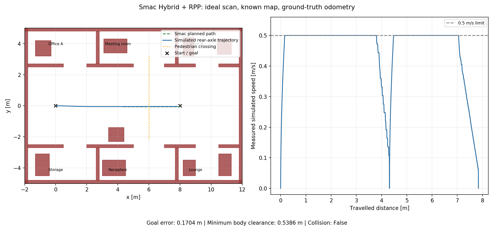
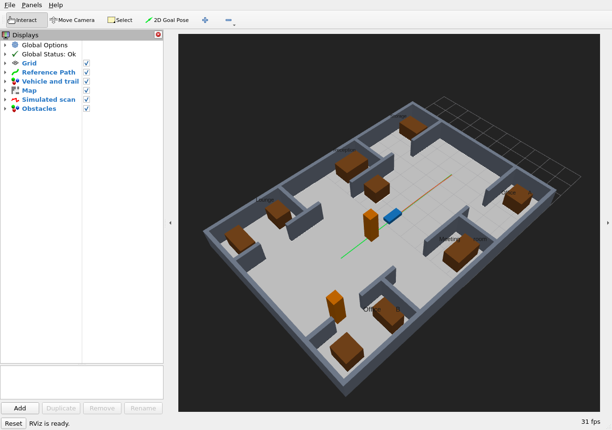

# 실내 동적 시뮬레이션 검증 — 2026-11-17

Ubuntu 22.04 / ROS2 Humble 컨테이너, Nav2 1.1.20, 알려진 지도·이상적 360° scan·정답 odometry를 사용한다.
재현 명령은 [실내 설명서](indoor-simulation-guide.md), 이전 환경 결과는 [기존 검증 기록](navigation-simulation-validation.md)에 있다.

## 검증 범위

정적 실내 완주, 횡단 장애물 정지, 보행자 이동 계속, 자동 재출발 금지, 명시적 재허가 후 완주를 실제 ROS2 토픽/action으로 검사했다.
원래의 정적 장애물 우회·막힌 경로·고장 8종·제어기 시험도 전체 회귀 대상으로 유지했다.

## 이번 실행 결과

`bash tools/ros2/verify.sh`: colcon 빌드 2개 패키지 PASS, **110 tests, 0 errors, 0 failures, 0 skipped**.
이는 개별 시험 **96개**와 CTest 실행 wrapper **14개**를 합한 수다.
개별 시험은 기존 제어 패키지 45개, 안전 단위 32개, 실내 기하 7개, Navigation launch 6개 및 정상 종료 6개다.
[빌드·시험 출력](build/evidence/legacy-results/indoor/build-test.log), [제어 XML](build/evidence/legacy-results/indoor/mrider_autonomy/),
[Navigation XML](build/evidence/legacy-results/indoor/mrider_navigation_sim/)에 이번 실행 증거를 보관했다.

| 환경 | 목표 위치 오차 | 최소 차체 이격 거리 | 충돌 | 판정 |
|---|---:|---:|---|---|
| 정적 실내 | 0.171504 m | 1.044950 m | false | PASS |
| 이동 물체가 있는 실내, 재허가 후 | 0.170449 m | 0.538597 m | false | PASS |

동적 시험에서 Nav2의 충돌 예측이 추종을 중단했고, 안전 상태는
`STOPPED / planning_or_tracking_failed`가 됐다. 정지 상태에서 횡단 물체가 y=0.0 m에서
3.3 m까지 이동해도 차량 명령 0이 유지됐고, arm/start 후 재계획하여 완주했다.
[정적 JSON](build/evidence/legacy-results/indoor/indoor.json), [동적 JSON](build/evidence/legacy-results/indoor/indoor_dynamic.json)을 참조한다.
모의 차체의 정답 기하 거리이며 센서로 추정한 실차 거리나 통계적 안전 보장은 아니다.

기존 우회·막힘·장애물 복구·고장 주입 측정도 [결과 디렉터리](build/evidence/legacy-results/indoor/)에 함께 저장했다.
ROS 없는 직선/곡선 데모의 목표 오차는 각각 0.119574 m / 0.118822 m, 최종 속도는 모두 0이었다.


## 개발 중 발견한 문제와 남은 한계

- 초기 Nav2 준비 중 arm을 먼저 요청하면 scan 지연에 의해 정지할 수 있었다. 자동 검증은 두 Nav2 lifecycle이 ACTIVE인 것을 확인한 뒤 arm한다. 감시 timeout을 늘리거나 안전 정지를 해제하지 않았다.
- 복도 중앙 카트를 배치했던 첫 실내 시험에서는 RPP 충돌 예측으로 임무가 중단됐다. 최종 실내 환경은 카트를 벽 쪽에 배치해 횡단 상황을 분리한다. 중앙 물체 우회는 기존 `static_obstacle` 시험에서 별도로 유지한다. 실내의 임의 장애물 배치를 모두 통과할 수 있다는 결과가 아니다.
- 횡단 시작 조건을 차량 x=3.7 m로 둔 초기 시험에서는 차량이 약 x=4.999 m에 정지했지만, 옆에서 이동한 물체가 앞부분에 닿아 `collision=true`였다. 최종 기본 조건은 x=2.5 m에서 횡단을 시작해 전방 관측 거리를 확보한다. **늦은 측면 진입 문제를 해결했다는 의미가 아니다.** 현재는 물체 속도 예측·측면 접근 위험 분석·실차 비상정지 검증이 없다.
- 추종 실패 후 반복 발행되는 `FAILED`가 수동 arm을 다시 취소할 수 있었다. 안전 게이트는 임무 상태 전환 때 terminal 상태를 처리하도록 수정하고, `FAILED`/`GOAL` 반복 수신과 새 임무 실패에 대한 단위 시험을 추가했다.
- 검사 도구가 재시작 직후 이전 실패 상태를 새 결과로 읽는 문제는 새 `PLANNING`/`FOLLOWING` 수신을 확인하도록 수정했다.

한 번의 재현 가능한 횡단과 넓은 복도에서 합격한 것이다. 무작위 군중·밀집 교차·좁은 문 통과·
SLAM 위치 오차·실물 A2·카메라·Gazebo 물리·Teensy 및 차량은 검증하지 않았다.

## 시각화



위 그림의 계획 경로는 재허가 후 마지막 경로이고, 파란 궤적은 출발부터 완주까지의 전체 측정값이다.
속도 그래프의 가로축은 누적 이동 거리이므로 정지 대기 시간은 폭으로 나타나지 않는다.

```bash
python3 tools/ros2/plot_navigation.py docs/build/evidence/legacy-results/indoor/indoor_dynamic.json /tmp/indoor-trajectory.png
```



Xvfb 가상 디스플레이에서 실제 `indoor_demo.launch.py`와 RViz2를 실행하여 화면을 확인했다.
표시된 벽과 가구의 높이는 시각화용이며 센서·충돌 계산은 2D다.
기존 RViz2 map 초기 GLSL sampler 경고는 이 환경에서도 관찰되는 알려진 제한이다.

