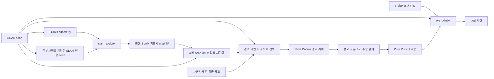
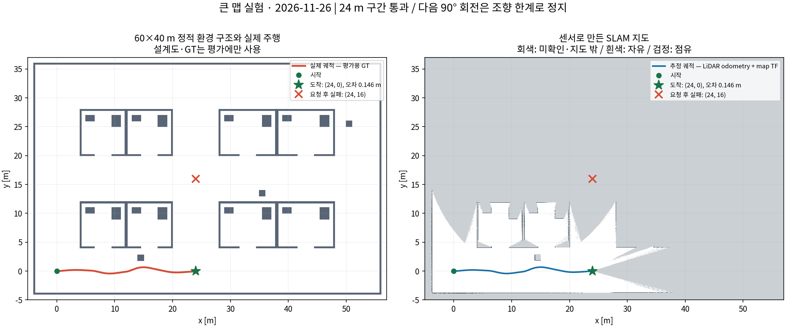

# 큰 실내 맵의 관측 기반 단계별 주행

> **최신 추가 GUI 실행:** 첫 24 m 도착 오차 0.106559 m 후 좌회전 중 LiDAR 정합 대응점 부족으로 안전 정지하여 완주 FAIL. [E31·원본 증거](experiment-log.md)를 참고한다.
>
> **직전 헤드리스 결과:** `regression-08`의 큰 맵 직진·90도 좌회전·90도 우회전 및 정상 종료 PASS.
> 세 목표 오차 **0.071677 / 0.149088 / 0.168477 m**, 충돌 없음, 최소 여유 **0.512848 m**,
> 최대 후보 조향 **0.217242 rad**로 vehicle 1의 물리 한계 안이다.
> 24 m 별도 주행도 오차 **0.118335 m**로 통과했다. [원본·전체 집계·남은 검증](experiment-log.md#current-validation)을 확인한다.
> 합성 센서를 사용하는 2D 시험 결과이며, 실제 차량이나 건물 전체 탐색의 검증 결과가 아니다.

> **수정 전 직접 실험 — 2026-11-26:** 기존 RViz 창을 유지한 큰 맵 주행에서 24 m 목표는
> **74.5초, 오차 0.146 m**로 도착했다. 다음 북쪽 목표의 **90도 회전은 `untrackable_curvature`로 실패**했다.
> [실행 결과·원본 로그·재현 명령](#live-large-office-2026-11-26)을 참고한다. 건물 전체 완주 결과가 아니다.

> **추가 수정:** SLAM scan의 `laser` frame을 보존하도록 헤더 공유 오류를 수정했다.
> [수정 후 검증](sensor-only-navigation.md#slam-tf-fix)에서 24 m 도착 오차 0.120646 m,
> 해당 odometry 경고 0회를 확인했다. 하단 115개 시험 기록은 헤더 수정 전 결과다.

2026-11-25. 학습 모델과 정답 지도/위치를 주행 입력으로 사용하지 않는다.
[환경 설계도](large-office-simulation.md)의 60×40 m 맵에서, 우선 남쪽 복도의 `(24,0)` 목표를 단계적으로 향하는 구현이다.
건물 전체 탐색·방 진입까지 완료된 시스템으로 해석하지 않는다. 교차로 90도 회전은 별도 세 목표 시험으로 판정한다.

## 보완한 입력 계약

합성 raycaster는 모든 장애물과 광선의 교차를 계산한 뒤, 15 m 안에 교차점이 없으면 **유한한 `range_max` 값**을 반환한다.
이 반환 의미가 확인된 시뮬레이션에만 `max_range_is_clear: true`를 설정했다.

| scan 값/상태 | 취급 |
|---|---|
| 유효한 범위 내 반사점 | 점 앞까지 자유 공간 근거, 점은 표면 후보 |
| 유한한 최대 거리 + 확인된 계약 | 해당 거리 안쪽의 자유 공간 근거. 가짜 벽 씨앗을 생성하지 않음 |
| 최대 거리 + 확인되지 않은 계약 | 미확인, 기존 기본값 false 유지 |
| NaN/무한대/0/범위 밖 | 자유 공간 근거로 사용하지 않음 |
| 누락/지연/잘못된 frame | 안전 정지 및 수동 복구 조건 유지 |

실제 A2M4-R2 드라이버에서 무반사/오류가 어떤 값으로 나오는지 확인하지 않고 이 설정을 복사하면 안 된다.
`range_max` 직전의 유효 반사도 공간 관측에 사용한다. 14.98~15 m 구간을 통째로 버리던 이전 구현은 차체 주변까지 미확인 쐐기를 남겼다. 이제 유효 반사점까지의 거리를 사용하고 기존 0.15 m+셀 여유 앞까지만 인정한다.
카메라는 여전히 보정된 지면 투영·영상 색상·Watershed로 **후보**를 판정한다.
LiDAR 평면보다 낮은 물체·유리·단차 검출을 보장하지 않는다.

## 장거리 위치 추정과 SLAM 입력

LiDAR odometry는 연속 두 scan의 편향이 누적되지 않도록 **scan-to-keyframe 점-직선 ICP**를 사용한다.
직전 추정값으로 정합을 시작하고, 기준 scan에서 0.5 m 이동하거나 0.15 rad 회전하면 키프레임을 바꾼다.
정지 중에도 source timestamp 기준 `keyframe_max_age`(기본 2초)가 지나면 유효 정합 후 기준을 갱신한다.
추정 pose·원점을 유지하며 정합에 실패한 scan으로 기준을 덮어쓰지 않는다.
이동량·잔차·퇴화 검사는 유지하며 정합 실패 시 추정값을 갱신하지 않는다. 명령·GT를 적분하지 않는다.
최종 품질 검사에도 정합에서 채택한 거리 내 대응점만 쓰며, 최소 60개·전체 70% 이상 지지점과
채택된 대응점 내부에서 상위 20%를 절삭한 RMSE 0.08 m 이하를 요구한다. 근접 보행자로 가려진 점을 평가에 다시 포함해 정상 정합을 거부하던 오류를 수정했다.
정적 표면의 충분한 지지가 필요하며, 실제 정합 손실 뒤에는 자동으로 위치를 만들어 재출발하지 않는다.
속도는 최근 네 scan의 추정 위치 차분(10 Hz에서 약 0.3초 구간)으로 계산한다. 정지 중 정합 잡음이
재개 대기 시간을 반복 초기화하는 문제를 줄이며, 원본 pose·timestamp와 정지 판정 한계는 유지한다.

큰 복도에서는 유한한 15 m 무반사 값들이 차량에 붙어 움직이는 가짜 표면처럼 SLAM 정합에 사용됐다.
설치된 Karto의 `GetPointReadings()` 기본값은 **필터되지 않은 점**이며 correlation lookup도 이를 사용한다.
`max_laser_range`를 14.9 m로 낮추는 것만으로는 이 점을 제외하지 못했다.
loop closure를 꺼 본 분리 시험도 실패했으므로 최종 설정은 원래의 loop closure=true와 range 15 m를 유지한다.

`laser_odometry_node`는 원본 `/scan`을 변경하지 않고 **`/mrider_sim/slam_scan` 복사본**을 발행한다.
시뮬레이터에서 무반사로 확인된 최대 거리 값과 비정상 관측을 NaN으로 표시하여 Karto 정합에서 제외한다.
유효한 반사점·각도·원본 frame·timestamp는 유지한다. 이 NaN을 자유 공간 증거로 쓰지 않는다.
카메라·안전 게이트·Nav2·지역 목표 선택은 원본 scan과 각자의 계약을 그대로 따른다.

원본 근거: [Karto 점/lookup 구현](https://github.com/SteveMacenski/slam_toolbox/blob/humble/lib/karto_sdk/include/karto_sdk/Karto.h),
[SLAM 정합 구현](https://github.com/SteveMacenski/slam_toolbox/blob/humble/lib/karto_sdk/src/Mapper.cpp).
이는 입력 의미를 정정한 것이며 GT로 지도·위치를 보정한 것이 아니다.

## 단계별 목표 선택



- SLAM에서 만든 지도를 최신 scan 3회로 재검증한 `/navigation/observed_map`과 scan 시각의 `map→laser` TF를 사용한다. 원본 `/map`은 SLAM이 그대로 발행한다. [갱신 계약](architecture.md)의 freshness·가림·반사점 제약을 적용한다.
- 최초 지도에는 광선 사이의 작은 미확인 빈틈이 있었다. 목표 선택용 복사본에서만 최신 scan으로 관측한 미확인 셀을 보완한다.
  인접한 두 유효 광선 중 짧은 거리에서 여유를 뺀 안쪽만 인정하며, 기존 점유 셀은 절대 지우지 않는다.
  `/map`을 대신 발행하거나 정답 환경 기하를 읽지 않는다.
  완전한 360도 scan에서는 첫·마지막 광선도 이웃으로 연결한다. 이 경계가 빠져 차량 뒤쪽에 미확인 틈이 생기던 사례를 회귀 시험으로 검사한다.
- 광선 사이 공간을 근사하므로 각도 분해능보다 작은 장애물을 놓칠 수 있다. 이는 완전한 장애물 부재 증명이 아니다.
- 연결성 검사는 낙관적 후보 필터로 사용하고, 각 후보 전진 원호의 전체 차체(방향을 가진 직사각형+0.15 m 여유)를 조밀하게 검사한다. 경계뿐 아니라 차체 내부의 점유·미확인 셀도 거부한다. 외접원 때문에 안전한 코너 출발을 거부하던 과도한 제약을 제거했다.
- 중간 목표는 최대 6 m 이내다. 최종 목표가 바로 그 범위 밖이면 마지막 접근 구간을 최소 1 m 남기도록 앞 단계를 줄인다. 최종 목표가 관측된 연결 공간의 8 m 이내에 들어오면 원래 위치와 방향을 함께 전달하여 최종 접근 여유를 확보한다.
- 큰 방향 전환에서는 단순히 옆에 있는 점을 목표로 고르지 않는다. 현재 추정 자세에서 전진 원호 후보를 만들고, 원호 전체가 관측·팽창된 자유 공간 안에 있는지 검사한다. 끝 위치와 끝 방향을 함께 Nav2에 전달한다.
- 후보 원호는 계획 최소 반경보다 5% 크게 만들어 격자·방향 반올림 여유를 둔다. 이는 차량 치수를 바꾸는 값이 아니라 중간 목표 선택의 여유다.
- 후보 점수는 남은 목표 거리와 `계획 반경 × 남은 목표 방향과의 각도 차이`를 더한다. 위치 진전만 앞세워 과도하게 회전한 뒤 되돌아 꺾는 후보를 줄인다. 동적 물체의 미래 궤적을 계획하는 비용은 아니다.
- 최종 목표가 아직 미확인/막힘 상태이면 중간 원호 끝에서 계획 회전 반경 이상의 최종 접근 거리를 남긴다. 최초 요청의 일시적인 관측 부족은 최대 5초 보류하고 다시 검사한다. 관측을 갱신해도 유효한 후보가 없으면 실패 정지한다.
- 먼 목표 자체가 미확인이어도, 실제 관측된 연결 공간 안에서 최소 1 m 이상 진전하는 지역 목표를 고른다.
- 최종 목표가 가까워지고 관측 범위 안에 들어오면 원래 목표를 사용한다. 도달 가능 후보가 없으면 실패하며, 미확인 구역을 임의로 자유 공간으로 바꾸지 않는다.
- 연결성만으로 회전 가능성을 판단하지 않는다. Nav2가 전진 Dubins 경로를 계산하고, mission이 실제 경로의 곡률·출발 자세를 검사한 뒤에만 추종을 요청한다. 주행 중 조향 제한도 안전 게이트가 계속 검사한다.
- 이 정책은 목표 방향으로 진행하는 방식이다. 목표에서 멀어져야 하는 막다른 길 탈출·frontier 탐색·완전한 탐색기는 아직 없다.

센서용 Nav2 기본 계획 반경은 2.5 m이며, vehicle overlay의 실측 반경+5%가 더 크면 그 값을 사용한다.
이는 vehicle 1의 물리 최소 반경 2.10 m를 바꾸지 않는다. 작은 맵 우회 시험은 별도로 3.5 m를 사용한다.
생성 경로와 초기 추종 곡률을 검사하여 물리 조향 한계 안의 경로만 실행한다.

목표 선택은 연결 성분 연산으로 수행한다. Python flood fill이 TF 수신을 지연시킨 문제를 줄였고,
TF/scan 0.35초 제한을 늘리지 않았다. 목표 선택용 지도는 2초보다 오래되면 거부한다.

## 중간 목표 정지와 권한

`PLANNING → FOLLOWING → WAYPOINT → PLANNING ... → GOAL`

각 중간 목표에서 정지한 뒤 `/mrider_sim/continue`로 다음 구간만 허가한다.
이 서비스는 mission 노드가 호출하므로 사용자가 중간 목표마다 arm/start를 반복할 필요는 없다.
이 서비스는 안전 게이트가 깨끗한 목표 완료 상태이고, 차량 정지·센서 신선도·전방 여유가 확인될 때만 성공한다.
센서 고장이나 운전자 disarm 상태를 수동 arm 호출로 덮어쓰지 않는다.
운전자 disarm은 남은 최종 목표도 취소한다. 지역 목표는 `/mrider_sim/local_goal`로 확인한다.

## 실행

기존 demo와 같은 domain에서 중복 실행하지 않는다. 기존 GUI를 자동으로 닫거나 재시작하는 명령은 없다.

```bash
docker exec -it ros2_humble bash
cd /root/mrider-team
source ros2_ws/setup_env.sh
source ros2_ws/install-docker/setup.bash
cd ros2_ws
colcon --log-base log-docker build --build-base build-docker --install-base install-docker \
  --symlink-install --packages-select mrider_navigation_sim --cmake-args -DBUILD_TESTING=ON
source install-docker/setup.bash
export ROS_DOMAIN_ID=192
ros2 launch mrider_navigation_sim large_office_demo.launch.py vehicle:=1 rviz:=false
```

다른 터미널에서 같은 환경과 domain을 설정한 후:

```bash
ros2 service call /mrider_sim/arm std_srvs/srv/Trigger '{}'
# success: true 확인 후
ros2 service call /mrider_sim/start std_srvs/srv/Trigger '{}'
ros2 topic echo /mrider_sim/local_goal
# 다른 터미널에서 상태 확인
ros2 topic echo /mrider_sim/mission_state
# 수동 정지
ros2 service call /mrider_sim/disarm std_srvs/srv/Trigger '{}'
```

## 자동 검증

GUI 없이 24 m 시험은 domain 214, 세 목표 회전 시험은 domain 216에서 독립 실행한다. 검증용 truth는 검사 노드만 구독한다.

```bash
export MRIDER_TEST_VEHICLE=1
export MRIDER_SIM_REPORT_DIR=/root/mrider-team/docs/build/evidence/large-office-manual
colcon --log-base log-docker test --build-base build-docker --install-base install-docker \
  --packages-select mrider_navigation_sim --event-handlers console_direct+ \
  --ctest-args -R 'test_large_office(_turns)?_launch|^local_goal$|^observed_map$|^large_office$|^segmentation$|^safety$' -j1 --output-on-failure
```

검사 항목: 무반사 SLAM 복사본·원본 보존, 입력 계약별 자유 공간 인정/거부, 점유 셀 보존, 미확인/장벽을 가로질러 목표 선택하지 않기,
차체 여유·최대 단계 거리, 단계별 목표 전환, GT 구독 격리, 목표 오차 0.5 m 미만,
충돌 없음, 카메라 중단 후 정지 latch. Python 단독 시험에는 scipy도 필요하다.
세 목표 시험은 `(24,0,0°) → (24,16,90°) → (40,16,0°)` 순서로 요청하여 실제 좌·우회전과 각 목표의 위치 오차 `<0.5 m`·방향 오차 `<0.3 rad`, 생성 경로 및 후보 명령의 조향 한계까지 검사한다.

<a id="validation-2026-11-25"></a>

## 장거리 보완 검증 결과 — 2026-11-25, 헤더 수정 전

기존 `ros2_humble`의 `/root/mrider-team`에서 vehicle 1, GUI 없이 실행했다.
팀 Navigation 패키지 colcon 빌드가 성공했다. 이번 수정본의 단위 시험 **109개**와
센서 ROS 주행 3개·정상 종료 3개, 합계 **115개 PASS, 실패·오류·skip 0개**다.
CTest 실행 wrapper를 개별 시험 수에 다시 더하지 않았다. 전체 공식 workspace/CI 합격을 뜻하지 않는다.

| 실제 ROS 시험 | 도착 시 목표 오차 | 추가 판정 |
|---|---:|---|
| 24 m 대형 맵 | **0.128062 m** | 5개 지역 목표, 충돌 없음, 카메라 중단 후 정지 latch |
| 12 m 좌우 우회·횡단 | **0.110664 m** | 정지 후 13.224152 s에 자동 재개, 최소 이격 0.564426 m, 충돌 없음 |
| 8 m 기본 센서 주행 | `<0.5 m` assertion PASS | 카메라 중단·복구 후 정지 유지; 도착 시 수치 자체는 기존 보고서 형식에 저장하지 않음 |

좌우 시험의 조향 범위는 **−0.094931 ~ +0.227206 rad**이며 평가 정답으로 실제 양방향 회전도 검사했다.
GOAL 확인 뒤 별도 고장 시험으로 조금 더 움직였으므로 보고서의 최종 `truth_goal_error_m`는
도착 오차와 다르다. 대형/좌우/기본의 **고장 시험 후 최종 목표 거리**는 각각
0.157969 / 0.153805 / 0.124659 m다. 대형 맵의 최종 raw odometry 오차는 0.050698 m다.
평가 정답 토픽을 주행 노드가 구독하지 않는지 세 ROS 시험에서 검사했다.

- [시험 집계·측정값](build/evidence/large-office-progress-2026-11-25/verified/summary.json),
  [개별 XML](build/evidence/large-office-progress-2026-11-25/verified/xml/),
  [코드 SHA256](build/evidence/large-office-progress-2026-11-25/verified/source-sha256.json).
- [대형 맵 JSON](build/evidence/large-office-progress-2026-11-25/verified/large_office.json),
  [좌우·횡단 JSON](build/evidence/large-office-progress-2026-11-25/verified/sensor_turns.json),
  [기본 JSON](build/evidence/large-office-progress-2026-11-25/verified/sensor_only.json).
- [빌드 로그](build/evidence/large-office-progress-2026-11-25/verified/logs/build.log),
  [대형 맵 로그](build/evidence/large-office-progress-2026-11-25/verified/logs/large-office.log).
- [수정 과정의 원본·실패 로그 압축본](build/evidence/large-office-progress-2026-11-25/development-runs.tar.gz).
  `final`·`final-verified`라는 개발 중 폴더명도 합격 표시가 아니다. 현행 결과는 위 `verified/summary.json`으로 판정한다.

세 주행 시나리오와 단위 시험을 한 번에 재현하려면 앞의 build/source 이후:

```bash
export MRIDER_TEST_VEHICLE=1
export MRIDER_SIM_REPORT_DIR=/tmp/mrider-sensor-validation
colcon --log-base log-docker test --build-base build-docker --install-base install-docker \
  --packages-select mrider_navigation_sim --event-handlers console_direct+ \
  --ctest-args -R 'camera_contract|segmentation|sensor_core|safety|local_goal|vehicle_overlay|^large_office$|indoor_geometry|test_(sensor_only|sensor_turns|large_office)_launch' -j1 --output-on-failure
```

## 개발 중 실패 기록

완료 메시지만으로 성공을 판정하지 않고 평가 전용 정답과 비교했다.

| 단계 | 관측한 실패 | 조치 |
|---|---|---|
| 초기 큰 맵 | 최대 거리 입력을 모두 미확인으로 처리해 카메라가 출발 거부 | 확인된 합성 센서 계약에 한해 자유 공간 근거 사용 |
| 첫 지역 목표 | SLAM 광선 사이 미확인 틈으로 진행 후보 없음 | 원본 지도는 보존하고 지역 목표 선택 복사본에 최신 scan 근거 보완 |
| Python flood fill | TF 수신 처리 지연 | 연결 성분 계산으로 교체; freshness 한계 유지 |
| SLAM 무반사점 미처리 | GOAL 보고에도 실제 목표 오차 약 22 m | SLAM 전용 무반사점 제외; range threshold·loop closure 변경만으로 해결되지 않았음 |
| 정확해진 위치에서 기존 우회 | 고정 물체에 너무 가까운 경로, 정지 속도 잡음으로 재개 대기 초기화 | 계획 여유 유지·우회 padding·네 scan 속도 추정 |
| 360도 scan 경계 | 첫·마지막 광선 사이 미확인 틈이 차체 여유 검사를 막음 | 완전한 원형 scan의 마지막 sector 연결 |
| 최종 목표 수 cm 전 단계 | 셀 횡오차로 중간 목표 heading이 급변해 `original_goal_missed` | 마지막 1 m를 남기도록 현재 단계의 이동 거리 제한 |

마지막 문제에서 최종 목표 주변 반경만 제외하는 방식도 옆 방향 후보를 선택해 실패했다.
현재 방식은 현재 위치에서의 이동 거리를 줄인다. 실패 JSON과 로그도 같은 증거 폴더에 유지한다.

<a id="path-curvature-fix"></a>

## 조향 한계를 반영한 경로 생성 — 2026-11-26

차량 1의 모의 조향 한계는 `atan(0.533 / 2.10) = 0.248561 rad`다.
경로 곡률 `κ`에 필요한 조향은 `δ = atan(wheelbase × κ)`이며, 속도만 줄여도 필요한 조향각은 줄어들지 않는다.
따라서 한계를 넘는 후보 명령이 나올 때마다 정지하는 데 그치지 않고 경로 생성과 검증을 수정했다.

1. **지도 해상도 일치.** SLAM은 0.05 m, 이전 global costmap 초기값은 0.10 m였다.
   Humble Smac은 초기화 시 회전 반경을 셀 단위로 저장한다. 이후 StaticLayer가 SLAM 지도에 맞춰
   0.05 m로 바뀌면서 기존 셀 단위 반경 3.5 m가 실제 경로에서는 약 1.75 m로 나타났다.
   재현 기록에서 후보 곡률은 약 0.58447 m⁻¹였다. 현재는 costmap을 처음부터 0.05 m로 만들고,
   설정 불일치 또는 실행 중 지도 해상도 변경 시 경로 실행을 거부한다.
2. **제약을 보존하는 경로.** 전진 Dubins를 사용한다. 이 수정 당시에는 최소 3.0 m였으며,
   후속 관측 지도 재생에서 벽과의 여유를 확인하여 현재 팀 기본 하한은 2.5 m로 조정했다([E23](experiment-log.md)).
   차량 overlay가 요구하는 반경이 더 크면 그 값을 사용한다. 좌우 우회 소형 시험은 기존 3.5 m를 유지한다.
   Humble의 단순 평활화가 경로 내부 곡률을 다시 높이는 사례를 확인하여 `smooth_path: false`로 설정했다.
   실제 생성된 좌표 세 점의 외접원 곡률을 검사하므로 설정값만 보고 통과시키지 않는다.
3. **차량이 향할 방향을 포함한 중간 목표.** 최신 추정 자세에서 전진 원호를 만들고
   관측된 자유 공간 안의 끝 위치·방향을 함께 선택한다. 최종 목표 앞에서는 원래 도착 방향을 유지한다.
4. **출발 전 검사.** `path_feasibility.py`가 잘못된 값·불연속/후진/제자리 회전·과도한 곡률과
   초기 Pure Pursuit 추종 곡률을 검사한다. 물리 반경에 5% 여유를 둔 한계는 약 0.453515 m⁻¹다.
   실패 시 `/mrider_sim/path_validation`에 이유를 발행하고 `FollowPath`를 호출하지 않는다.
   경로 결과가 TF 콜백보다 먼저 처리되면 정지 상태에서 최대 1초 동안 콜백을 처리한다.
   그 안에도 **나이 0.35초 이하**의 TF가 없으면 실패한다. 허용 나이를 늘린 것이 아니다.

실행 중에는 기존 안전 게이트가 추종·추정 오차로 인한 조향 초과도 계속 차단한다.
경로 검사가 미래의 모든 추종 오차를 보장하지는 않는다. 조향 clamp나 GT 보정으로 통과시키지 않는다.

구현 근거: [Smac의 반경 환산·평활화](https://github.com/ros-navigation/navigation2/blob/humble/nav2_smac_planner/src/smac_planner_hybrid.cpp),
[StaticLayer 해상도 변경](https://github.com/ros-navigation/navigation2/blob/humble/nav2_costmap_2d/plugins/static_layer.cpp),
[Humble 단순 smoother](https://github.com/ros-navigation/navigation2/blob/humble/nav2_smac_planner/src/smoother.cpp),
[Pure Pursuit 곡률 계산](https://github.com/ros-navigation/navigation2/blob/humble/nav2_regulated_pure_pursuit_controller/src/regulated_pure_pursuit_controller.cpp).

<a id="live-large-office-2026-11-26"></a>

## 큰 맵 직접 주행 — 2026-11-26

Docker `ros2_humble`, `/root/mrider-team`, vehicle 1, ROS domain 192에서 직접 실행했다.
커스텀 평면 센서 시뮬레이터와 실제 slam_toolbox/Nav2를 사용했다. Gazebo 물리 twin 시험은 별도다.
코드는 `f274f9a`이며, 이전 SLAM 수정본의 소스 61개 SHA256이 모두 일치했다.
런타임 코드·차량 치수·안전 한계는 이 실험에서 변경하지 않았다.
이미 열려 있던 RViz 창을 계속 사용했으며 재시작하지 않았다.

운전자 목표를 `(24,0,0°)` → `(24,16,90°)` → `(40,16,0°)` 순서로 요청하도록 준비했다.
이 좌표는 목적지 지정이며 정답 경로·위치를 주행기에 공급하는 방식이 아니다.
두 번째 목표에서 정지하여 세 번째 목표는 요청하지 않았다.

| 항목 | 이번 실행의 측정값·판정 |
|---|---|
| 남쪽 복도 `(24,0)` | **PASS**, 74.464667 s, 도착 오차 **0.145956 m** |
| 중간 목표 | 약 x=5.97, 11.86, 17.80, 23.00, 24.00 m의 **5개**를 관측 기반으로 선택 |
| 평가용 실제 이동 거리 | 24.150554 m |
| 북쪽 `(24,16)` 목표 | **FAIL**, 첫 지역 목표 `(24.00,5.97)` 계획 후 `untrackable_curvature` 정지 |
| 동쪽 `(40,16)` 목표·오른쪽 90도 회전 | 앞 구간 실패로 미실행 |
| 전체 시험 | **FAIL**, 76.857383 s 후 disarm. 한 실행에서 첫 목표 성공·두 번째 실패 |
| 충돌·최소 이격 | 충돌 없음, 최소 0.793580 m |
| SLAM `Failed to compute odom pose` | 전체 launch 로그에서 0회 |
| 주행 기록 중 odometry 진단 | 729개 모두 `valid=true` |
| 마지막 관측 지도 | 알려진 셀 170,206개, 약 **425.52 m²**. 건물 전체 탐색률이나 지도 정확도 지표는 아님 |
| 동적 장애물 정지·자동 재개 | 옵션은 켰으나 이 구간에서 해당 정지가 발생하지 않아 **미검증** |

첫 구간에서 조향은 −0.133186~+0.178135 rad였다. 이 값은 곡선 보정의 양방향 조향을 의미하며,
교차로 좌·우 90도 회전을 완료했다는 뜻이 아니다.



왼쪽 환경 기하·실제 궤적은 사후 평가용이다. 오른쪽은 SLAM `/map`과 LiDAR odometry에 map TF를 적용한 추정 궤적이다.
주행 중 ROS graph에서 `/map` 발행자는 `slam_toolbox`, `/mrider_sim/odometry` 발행자는 `laser_odometry`,
최종 명령 발행자는 `mrider_safety_gate` 한 개씩이었다.
`/evaluation/ground_truth` 구독자는 검사 노드 `navigation_checks`뿐이었다.

### 발견한 실패와 보완 지점

1. **교차로 진입의 곡률 불일치.** 안전 게이트는 입력 `Twist`를 조향각으로 환산했을 때
   vehicle 1 한계 `atan(0.533 / 2.10)`을 넘으면 정지한다.
   이번에 이 분기가 작동했다. 계획 최소 반경 3.5 m, RPP lookahead 2 m 설정만으로 모든
   급격한 방향 전환을 추종할 수 있음이 보장되지는 않았다.
   당시 후보 `Twist`와 계획 경로 전체는 저장하지 않았으므로, 목표 선택·경로 형상·추종 시작점 중
   어느 부분이 직접 원인인지는 추가 기록으로 분리해야 한다. 안전 한계를 늘리거나 조향을 강제로
   잘라 실행하는 방식으로 통과시키지 않았다.
2. **정지 후 대기의 scan 간격 오류.** 위 실패로 disarm한 뒤 주행 시험이 끝난 상태에서
   `scan_gap_manual_restart_required`가 추가 관측됐다. 이후 Nav2에는 scan observation buffer 지연 경고가 발생했다.
   이는 주행 중 729개 정상 진단과 구분한 [시험 후 상태](build/evidence/large-office-live-2026-11-26/post-trial-status.json)다.
   최초 간격 초과 원인은 이번 자료만으로 확정할 수 없다. 차량은 계속 DISARMED, 속도 0이었고
   실험 backend를 정상 종료했다. 기존 안전 계약을 유지하면서 지연 원인·명시적 복구 절차를 검증해야 한다.

다음 통과 조건은 같은 출발·목표에서 90도 좌회전과 우회전을 연속 수행하고,
도착 오차 <0.5 m·충돌 없음·추종 가능한 곡률·센서 지연 시 정지를 모두 확인하는 것이다.
이동 장애물이 실제 경로를 가로지르는 위상에서 정지·재개 시험도 별도로 필요하다.

### 같은 실험 재현

앞 절의 Docker build/source를 완료하고 같은 domain의 다른 demo를 종료한 상태에서 실행한다.
이번에는 기존 RViz를 재사용했기 때문에 `rviz:=false`였다. 새 화면이 필요할 때는 한 번만 `rviz:=true`로 실행한다.

```bash
cd /root/mrider-team
source ros2_ws/setup_env.sh
source ros2_ws/install-docker/setup.bash
export ROS_DOMAIN_ID=192
ros2 launch mrider_navigation_sim sensor_only_demo.launch.py \
  scenario:=large_office goal_x:=24.0 auto_resume:=true vehicle:=1 rviz:=false
```

다른 터미널에서 같은 source/domain 설정 후 다음 검사기를 실행한다.
**새로 시작한 시뮬레이터 전용**이며, 이미 목표에 도착한 world를 초기화하는 스크립트가 아니다.
검사기가 arm/start와 후속 목적지를 보내므로 별도로 arm/start를 중복 호출하지 않는다.

```bash
python3 docs/build/evidence/large-office-live-2026-11-26/drive_trial.py \
  --output /tmp/mrider-large-live-new
```

기본 목표 목록은 위 세 목적지다. 이번 코드에서는 두 번째 목적지에서 실패하고 종료 코드 1을 반환했다.
24 m 구간만 재현하려면 새 world에서 `--goals '[[24,0,0]]'`을 추가한다.
결과의 `requests`, `legs`, `final_safety`와 launch 로그를 함께 확인한다.

- [집계·소스 검증](build/evidence/large-office-live-2026-11-26/summary.json),
  [주행 원본 JSON](build/evidence/large-office-live-2026-11-26/drive.json),
  [검사 로그](build/evidence/large-office-live-2026-11-26/drive.log),
  [launch 로그](build/evidence/large-office-live-2026-11-26/launch.log).
- [주행 중 실제 RViz 화면](build/evidence/large-office-live-2026-11-26/rviz-in-drive.png),
  [정지 후 화면](build/evidence/large-office-live-2026-11-26/rviz-stopped.png),
  [최종 SLAM 지도](build/evidence/large-office-live-2026-11-26/map.json).
- 런타임 수정 없이 수행한 직접 주행 시험이며 기존 단위·launch regression 시험의 재실행으로 합산하지 않는다.
  문서 strict build와 내부 anchor 검사 결과는 [문서 검증 로그](build/evidence/large-office-live-2026-11-26/docs-check.log)에 남긴다.

## 남은 검증

- 큰 맵 세 목표는 현재 실행에서 통과했다. 반복 부하·다른 출발 자세·보행자 타이밍에 대한 성공률을 추가 측정해야 한다. 앞선 90도 회전·정합 중단·보행자 접촉 실패와 수정은 [실험 기록](experiment-log.md)에서 추적한다.
- 정지 차량으로 계속 접근하는 비반응형 이동 물체에 대한 예측·회피. 현재 계획은 물체의 미래 궤적까지 최적화하지 않는다.
- 60×40 m 전체 순환, 방 진입, 막다른 길 탐색, 다른 출발점·배치의 반복 통계.
- 실제 RPLiDAR A2M4-R2·카메라, 일반 장착 TF·동기·반사체·유리·저상 물체.
- 공식 Gazebo Harmonic 물리 twin, Teensy DBW·E-stop·RC·실차 제동·조향.
- RViz/OpenGL 첫 실행 안정성. 11월 26일에는 기존 창으로 큰 맵을 표시했으며 새 GUI 시작 시험은 하지 않았다.
