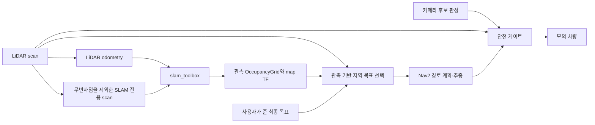

# 큰 실내 맵의 관측 기반 단계별 주행

2026-11-25. 학습 모델과 정답 지도/위치를 주행 입력으로 사용하지 않는다.
[환경 설계도](large-office-simulation.md)의 60×40 m 맵에서, 우선 남쪽 복도의 `(24,0)` 목표를 단계적으로 향하는 구현이다.
건물 전체 탐색·방 진입·교차로 90도 회전까지 완료된 시스템으로 해석하지 않는다.

## 보완한 입력 계약

합성 raycaster는 모든 장애물과 광선의 교차를 계산한 뒤, 15 m 안에 교차점이 없으면 **유한한 `range_max` 값**을 반환한다.
이 반환 의미가 확인된 시뮬레이션에만 `max_range_is_clear: true`를 설정했다.

| scan 값/상태 | 취급 |
|---|---|
| 유효한 범위 내 반사점 | 점 앞까지 자유 공간 근거, 점은 표면 후보 |
| 유한한 최대 거리 + 확인된 계약 | 해당 거리 안쪽의 자유 공간 근거. 가짜 벽 씨앗을 생성하지 않음 |
| 최대 거리 + 확인되지 않은 계약 | 미확인, 기존 기본값 false 유지 |
| NaN/무한대/0/범위 밖 | 자유 공간 근거로 사용하지 않음 |
| 누락/지연/잘못된 frame | 안전 정지 및 수동 복구 조건 유지 |

실제 A2M4-R2 드라이버에서 무반사/오류가 어떤 값으로 나오는지 확인하지 않고 이 설정을 복사하면 안 된다.
카메라는 여전히 보정된 지면 투영·영상 색상·Watershed로 **후보**를 판정한다.
LiDAR 평면보다 낮은 물체·유리·단차 검출을 보장하지 않는다.

## 장거리 위치 추정과 SLAM 입력

LiDAR odometry는 연속 두 scan의 편향이 누적되지 않도록 **scan-to-keyframe 점-직선 ICP**를 사용한다.
직전 추정값으로 정합을 시작하고, 기준 scan에서 0.5 m 이동하거나 0.15 rad 회전하면 키프레임을 바꾼다.
이동량·잔차·퇴화 검사는 유지하며 정합 실패 시 추정값을 갱신하지 않는다. 명령·GT를 적분하지 않는다.
속도는 최근 네 scan의 추정 위치 차분(10 Hz에서 약 0.3초 구간)으로 계산한다. 정지 중 정합 잡음이
재개 대기 시간을 반복 초기화하는 문제를 줄이며, 원본 pose·timestamp와 정지 판정 한계는 유지한다.

큰 복도에서는 유한한 15 m 무반사 값들이 차량에 붙어 움직이는 가짜 표면처럼 SLAM 정합에 사용됐다.
설치된 Karto의 `GetPointReadings()` 기본값은 **필터되지 않은 점**이며 correlation lookup도 이를 사용한다.
`max_laser_range`를 14.9 m로 낮추는 것만으로는 이 점을 제외하지 못했다.
loop closure를 꺼 본 분리 시험도 실패했으므로 최종 설정은 원래의 loop closure=true와 range 15 m를 유지한다.

`laser_odometry_node`는 원본 `/scan`을 변경하지 않고 **`/mrider_sim/slam_scan` 복사본**을 발행한다.
시뮬레이터에서 무반사로 확인된 최대 거리 값과 비정상 관측을 NaN으로 표시하여 Karto 정합에서 제외한다.
유효한 반사점·각도·원본 frame·timestamp는 유지한다. 이 NaN을 자유 공간 증거로 쓰지 않는다.
카메라·안전 게이트·Nav2·지역 목표 선택은 원본 scan과 각자의 계약을 그대로 따른다.

원본 근거: [Karto 점/lookup 구현](https://github.com/SteveMacenski/slam_toolbox/blob/humble/lib/karto_sdk/include/karto_sdk/Karto.h),
[SLAM 정합 구현](https://github.com/SteveMacenski/slam_toolbox/blob/humble/lib/karto_sdk/src/Mapper.cpp).
이는 입력 의미를 정정한 것이며 GT로 지도·위치를 보정한 것이 아니다.

## 단계별 목표 선택



- SLAM `/map`과 해당 시각의 `map→laser` TF, 최신 scan만 사용한다.
- 최초 지도에는 광선 사이의 작은 미확인 빈틈이 있었다. 목표 선택용 복사본에서만 최신 scan으로 관측한 미확인 셀을 보완한다.
  인접한 두 유효 광선 중 짧은 거리에서 여유를 뺀 안쪽만 인정하며, 기존 점유 셀은 절대 지우지 않는다.
  `/map`을 대신 발행하거나 정답 환경 기하를 읽지 않는다.
  완전한 360도 scan에서는 첫·마지막 광선도 이웃으로 연결한다. 이 경계가 빠져 차량 뒤쪽에 미확인 틈이 생기던 사례를 회귀 시험으로 검사한다.
- 광선 사이 공간을 근사하므로 각도 분해능보다 작은 장애물을 놓칠 수 있다. 이는 완전한 장애물 부재 증명이 아니다.
- 차체 외접 반경+안전 여유로 팽창한 공간에서 현재 위치와 연결된 후보만 선택한다.
- 한 단계 목표는 최대 6 m 이내다. 최종 목표가 바로 그 범위 밖이면 마지막 접근 구간을 최소 1 m 남기도록 앞 단계를 줄인다. 수 cm 구간에서 지도 셀의 횡오차가 급격한 목표 방향 요구로 증폭되는 것을 막는다.
- 먼 목표 자체가 미확인이어도, 실제 관측된 연결 공간 안에서 최소 1 m 이상 진전하는 지역 목표를 고른다.
- 최종 목표가 가까워지고 관측 범위 안에 들어오면 원래 목표를 사용한다. 도달 가능 후보가 없으면 실패하며, 미확인 구역을 임의로 자유 공간으로 바꾸지 않는다.
- 연결성은 회전 가능성의 증명이 아니다. Ackermann 경로는 Nav2가 별도로 계산하고 조향 제한은 안전 게이트가 검사한다.
- 이 정책은 목표 방향으로 진행하는 방식이다. 목표에서 멀어져야 하는 막다른 길 탈출·frontier 탐색·완전한 탐색기는 아직 없다.

목표 선택은 연결 성분 연산으로 수행한다. Python flood fill이 TF 수신을 지연시킨 문제를 줄였고,
TF/scan 0.35초 제한을 늘리지 않았다. 목표 선택용 지도는 2초보다 오래되면 거부한다.

## 중간 목표 정지와 권한

`PLANNING → FOLLOWING → WAYPOINT → PLANNING ... → GOAL`

각 중간 목표에서 정지한 뒤 `/mrider_sim/continue`로 다음 구간만 허가한다.
이 서비스는 안전 게이트가 깨끗한 목표 완료 상태이고, 차량 정지·센서 신선도·전방 여유가 확인될 때만 성공한다.
센서 고장이나 운전자 disarm 상태를 수동 arm 호출로 덮어쓰지 않는다.
운전자 disarm은 남은 최종 목표도 취소한다. 지역 목표는 `/mrider_sim/local_goal`로 확인한다.

## 실행

기존 demo와 같은 domain에서 중복 실행하지 않는다. 기존 GUI를 자동으로 닫거나 재시작하는 명령은 없다.

```bash
docker exec -it ros2_humble bash
cd /root/mrider-team
source ros2_ws/setup_env.sh
source ros2_ws/install-docker/setup.bash
cd ros2_ws
colcon --log-base log-docker build --build-base build-docker --install-base install-docker \
  --symlink-install --packages-select mrider_navigation_sim --cmake-args -DBUILD_TESTING=ON
source install-docker/setup.bash
export ROS_DOMAIN_ID=192
ros2 launch mrider_navigation_sim large_office_demo.launch.py vehicle:=1 rviz:=false
```

다른 터미널에서 같은 환경과 domain을 설정한 후:

```bash
ros2 service call /mrider_sim/arm std_srvs/srv/Trigger '{}'
# success: true 확인 후
ros2 service call /mrider_sim/start std_srvs/srv/Trigger '{}'
ros2 topic echo /mrider_sim/local_goal
# 다른 터미널에서 상태 확인
ros2 topic echo /mrider_sim/mission_state
# 수동 정지
ros2 service call /mrider_sim/disarm std_srvs/srv/Trigger '{}'
```

## 자동 검증

GUI 없이 domain 214에서 독립 실행한다. 검증용 truth는 검사 노드만 구독한다.

```bash
export MRIDER_TEST_VEHICLE=1
export MRIDER_SIM_REPORT_DIR=/root/mrider-team/docs/build/evidence/large-office-manual
colcon --log-base log-docker test --build-base build-docker --install-base install-docker \
  --packages-select mrider_navigation_sim --event-handlers console_direct+ \
  --ctest-args -R 'test_large_office_launch|^local_goal$|^large_office$|^segmentation$|^safety$' --output-on-failure
```

검사 항목: 무반사 SLAM 복사본·원본 보존, 입력 계약별 자유 공간 인정/거부, 점유 셀 보존, 미확인/장벽을 가로질러 목표 선택하지 않기,
차체 여유·최대 단계 거리, 단계별 목표 전환, GT 구독 격리, 목표 오차 0.5 m 미만,
충돌 없음, 카메라 중단 후 정지 latch. Python 단독 시험에는 scipy도 필요하다.

<a id="validation-2026-11-25"></a>

## 최종 검증 결과 — 2026-11-25

기존 `ros2_humble`의 `/root/mrider-team`에서 vehicle 1, GUI 없이 실행했다.
팀 Navigation 패키지 colcon 빌드가 성공했다. 이번 수정본의 단위 시험 **109개**와
센서 ROS 주행 3개·정상 종료 3개, 합계 **115개 PASS, 실패·오류·skip 0개**다.
CTest 실행 wrapper를 개별 시험 수에 다시 더하지 않았다. 전체 공식 workspace/CI 합격을 뜻하지 않는다.

| 실제 ROS 시험 | 도착 시 목표 오차 | 추가 판정 |
|---|---:|---|
| 24 m 대형 맵 | **0.128062 m** | 5개 지역 목표, 충돌 없음, 카메라 중단 후 정지 latch |
| 12 m 좌우 우회·횡단 | **0.110664 m** | 정지 후 13.224152 s에 자동 재개, 최소 이격 0.564426 m, 충돌 없음 |
| 8 m 기본 센서 주행 | `<0.5 m` assertion PASS | 카메라 중단·복구 후 정지 유지; 도착 시 수치 자체는 기존 보고서 형식에 저장하지 않음 |

좌우 시험의 조향 범위는 **−0.094931 ~ +0.227206 rad**이며 평가 정답으로 실제 양방향 회전도 검사했다.
GOAL 확인 뒤 별도 고장 시험으로 조금 더 움직였으므로 보고서의 최종 `truth_goal_error_m`는
도착 오차와 다르다. 대형/좌우/기본의 **고장 시험 후 최종 목표 거리**는 각각
0.157969 / 0.153805 / 0.124659 m다. 대형 맵의 최종 raw odometry 오차는 0.050698 m다.
평가 정답 토픽을 주행 노드가 구독하지 않는지 세 ROS 시험에서 검사했다.

- [시험 집계·측정값](build/evidence/large-office-progress-2026-11-25/verified/summary.json),
  [개별 XML](build/evidence/large-office-progress-2026-11-25/verified/xml/),
  [코드 SHA256](build/evidence/large-office-progress-2026-11-25/verified/source-sha256.json).
- [대형 맵 JSON](build/evidence/large-office-progress-2026-11-25/verified/large_office.json),
  [좌우·횡단 JSON](build/evidence/large-office-progress-2026-11-25/verified/sensor_turns.json),
  [기본 JSON](build/evidence/large-office-progress-2026-11-25/verified/sensor_only.json).
- [빌드 로그](build/evidence/large-office-progress-2026-11-25/verified/logs/build.log),
  [대형 맵 로그](build/evidence/large-office-progress-2026-11-25/verified/logs/large-office.log).
- [수정 과정의 원본·실패 로그 압축본](build/evidence/large-office-progress-2026-11-25/development-runs.tar.gz).
  `final`·`final-verified`라는 개발 중 폴더명도 합격 표시가 아니다. 현행 결과는 위 `verified/summary.json`으로 판정한다.

세 주행 시나리오와 단위 시험을 한 번에 재현하려면 앞의 build/source 이후:

```bash
export MRIDER_TEST_VEHICLE=1
export MRIDER_SIM_REPORT_DIR=/tmp/mrider-sensor-validation
colcon --log-base log-docker test --build-base build-docker --install-base install-docker \
  --packages-select mrider_navigation_sim --event-handlers console_direct+ \
  --ctest-args -R 'camera_contract|segmentation|sensor_core|safety|local_goal|vehicle_overlay|^large_office$|indoor_geometry|test_(sensor_only|sensor_turns|large_office)_launch' -j1 --output-on-failure
```

## 개발 중 실패 기록

완료 메시지만으로 성공을 판정하지 않고 평가 전용 정답과 비교했다.

| 단계 | 관측한 실패 | 조치 |
|---|---|---|
| 초기 큰 맵 | 최대 거리 입력을 모두 미확인으로 처리해 카메라가 출발 거부 | 확인된 합성 센서 계약에 한해 자유 공간 근거 사용 |
| 첫 지역 목표 | SLAM 광선 사이 미확인 틈으로 진행 후보 없음 | 원본 지도는 보존하고 지역 목표 선택 복사본에 최신 scan 근거 보완 |
| Python flood fill | TF 수신 처리 지연 | 연결 성분 계산으로 교체; freshness 한계 유지 |
| SLAM 무반사점 미처리 | GOAL 보고에도 실제 목표 오차 약 22 m | SLAM 전용 무반사점 제외; range threshold·loop closure 변경만으로 해결되지 않았음 |
| 정확해진 위치에서 기존 우회 | 고정 물체에 너무 가까운 경로, 정지 속도 잡음으로 재개 대기 초기화 | 계획 여유 유지·우회 padding·네 scan 속도 추정 |
| 360도 scan 경계 | 첫·마지막 광선 사이 미확인 틈이 차체 여유 검사를 막음 | 완전한 원형 scan의 마지막 sector 연결 |
| 최종 목표 수 cm 전 단계 | 셀 횡오차로 중간 목표 heading이 급변해 `original_goal_missed` | 마지막 1 m를 남기도록 현재 단계의 이동 거리 제한 |

마지막 문제에서 최종 목표 주변 반경만 제외하는 방식도 옆 방향 후보를 선택해 실패했다.
현재 방식은 현재 위치에서의 이동 거리를 줄인다. 실패 JSON과 로그도 같은 증거 폴더에 유지한다.

## 남은 검증

- 60×40 m 전체 순환, 방 진입, 90도 교차로 회전, 막다른 길 탐색, 다른 출발점·배치의 반복 통계.
- 실제 RPLiDAR A2M4-R2·카메라, 일반 장착 TF·동기·반사체·유리·저상 물체.
- 공식 Gazebo Harmonic 물리 twin, Teensy DBW·E-stop·RC·실차 제동·조향.
- RViz/OpenGL 첫 실행 안정성. 이번 검증은 headless이며 GUI를 재시작하지 않았다.
