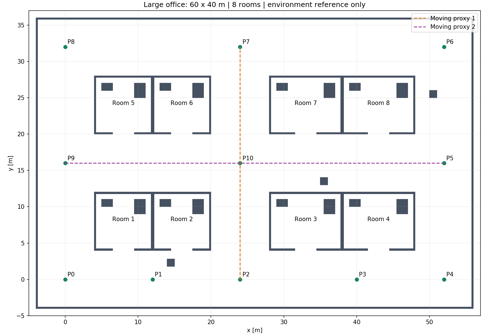

# 큰 실내 맵 — 논문 참고 설계와 검증 범위

**초기 맵 추가 기록 (2026-11-25). 이후 입력 계약·단계별 목표 보완은 [큰 맵 주행 문서](large-office-navigation.md)를 우선 참고한다.**
초기 버전은 시작 지점을 미확인으로 분류해 출발하지 못했다. 이후 입력 계약·SLAM 입력을 보완한 주행 결과는
위 후속 문서에 기록한다. 아래 초기 실패 기록을 최신 결과로 해석하지 않는다. RViz 렌더링 문제는 별도다.



위 그림은 **시뮬레이션 환경 설계도**다. 주행 노드에 주는 정답 지도나 계획 경로가 아니다.
녹색 P0~P10은 평가 위치이며 자동 waypoint 미션으로 연결되지 않는다.

## 논문에서 참고한 것

| 연구 | 원본의 특징 | 이번 설계에 적용한 점 |
|---|---|---|
| [HouseExpo, IROS 2020](https://arxiv.org/abs/1903.09845) / [저자 코드](https://github.com/TeaganLi/HouseExpo) | 다수의 방을 가진 2D 실내 평면도와 탐색 실험 | 여러 방·문·복도, 아직 보이지 않는 구역을 포함하는 공간 구성 |
| [BARN: Benchmarking Metric Ground Navigation](https://arxiv.org/abs/2008.13315) / [공식 데이터](https://www.cs.utexas.edu/~xiao/BARN/BARN.html) | 장애물 밀도와 기하 난이도가 다른 navigation 환경 | 복도·가구·카트의 난이도를 분리해 평가하고 충돌·성공률을 기록하는 방식 |
| [DynaBARN, SSRR 2022](https://www.cs.utexas.edu/~xiao/papers/dynabarn.pdf) / [저자 코드](https://github.com/aninair1905/DynaBARN) | 서로 다른 이동 특성을 가진 동적 장애물 시험 | 센서 관측에 나타나는 이동 장애물과 정적인 맵 구조를 구분 |

**논문 원본 맵을 복사하거나 동일 벤치마크를 재현한 것이 아니다.** 위 특성을 참고해 팀 차량에 맞춰
새로 작성했다. HouseExpo의 학습 알고리즘이나 Pseudo-SLAM을 사용하지 않고 기존 규칙 기반 인식·실제 slam_toolbox를 유지한다.
BARN의 소형 차동구동 로봇용 좁은 배치를 그대로 쓰면 Ackermann 차량의 회전 제약과 맞지 않을 수 있어
순환 복도 폭에 여유를 두었다. 그렇더라도 곡률 제약을 만족하는 경로가 있다는 검증은 별도로 필요하다.

## 맵 구성

- 경계: x=-4~56 m, y=-4~36 m. **60×40 m, 2,400 m²**.
- 방 8개, 가구 16개, 카트 3개. 벽을 포함한 정적 직사각형 63개.
- 주요 복도 명목 폭 8 m, 문 개구부 3 m. 벽 두께·가구·차체·안전 여유만큼 실제 통과 폭은 줄어든다.
- 외곽 순환로와 중앙 십자 복도. 긴 직선·교차로·방 진입·loop closure 평가에 사용할 수 있다.
- 두 이동 장애물: 중앙 세로 복도 0.5 m/s, 중앙 가로 복도 0.6 m/s 왕복.
  일정 경로를 따르는 사각형 대용 모델이며 사람의 반응·상호 회피 모델은 아니다.
- 가상 LiDAR 범위는 기존 **15 m** 그대로다. 큰 맵을 한 번에 보도록 센서 범위를 늘리지 않았다.
  이는 실물 A2M4-R2의 검증된 유효 거리라는 뜻이 아니다.
- `large_office`는 `sensor_only=true`에서만 허용한다. 정답 occupancy map 발행 경로로 실행하려 하면 거부한다.

파일 책임:

- `mrider_navigation_sim/large_office.py`: 방·복도·가구·평가 위치·이동 장애물 생성.
- `geometry.py`: `large_office` 시나리오 선택.
- `synthetic_camera.py`: 기존 합성 영상 생성기를 분리해 런타임과 오프라인 진단에서 동일하게 사용.
- `world.py`: 큰 맵에서 scan/RGB를 생성. 환경 기하를 perception 노드로 직접 전달하지 않는다.
- `launch/large_office_demo.launch.py`: 기존 sensor-only stack 연결. RViz 및 자동 재개 기본 비활성화.
- `test/test_large_office.py`: 기하·연결성·이동체·센서 범위·렌더러 회귀·미확인 정지 검사.
- `tools/ros2/render_large_office.py`: 설계도 PNG/SVG와 시작 위치 perception 진단 생성. ROS를 실행하지 않는다.

## 초기 구현에서 확인된 한계 (보완 전)

시작 위치 `(0,0,0)`에서 합성 RGB와 360개 scan 광선을 기존 분할기에 넣었다.
그 결과 무반사/최대 범위 광선 58개, 전방 ROI 바닥 후보 16.11%, 미확인 83.89%,
`clear=false`, `reason=unknown_region`이었다.
따라서 현재 규칙에서는 arm이 `camera_not_ready`로 거부될 수 있다.
이 결과를 숨기기 위해 미확인 영역을 통행 가능으로 바꾸거나 센서를 무한 거리로 만들지 않았다.

다음 구현은 유효한 자유 공간 관측과 센서 고장/무반사를 구분하는 입력 계약,
큰 공간의 바닥 후보 판정, 부분 지도 내 단계별 목표 선택이다.
전체 맵의 먼 목표를 처음부터 줄 경우 아직 SLAM 지도가 없어 경로 계획도 실패할 수 있다.
평가용 설계도나 P0~P10을 정답 경로로 주행기에 넣는 방식으로 해결하지 않는다.

## 재현

시뮬레이션이나 RViz를 켜지 않고 호스트에서:

```bash
cd ~/mrider-team
python3 tools/ros2/render_large_office.py
PYTHONPATH=ros2_ws/src/mrider_navigation_sim python3 -m pytest -q \
  ros2_ws/src/mrider_navigation_sim/test/test_large_office.py \
  ros2_ws/src/mrider_navigation_sim/test/test_indoor.py \
  ros2_ws/src/mrider_navigation_sim/test/test_segmentation.py
```

Python 의존성은 numpy, opencv, matplotlib, pytest다.
Docker에서 빌드하려면:

```bash
docker exec -it ros2_humble bash
cd /root/mrider-team
source ros2_ws/setup_env.sh
source ros2_ws/install-docker/setup.bash
cd ros2_ws
colcon --log-base log-docker build --build-base build-docker --install-base install-docker \
  --symlink-install --packages-select mrider_navigation_sim --cmake-args -DBUILD_TESTING=ON
source install-docker/setup.bash
```

아래는 **사용자가 나중에 환경을 직접 실행할 때의 명령**이다. 이번 작업에서는 실행하지 않았다.

```bash
export ROS_DOMAIN_ID=192
ros2 launch mrider_navigation_sim large_office_demo.launch.py vehicle:=1 rviz:=false
```

기존 demo가 같은 domain에서 실행 중이면 함께 실행하지 않는다.
RViz 기본값은 false이며 GUI 안정화 완료를 주장하지 않는다. 자동 주행 시작 명령도 보내지 않는다.

## 평가 계획

| 단계 | 확인할 값 | 현재 상태 |
|---|---|---|
| 기하 | 경계, 8개 방, 0.65 m 팽창 후 평가 위치 연결, 이동체-벽 충돌 | 오프라인 통과 |
| 인식 | 긴 무반사 구간, 그림자/색 변화, 미확인 오판 | 시작 위치의 보수적 출발 거부 확인 |
| SLAM | 부분 지도 확대, 장거리 drift, loop closure | 큰 맵에서 미검증 |
| 계획/제어 | 90도 좌우회전, 긴 경로, 방 진입, Ackermann 곡률 | 큰 맵에서 미검증 |
| 동적 장애물 | 충돌률, 정지 시간, 재개 조건 | 큰 맵에서 미검증 |
| 반복성 | 출발/목표/장애물 위상을 바꾼 성공률과 CPU 지연 | 미검증 |

이전 작은 맵의 목표 도달/83개 시험 통과를 큰 맵의 주행 성공 결과로 옮겨 쓰지 않는다.


## 이번 실행 결과 (2026-11-25 KST)

- 호스트 오프라인 시험 **29개 통과**: 큰 맵 8, 기존 실내 기하 8, 분할 13.
- ROS 2 Humble Docker 패키지 **빌드 성공**, 같은 세 시험 묶음 **29개 통과**, 실패/skip 0.
- [Docker 빌드·시험 로그와 XML](build/evidence/large-office-2026-11-25/docker/).
- [호스트 시험 로그](build/evidence/large-office-2026-11-25/unit.log), [XML](build/evidence/large-office-2026-11-25/unit.xml).
- [시작 위치 오프라인 진단 JSON](build/evidence/large-office-2026-11-25/offline.json).
- 호스트 NumPy에서는 지면과 교차하지 않는 영상 광선의 NaN 비교 경고가 기록됐다. 해당 영역은 미확인으로 남으며, 시험 실패는 없었다.
- ROS 주행 launch 및 RViz는 실행/재시작하지 않았다. 목표 도달 오차·완주 시간·성공률은 이번 작업에서 측정하지 않았다.
