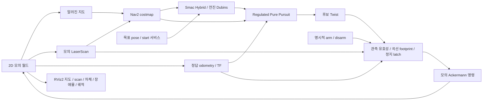

# 방향 A 센서·장애물 Navigation 시뮬레이션

건물 내부 지도와 움직이는 장애물은 [실내 동적 시뮬레이션 설명서](indoor-simulation-guide.md)를 참고하세요.

2026-11-17. ROS2 Humble에서 **실제 Nav2 Smac Hybrid + Regulated Pure Pursuit**를 실행한다.
모의 지도·360° LaserScan·정답 odometry·전진 자전거 모델을 연결하여 센서 없이 계획·우회·정지·재허가를 검사한다.
차량 제어 출력은 `/mrider_sim/*`이며 Teensy와 차량을 연결하지 않는다. 학습 모델·데이터·GPU는 필요하지 않다.

## 1. 무엇을 검증하는가



임무 노드는 Nav2 lifecycle의 ACTIVE를 확인한 뒤 `ComputePathToPose → FollowPath` action을 실행한다.
후진·제자리 회전·자동 recovery는 사용하지 않는다. 정적 장애물은 경로 계획으로 우회한다.
갑자기 생긴 장애물은 감속/정지하고 임무를 취소하며, 제거 후 **arm과 start를 다시 요청해야 재계획**한다.
현재 자동 주기 재계획이나 움직이는 장애물의 속도 예측은 구현하지 않았다.

`nav2_collision_monitor`를 실행한 것은 아니다. 이번에는 원본 scan·현재 속도·후보 곡률에 근거한 팀의 모의 안전 게이트를 사용한다.
Nav2 내부 costmap 충돌 검사와 별도로 곡선 주행 footprint를 검사하지만 물리적 안전 인증이나 실차 최종 게이트는 아니다.

## 2. 설치·빌드

[새 PC 설명서](new-pc-setup.md)의 Humble 설치 후 팀 checkout 루트에서 실행한다.
다른 주행 demo를 같은 도메인에서 동시에 실행하지 않는다.

```bash
source /opt/ros/humble/setup.bash
sudo apt-get install ros-humble-navigation2 ros-humble-nav2-bringup
cd ~/mrider-team/ros2_ws
rosdep install --from-paths src --ignore-src --rosdistro humble -r -y
colcon build --symlink-install --cmake-args -DBUILD_TESTING=ON
source install/setup.bash
export ROS_DOMAIN_ID=187
ros2 launch mrider_navigation_sim navigation_sim.launch.py scenario:=static_obstacle
```

디스플레이 없는 서버에서는 `rviz:=false`를 추가한다. 이 시뮬레이션은 Python 2D 월드에서 센서와 운동을 계산하며
Gazebo 센서/물리 엔진을 사용하는 구성은 아니다. 기존 Gazebo 위치 시각화는 [기본 시험](simulation-test-guide.md)에 별도로 남아 있다.
검증 화면과 알려진 첫 map 렌더링 경고는 [검증 기록](navigation-simulation-validation.md)의 RViz2 항목을 확인한다.
RViz2 Fixed Frame은 `map`이며 지도, 녹색 계획 경로, scan, 차체/누적 궤적, 장애물 마커를 표시한다.

## 3. 수동 목표 주행

새 터미널에도 동일한 Humble·팀 workspace·ROS_DOMAIN_ID 설정을 적용한다.
시작 시 DISARMED이므로 launch만으로 차량이 움직이지 않는다.

```bash
source /opt/ros/humble/setup.bash
source ~/mrider-team/ros2_ws/install/setup.bash
export ROS_DOMAIN_ID=187
ros2 service call /mrider_sim/arm std_srvs/srv/Trigger '{}'
ros2 service call /mrider_sim/start std_srvs/srv/Trigger '{}'
```

`arm`: 정상 scan/odom, 실제 모의 속도 정지, 가까운 장애물 없음 확인 후 READY.
`start`: 기본 목표 (8,0, yaw=0)로 계획/추종. `nav2_not_ready`면 lifecycle ACTIVE 이후 다시 요청한다.
RViz2의 Goal Pose(`/goal_pose`, map frame)로 다른 목표도 지정할 수 있다. 실행 중 임무 교체는 거절하며
STOPPED 또는 GOAL 이후 재허가와 새 목표를 사용한다. 도달 가능한 전진 곡률의 목표를 선택한다.

```bash
ros2 topic echo /mrider_sim/safety_state
ros2 topic echo /mrider_sim/mission_state
ros2 topic echo /mrider_sim/clearance
ros2 topic echo /mrider_sim/collision
ros2 service call /mrider_sim/disarm std_srvs/srv/Trigger '{}'
```

`/mrider_sim/candidate_cmd_vel`은 Nav2 후보이고 실제 모의 차량은 안전 게이트의 `/mrider_sim/command`만 구독한다.
모의 collision은 전체 차량 사각형과 장애물의 겹침을 정답 좌표로 검사하며, 한 번 충돌하면 true를 유지한다.
clearance는 원본 scan의 최근접 점이 아닌 정답 기하의 차체-장애물 최소 거리다.

## 4. 재현 가능한 자동 시나리오

각 케이스마다 이전 launch를 종료하고 새 월드로 시작한다. 자동 검사는 직접 arm/start 또는 고장 주입을 수행하므로
수동 임무와 동시에 실행하지 않는다. 아래 명령은 모두 모의 전용이다.

| launch | 다른 터미널의 검사 | 통과 조건 |
|---|---|---|
| `navigation_sim.launch.py scenario:=static_obstacle rviz:=false` | `ros2 run mrider_navigation_sim run_scenario navigation` | 장애물 우회, 위치 오차 ≤0.23m·yaw ≤0.25rad, 충돌 없음, 속도·조향 한계 |
| `navigation_sim.launch.py scenario:=blocked rviz:=false` | `ros2 run mrider_navigation_sim run_scenario blocked` | 계획 실패, STOPPED, 속도 명령 0 |
| `navigation_sim.launch.py scenario:=clear rviz:=false` | `ros2 run mrider_navigation_sim run_scenario recovery` | Nav2 주행 중 장애물 정지, 제거 후 정지 유지, 재허가·재계획 후 목표 도달 |
| `fault_test.launch.py` | `ros2 run mrider_navigation_sim run_scenario faults` | 8가지 고장·입력 복구 후 latch 유지, 재허가 필수, 충돌 없음 |

전체 자동 검증:

```bash
cd ~/mrider-team/ros2_ws
colcon test --executor sequential --ctest-args -j1 --output-on-failure
colcon test-result --verbose
```

Navigation launch 테스트는 DDS 도메인 201~204로 각각 격리한다. 해당 도메인을 다른 실험에 사용하지 않는다.
기존 제어 테스트도 함께 실행된다. 고장 8종은 하나의 통합 테스트 메서드 안에서 각각 검사하므로 테스트 개수와 케이스 수를 구분한다.
JSON 궤적/측정값이 필요하면 검사 실행 전에 `MRIDER_SIM_REPORT_DIR`를 출력 디렉터리로 설정한다.

## 5. 고장 주입과 판정

주행 중 다음 예제로 센서 중단을 확인한다. false 복구만으로 재출발하지 않아야 한다.

```bash
ros2 service call /mrider_sim/fault/scan_dropout std_srvs/srv/SetBool '{data: true}'
ros2 service call /mrider_sim/fault/scan_dropout std_srvs/srv/SetBool '{data: false}'
# 정지·정상 입력 확인 후에만 다시 허가하고 계획
ros2 service call /mrider_sim/arm std_srvs/srv/Trigger '{}'
ros2 service call /mrider_sim/start std_srvs/srv/Trigger '{}'
```

지원되는 서비스 suffix는 `scan_dropout`, `scan_bad_frame`, `scan_future`, `scan_nan`,
`odom_bad_frame`, `odom_dropout`, `dynamic_obstacle`다. 동적 장애물은 호출 당시 차량 전방 1.5m에 정적 상자를 갑자기 추가한다.
움직이는 보행자 모델이 아니다. `command_dropout`은 fault_test 검증기가 후보 명령 발행을 끊어 검사한다.
단위 시험에는 반복 timestamp, 빈/부분 scan, Inf, 역행/정지 clock, 불가능한 곡률·제자리 회전도 포함한다.

사전 판정: 중단 감지 <0.6s, 잘못된 frame/시각/NaN 감지 <0.3s, 갑작스러운 장애물 감지 <0.8s,
고장 주입 시점부터 정지까지 모의 이동 거리 <0.4m. 모든 경우 입력 정상화만으로 재출발 금지.
이 한계는 아래 가상 속도·제동 모델에서의 테스트 기준이며 실차 허용값이 아니다.

## 6. 가상 파라미터·제약

[simulation.yaml](../ros2_ws/src/mrider_navigation_sim/config/simulation.yaml)은 축거 0.65m, 최대 속도 0.5m/s,
조향 0.3927rad, 후륜축에서 전방 0.9m/후방 0.2m·반폭 0.3m footprint,
여유 0.15m, 제동 감속도 0.8m/s², 지연 예산 0.25s, 입력 timeout 0.35s를 정의한다.
모의 조향 변화율은 0.7rad/s다. 실측값이 아니며 설정은 시작 시 읽는다.
Nav2 설정은 [nav2.yaml](../ros2_ws/src/mrider_navigation_sim/config/nav2.yaml)이며
전진 Dubins 최소 반경 2.2m, 회전/후진 비활성화, footprint/inflation을 사용한다.
기하·한계를 바꾸면 두 설정의 일치를 테스트하고 재검증해야 한다.

안전 게이트는 현재 속도와 요청 속도의 큰 값으로 `v×지연 + v²/(2×감속도)`를 계산하고,
후보/현재 곡률의 궤적을 0.04m 이하 간격으로 표본화하여 확장 footprint와 scan 끝점을 검사한다.
scan은 이상적인 360 ray, 10Hz, 최대 15m 모델이다. **A2M4-R2 실물 사양이나 실제 탐지율을 재현한 것은 아니다.**
NaN/Inf/부분 scan을 엄격히 거절하므로 실제 A2의 no-return 표현은 별도 어댑터와 센서 검증이 필요하다.

## 7. 검증하지 않는 항목

SLAM/EKF 정확도(정답 pose 사용), 카메라 영상/인지, 실제 LiDAR 노이즈·재질·사각지대,
접촉/타이어/노면 물리, Teensy/USB/firmware/RC/E-stop, 실차 제동·조향 지연은 검증하지 않는다.
이번 시험은 Plan A의 소프트웨어 연결·규칙·장애물 시나리오 근거다.
실행 결과는 [Navigation 검증 기록](navigation-simulation-validation.md), 실차 전환은 [실환경 시험](real-world-test-guide.md)을 따른다.
