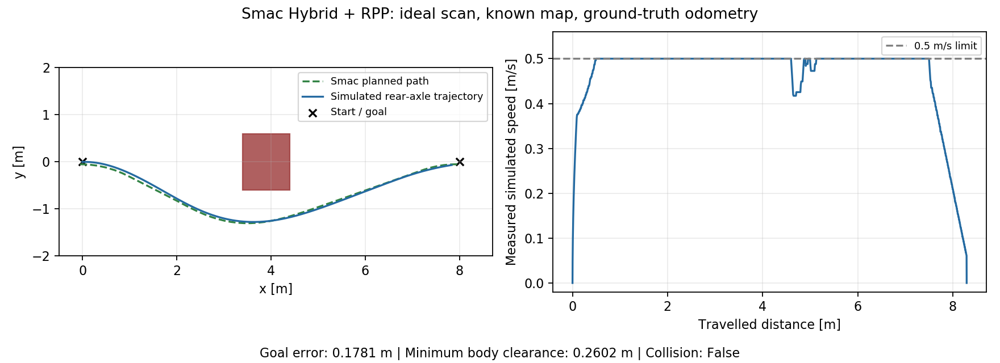
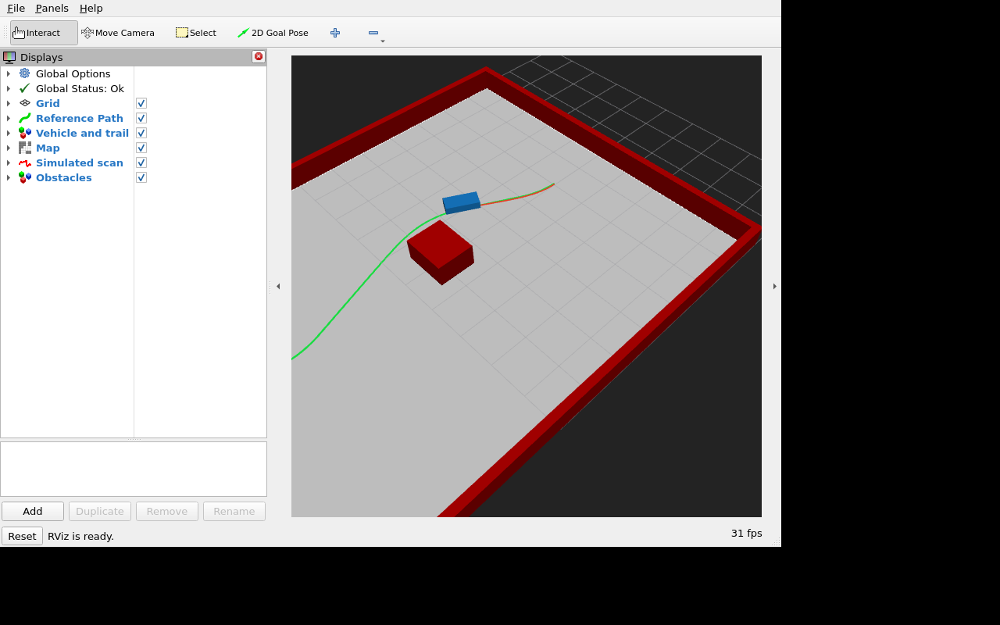

# 방향 A 센서 시뮬레이션 검증 — 2026-11-17

이 문서는 실내 확장 전 결과다. 후속 전체 회귀·실내 시험은 [실내 검증 기록](indoor-simulation-validation.md)을 참고한다.

실행 환경: Ubuntu 22.04 / ROS2 Humble Docker. Nav2 `1.1.20`의 Smac Hybrid(Dubins 전진)와 RPP를 실제 실행했다.
호스트 설치·개인 Lab·실차·Teensy는 변경하거나 연결하지 않았다.
설치와 명령은 [센서 시뮬레이션 설명서](navigation-simulation-guide.md)를 따른다.

## 시험 수와 결과

| 범위 | 개별 테스트 | 결과 |
|---|---:|---|
| 기존 ROS2 제어·경계·실토픽·종료 회귀 | 45 | PASS |
| 새 안전·기하·설정 일치 단위 시험 | 30 | PASS |
| Nav2 우회 / 막힘 / 장애물 복구 / 고장 8종 | 4 | PASS |
| 위 launch의 정상 종료 | 4 | PASS |
| **합계** | **83** | **오류·실패·skip 0** |

`colcon test-result`는 실행 wrapper 11개를 포함해 **94 tests, 0 errors, 0 failures, 0 skipped**다.
고장 8종은 통합 메서드 1개에 포함되므로 8개 메서드로 중복 집계하지 않는다.
기존 회귀는 공통 노드 종료 처리 변경 후 실행했고, 새 패키지는 이후 상태 수신·DDS 시험 격리 수정을 포함해 재실행했다.
두 패키지의 최종 XML은 [결과 디렉터리](build/evidence/legacy-results/navigation/)에 함께 보관했다.

## 목표 주행·장애물 시험

| 시나리오 | 실제 결과 | 판정 |
|---|---|---|
| 정적 장애물 우회 | 목표 위치 오차 **0.178059m**, yaw **0.159163rad** | PASS |
| 차체 여유 거리 | 최소 **0.260231m**, 충돌 false | PASS |
| 우회 경로 | 계획 경로 최대 좌우 편차 **1.303450m** | PASS |
| 조향 한계 | 최대 절대 조향 **0.375709rad** | PASS |
| 막힌 경로 | Smac 계획 실패, STOPPED, 속도 명령 0m/s | PASS |
| Nav2 주행 중 갑작스러운 장애물 | 정지·임무 취소, 제거 후 자동 재출발 없음 | PASS |
| 재허가·재계획 후 목표 도달 | 위치 오차 **0.174392m**, 최소 여유 **0.278298m**, 충돌 false | PASS |

최종 목표 위치 오차 기준은 0.23m, yaw 기준은 0.25rad, 속도 0.5m/s·조향 0.3927rad 기준이다.
Nav2 경로 끝점 허용 오차와 차량 감속 모델을 포함한 최종 pose를 별도로 측정한다.
재계획은 운영자 재허가 후 수행하며 자율적인 장애물 추적/주기 재계획 성공을 주장하지 않는다.



그림은 [측정 JSON](build/evidence/legacy-results/navigation/navigation.json)의 실제 계획 경로·정답 rear-axle 궤적·모의 측정 속도로 생성했다.
[재생성 스크립트](../tools/ros2/plot_navigation.py)는 matplotlib만 필요하며 ROS 없이 실행한다.

```bash
python3 tools/ros2/plot_navigation.py docs/build/evidence/legacy-results/navigation/navigation.json /tmp/navigation-trajectory.png
```

## 고장 주입·정지·복구

감지 시간은 고장 요청 시작부터 STOPPED 상태 수신까지, 이동 거리는 요청 당시 pose부터 정지 pose까지 측정했다.
모의 odometry 중단은 정지 후 토픽을 복구해 최종 pose를 읽었다. 물리적 실차 계측이 아니다.

| 고장 | 감지 시간(s) | 정지까지 이동(m) | 판정 |
|---|---:|---:|---|
| scan_dropout | 0.3483 | 0.2204 | PASS |
| scan_bad_frame | 0.0264 | 0.0490 | PASS |
| scan_future | 0.0678 | 0.0720 | PASS |
| scan_nan | 0.0271 | 0.0489 | PASS |
| odom_bad_frame | 0.0276 | 0.0493 | PASS |
| odom_dropout | 0.3671 | 0.2282 | PASS |
| command_dropout | 0.3481 | 0.2206 | PASS |
| dynamic_obstacle | 0.1712 | 0.0721 | PASS |

최대 감지 시간 **0.3671s**, 최대 이동 거리 **0.2282m**다.
각 시험은 입력을 복구하고 후보 명령을 다시 발행해도 STOPPED·속도 0이 유지됨을 검사했다.
재허가로만 다음 주행을 시작했으며 모든 케이스에서 collision=false였다.
[전체 고장 측정값](build/evidence/legacy-results/navigation/faults.json), [Nav2 장애물 복구 측정값](build/evidence/legacy-results/navigation/recovery.json).

## 수정 후 확인한 문제

- Action 서버 발견만으로 Nav2 준비를 판단하던 시작 순서 문제: 두 lifecycle 노드 ACTIVE 확인 후 계획하도록 수정.
- DDS callback 도중 Python 예외로 종료하면 handle 정리가 막힐 수 있는 문제: 신호는 이벤트만 설정하고 callback 완료 후 executor/node/context 순서로 종료.
- 복구 시 이전 STOPPED 메시지로 새 임무를 잘못 판정하던 검사: 새 임무 상태 수신을 기다리도록 수정.
- 연속 테스트의 DDS endpoint 잔존: 새 launch 시험을 각각 도메인 201~204로 격리하고 publisher/센서 준비를 확인.
- 목표 정지의 가감속 오차: Nav2 goal checker 허용 거리를 0.12m로 설정하고 최종 측정 pose 기준 0.23m를 별도 검사.

테스트는 최종 명령 publisher가 `mrider_safety_gate` 하나임을 검사한다.
이는 모의 launch 구성 검사이며 악의적인 publisher를 차단하는 DDS 보안 기능은 아니다.

## 한계와 후속 단계

모의 모델은 360 ray/10Hz·이상적 반사·알려진 지도·정답 pose·정해진 가감속 모델이다.
A2M4-R2 실물 특성·재질·작은 장애물 누락·SLAM/EKF 정확도·카메라·물리적 접촉·Teensy/DBW/RC/E-stop은 NOT RUN이다.
곡률별 footprint와 beam 끝점을 표본화하므로 실제 연속 공간 충돌 방지 보증으로 사용할 수 없다.
다음 단계는 실제 센서 bag replay와 위치 추정, 최종 권한/DBW 게이트를 연결하고 동일한 고장·정지 시험을 반복하는 것이다.

## RViz2 확인

Xvfb에서 실제 Nav2 주행을 시작하고 RViz2의 지도·차량·장애물·계획/추종 경로와 Goal Pose 도구를 화면으로 확인했다.
종료 순서를 지켜 launch와 각 노드가 정상 종료했으며 `VISUAL_SMOKE_EXIT 0`을 확인했다.



첫 map 수신에서 GLSL sampler 경고가 발생했다. [RViz upstream 이슈](https://github.com/ros2/rviz/issues/463)와 같은 문구이며,
이번 캡처에서는 지도가 실제 렌더링되는 것을 확인했다. 해당 경고가 해결되었다고 주장하지 않는다.
팀원 PC의 실제 GPU/디스플레이 확인은 별도로 필요하다.

## 문서·코드 정적 검사

Markdown 26개, 로컬 링크 175개, Bash 예제 48개 구문 및 코드 블록 검사 PASS.
ROS2 Python AST·package.xml 구문과 git diff --check를 통과했다.
