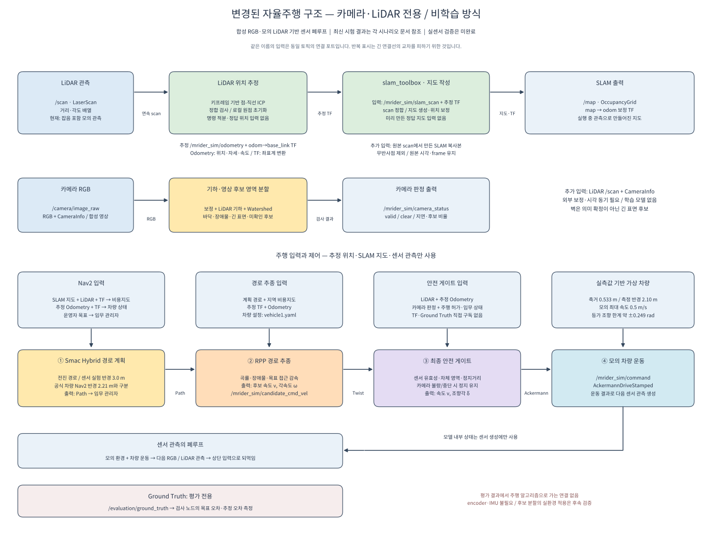
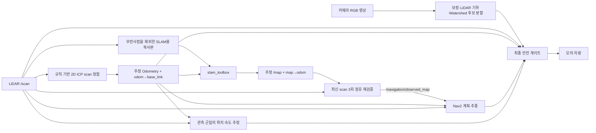

# 카메라·LiDAR만 사용하는 규칙 기반 Navigation

> 2026-11-25 변경: 회색 바닥 비율 검사를 [보정·LiDAR 기하·Watershed 후보 영역 분할](classical-perception.md)로 교체했다. 하단 11/23 기록은 당시 검증 이력이다. 현행 전체 구성은 [아키텍처](architecture.md), 장거리 변경·검증은 [대형 맵 주행](large-office-navigation.md)을 따른다.

> **현재 실험 상태:** 조향 제약·목표 처리 변경 후의 성공/실패와 미해결 문제는 [시행착오 기록](experiment-log.md)에 누적한다.

> **이전 SLAM 수정:** 반복되는 SLAM odometry 경고의 원인이었던 scan 헤더 공유 버그를 수정했다.
> [TF 수정·재현 명령·이번 검증](#slam-tf-fix): 11개 회귀 검사 PASS, 네 SLAM 실행에서 해당 경고 0회.

## 확정 요구사항

사용 센서는 카메라와 RPLiDAR A2M4-R2다. encoder·IMU·학습 모델을 입력으로 요구하지 않는다.
Ground Truth 지도·위치·속도를 제어 입력으로 쓰지 않는다. 시뮬레이터 내부 물리 상태와
평가용 정답을 사용하는 것과, 주행 알고리즘에 정답을 공급하는 것을 구분한다.

기존 `indoor_demo`와 `turns_demo`, 동영상, `indoor-navigation-pipeline.svg`는 **알려진 지도·정답 위치 조건의 이전 기준 시험**이다.
아래 센서 전용 경로의 성공 근거로 사용하면 안 된다.

## 새로 구현한 경로

기본 센서 경로의 입력 연결 그림(키프레임·SLAM 복사본 반영, 대형 맵 지역 목표는 별도 설명):



[PDF](figures/sensor-only-navigation-pipeline.pdf) · [PNG](figures/sensor-only-navigation-pipeline.png) · [생성 코드](../tools/ros2/render_sensor_architecture.py)

위 SVG/PDF는 11/25 기본 주행·카메라 중단 검증 당시 연결이다. 11/27 추가한 지도·costmap 재검증, 이동 군집 예측, 영상·scan 수신 버퍼와 조건부 경로 재개는 아래 흐름 및 [현행 아키텍처](architecture.md)를 따른다. 같은 이름의 입력은 동일 ROS 토픽을 받는 연결 포트다.




- `sensor_core.py`: scan-to-keyframe 점-직선 ICP와 SLAM용 무반사점 제외. 학습 가중치 없음.
- `sensor_nodes.py`: `/scan`만으로 odometry 생성. 첫 유효 scan의 위치를 로컬 원점으로 정의한다. 실제 정답 위치로 초기화하지 않는다.
- `slam_toolbox`: SLAM 전용 scan 복사본과 추정 odom TF로 지도·위치 보정 생성. 미리 만든 지도 파일 없음.
- `observed_map.py`: 원본 SLAM 지도는 보존하고 최신 scan 3회에서 빈 공간으로 확인된 셀을 별도 navigation 지도에 갱신한다. 반사점 뒤나 미관측 공간을 임의로 지우지 않는다.
- `ObservedObstacleLayer`: 같은 세 scan의 자유 공간 근거로 Nav2 장애물 층에 남은 과거 점유만 재검증한다. 현재 scan의 새 장애물 표시와 정적 층·inflation은 계속 적용한다.
- `moving_obstacles.py`: 추정 odom에서 관측 군집을 추적하고, 일정 속도 예측과 후보 명령의 차체가 겹치면 안전 게이트가 더 일찍 정지한다. 물체의 정답 위치나 행동 스크립트는 읽지 않는다.
- `CameraRules`: `/camera/image_raw`·CameraInfo·동기화된 scan으로 바닥/벽/장애물 후보·미확인 영역을 분할한다. RGB로 절대 거리를 추론하지 않는다.
- `SafetyNode(require_camera=true)`: 카메라 불량·중단·통행 불가 판정은 정지 latch. 복구 후 수동 재허가 필요.
- `world.py(sensor_only=true)`: 제어용 지도와 odom TF 발행 중지. 정답은 `/evaluation/ground_truth`에만 발행.
- `sensor_only_demo.launch.py`: 위 노드들과 Nav2·안전 게이트 연결. 기존 GT 기준 launch와 별도다.

시뮬레이션의 카메라는 단순 RGB 투영이며 실제 영상의 그림자·조명·노면 변화를 재현하지 않는다.
바닥 후보는 보정된 지면 기하와 색상 근거로 판정하며 실환경 의미 분할의 성능을 보장하지 않는다. 실제 카메라 모델·내외부 보정·영상 데이터가 없어
실환경 perception 검증은 진행하지 못했다. 카메라는 통행 검사에 참여하지만 visual odometry를 계산하지 않는다.
ICP는 특징이 부족한 긴 복도·이동 물체에 취약하다. 잔차 검사만으로 모든 퇴화를 검출할 수 없으며,
실사용 전 정합 신뢰도·장시간 드리프트·재위치추정 검증이 필요하다. scan 중단으로 추정이 끊기면 정답으로 대체하지 않는다.

## 실행 및 검사

컨테이너의 `/root/mrider-team`에서:

```bash
source ros2_ws/setup_env.sh
cd ros2_ws
colcon --log-base log-docker build --build-base build-docker --install-base install-docker \
  --symlink-install --packages-select mrider_navigation_sim --cmake-args -DBUILD_TESTING=ON
source install-docker/setup.bash
export ROS_DOMAIN_ID=192
ros2 launch mrider_navigation_sim sensor_only_demo.launch.py vehicle:=1 rviz:=false
```

다른 터미널에서도 같은 환경과 domain을 사용한다. 자동 시험은 domain 212에서 독립 실행하므로 수동 demo를 먼저 종료한다.

```bash
export MRIDER_SIM_REPORT_DIR=/root/mrider-team/docs/build/evidence/sensor-only-2026-11-23
colcon --log-base log-docker test --build-base build-docker --install-base install-docker \
  --packages-select mrider_navigation_sim --event-handlers console_direct+ \
  --ctest-args -R 'test_sensor_only_launch|sensor_core|safety|indoor_geometry' --output-on-failure
```

시험은 `/map`의 발행자가 SLAM인지, odometry 발행자가 LiDAR estimator인지,
정답 토픽을 평가 노드만 구독하는지 확인한다. 이어 목표 주행·실제 정답 대비 오차·카메라 중단 정지를 검사한다.
주행 노드에 GT 구독이 없다는 검사만으로 주행 성능까지 통과했다고 간주하지 않는다.


<a id="slam-tf-fix"></a>

## SLAM `Failed to compute odom pose` 수정 — 2026-11-25

이 경고가 반복되면 scan 시각의 `odom→base_link` 조회가 실패한 것이므로 정상 상태로 간주하지 않는다.
이번 원인은 `sensor_nodes.py`에서 `out.header = msg.header`로 객체를 공유한 뒤 odometry의 frame을
`odom`으로 바꾸면서 **SLAM에 전달할 scan의 frame까지 `laser`에서 `odom`으로 바뀐 것**이다.
원본 `/scan` 발행자의 메시지가 바뀐 것은 아니지만, 수신 콜백 내부와 SLAM용 복사본의 헤더가 오염됐다.
SLAM의 `odom←scan_frame` 대기 필터가 `odom←odom` 조건을 바로 통과해,
동적 TF가 도착하기 전에 scan 시각의 차량 자세를 조회할 수 있었다.

odometry 헤더를 독립적으로 복사하도록 수정했다. 원본 scan과 SLAM 복사본은 `laser`,
odometry와 동적 TF는 `odom→base_link`를 사용하며 모두 **동일한 원본 scan 시각**을 유지한다.
타임스탬프를 현재 시각으로 덮어쓰거나 임의 TF·Ground Truth로 대체하지 않는다.
SLAM의 TF 대기 시간과 안전 게이트의 입력 지연 한계도 변경하지 않았다.

근거: 설치된 `slam_toolbox 2.6.10`의 `get_pose_helper.hpp`와
[공식 SLAM 입력 TF 필터](https://github.com/SteveMacenski/slam_toolbox/blob/humble/src/slam_toolbox_common.cpp).

새 회귀 검사는 원본 메시지 불변성, frame·나노초 timestamp 보존, 잘못된 frame 거부를 검사한다.
별도 ROS launch 검사는 실제 SLAM 지도 생성과 50개 이상의 scan, scan 시각 TF 조회,
SLAM 프로세스의 해당 경고 부재·정상 종료를 확인한다. GUI 없이 실행하며 주행 허가를 보내지 않는다.

```bash
# Docker의 /root/mrider-team/ros2_ws, 환경 source와 build 후
colcon --log-base log-docker test --build-base build-docker --install-base install-docker \
  --packages-select mrider_navigation_sim --event-handlers console_direct+ \
  --ctest-args -R '^sensor_messages$|test_sensor_tf_launch' -j1 --output-on-failure
```

실행 중인 노드를 확인할 때는 같은 domain에서 다음을 본다.

```bash
ros2 topic echo /mrider_sim/slam_scan --once --field header
# frame_id: laser 여야 한다.
ros2 topic echo /mrider_sim/estimator_status
# valid: true인지 확인한다. scan_gap 등 실패 시각도 함께 확인한다.
```

수정은 다시 실행한 노드부터 적용된다. 오래 실행 중인 Python 프로세스에는 파일 변경이 자동 적용되지 않는다.
GUI를 반복 재시작하는 조치는 이 헤더 오류를 해결하지 않는다.

이번 실행 결과:

- 사용자 실행의 [SLAM 로그](build/evidence/slam-tf-2026-11-25/before/user-slam.log)에서 해당 경고 **73회**를 확인했다.
- 수정 전 새 메시지 검사는 원본 scan 변경 assertion에서 실패했다. [실패 로그](build/evidence/slam-tf-2026-11-25/before/messages.log).
- Docker 재빌드 성공. 수정 후 **11개 PASS, 실패·오류·skip 0**: 메시지 2개, TF launch 3개,
  기본·대형·좌우 주행 및 종료 6개. CTest wrapper 5개를 다시 합산하지 않았다.
- 실제 SLAM TF 시험: scan 50개 수신, 원본 scan·odom과 시각이 일치하는 48개에서 TF 조회 성공, 지도 10개 수신.
- 위 TF 시험과 세 주행 시험의 **SLAM 실행 네 번에서 `Failed to compute odom pose` 0회**.
  다른 원인의 모든 경고나 모든 부하에서의 무고장을 보장한다는 뜻은 아니다.

| 주행 회귀 시험 | 수정 후 측정값 |
|---|---|
| 대형 맵 24 m | GOAL 오차 **0.120646 m**, 5단계 목표, 충돌 없음 |
| 좌우 우회·횡단 | GOAL 오차 **0.120968 m**, 자동 재개 **13.194864 s**, 최소 이격 **0.568735 m**, 충돌 없음 |
| 기본 8 m | GOAL 오차 `<0.5 m` assertion 통과; 정확한 GOAL 수치 미저장 |
| 세 주행의 카메라 중단·복구 | 정지 latch 유지 |

고장 주입 뒤 최종 목표 거리는 대형/좌우/기본 각각 0.212513 / 0.178397 / 0.102434 m이며,
GOAL 순간의 오차와 구분한다. 이전 115개 시험은 헤더 수정 전 기록이다. 이번에는 이 변경에 직접 관련된
11개를 실행했으며 전체 단위 시험을 다시 실행했다고 합산하지 않는다. GUI·실센서·실차 검증은 남아 있다.

[이번 집계](build/evidence/slam-tf-2026-11-25/after/summary.json),
[XML](build/evidence/slam-tf-2026-11-25/after/xml/),
[전체 테스트 로그](build/evidence/slam-tf-2026-11-25/after/tests.log),
[빌드 로그](build/evidence/slam-tf-2026-11-25/after/build.log),
[코드 SHA256](build/evidence/slam-tf-2026-11-25/after/source-sha256.json).

## 검증 기록

첫 실행은 안전 게이트의 `untrackable_curvature` 정지로 목표 도달에 실패했다.
[첫 실행 JSON](build/evidence/sensor-only-2026-11-23/first-run/sensor_only.json)과
[로그](build/evidence/sensor-only-2026-11-23/first-run/launch.log)를 보존했다.
안전 한계는 유지하고 센서 전용 Nav2의 계획 반경을 3.0 m, lookahead를 1.5 m로 조정했다.


두 번째 시험에서는 Nav2가 GOAL을 보고했으나 실제 목표 오차 약 1.254 m로 실패했다.
[두 번째 기록](build/evidence/sensor-only-2026-11-23/second-run/sensor_only.json)을 보존했다.
복도 벽의 점 샘플 정합에 따른 이동량 편향을 줄이기 위해 점-직선 ICP로 변경했다.
동일 scan에서 대응점이 사라지는 수치 오류와 map 목표를 odom 좌표에 직접 비교하던 검사도 수정했다.

최종 실행:

- 패키지 빌드 성공. 센서 코어 시험 **5개**, ROS 주행·종료 시험 **2개**, 총 **7개 PASS**.
- 앞선 같은 작업의 안전 시험 35개·실내 기하 시험 7개도 PASS. 저장소 전체 CI 통과를 뜻하지 않는다.
- `/map` 발행자는 `slam_toolbox`, 주행 odometry 발행자는 `laser_odometry`임을 검사했다.
- `/evaluation/ground_truth`의 구독자는 검사 노드뿐이며 제어 노드에는 전달되지 않는다.
- 정지 시 실제 목표 오차 `<0.5 m`를 평가 노드에서 검사하고 통과했다.
- 이후 별도 후보 명령을 주입해 다시 움직인 뒤 카메라 중단을 주입했고, 정지·입력 복구 후 latch 유지를 검사했다.
- **고장 시험까지 마친 최종 위치**의 목표 거리 0.104749 m, raw odometry 위치 오차 0.202983 m.
  이는 최초 GOAL 순간의 오차와 구분한다. 정답은 이 측정에만 사용했다.
- [최종 JSON](build/evidence/sensor-only-2026-11-23/final-run/sensor_only.json),
  [실행 로그](build/evidence/sensor-only-2026-11-23/final-run/launch.log),
  [ROS 시험 XML](build/evidence/sensor-only-2026-11-23/final-run/test_test_sensor_only_launch.py.xunit.xml),
  [코어 시험 XML](build/evidence/sensor-only-2026-11-23/final-run/sensor_core.xunit.xml).

**당시 남은 검증:** 센서 전용 좌·우 우회+횡단 자동 재개, 긴 복도의 위치 추정 퇴화·장시간 드리프트,
SLAM loop closure, 조명 변화·바닥 색상 변화, 실카메라·A2M4-R2의 시간 동기·잡음·누락값,
실차 TF 보정·Teensy 통신·제동거리. 기존 GT 시험의 PASS를 이 항목으로 이전하지 않는다.

## Vehicle 1 실측값 사용

`ros2 launch mrider_navigation_sim sensor_only_demo.launch.py vehicle:=1`로 실측 overlay를 읽는다. 기본 `vehicle:=0`은 이전 가상 제원 비교용이다. 공식 Nav2의 2.21 m 반경과 센서 실험의 보수적인 3.0 m 반경, 검증 결과는 [반영 기록](build/vehicle1-measurements-2026-11-23.md)에 구분했다.

## 이후 작동 재확인: 실패

2026-11-23 사용자 요청으로 같은 vehicle1 기본 목표 주행을 다시 실행했다.
목표 1.957882 m 전방에서 `camera_blocked_or_stale` 정지로 실패했다.
이전 PASS만으로 반복 실행 안정성이 검증됐다고 볼 수 없다.
[이번 실패 근거](build/evidence/operation-check-2026-11-23/README.md)를 참조한다.
카메라 실제 판정·원본 시각·수신 경과를 구분해 기록하는 진단 보완이 필요하다.
