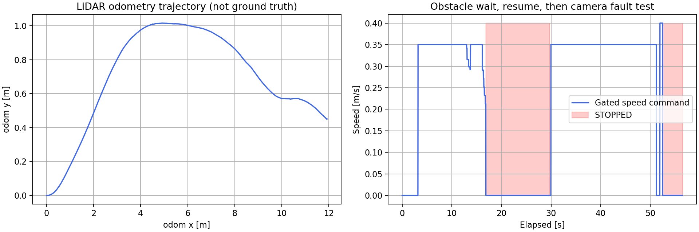

# 센서 기반 좌우 우회·보행자 정지·자동 재개 시험

> **2026-11-25 장거리 보완 후 회귀 검증:** 도착 오차 0.110664 m, 자동 재개 13.224152 s,
> 최소 이격 0.564426 m, 양방향 조향·충돌 없음·카메라 고장 latch PASS.
> [현행 결과와 원본](large-office-navigation.md#validation-2026-11-25)을 우선 확인한다.
> 하단의 이전 측정값은 당시 코드의 결과로 유지한다.

이 시험은 카메라·LiDAR 관측에서 위치와 지도를 추정한다. 학습 모델, 정답 지도, 정답 위치를
주행 입력으로 사용하지 않는다. `/evaluation/ground_truth`는 검사 노드에서 오차·실제 회전을 측정할 때만 사용한다.
Gazebo가 아닌 기존 2D 센서 시뮬레이터이며, RViz에서 지도·경로·분할 영상을 확인한다.

## 시나리오와 재개 조건

- 14 m 길이의 사무실: 벽·문·가구, 복도의 고정 장애물, 횡단하는 보행자 대용 사각형.
- 목표는 map 좌표 `(12, 0)`이다. 고정 장애물을 우회하며 양방향 조향하고, 횡단 장애물 앞에서 정지한 뒤 목표로 재출발한다.
- 보행자는 x=6.2 m 통로에서 횡단하며 y=0.8 m에서 8초간 기다린다. 차량이 멈춰도 보행자의 시간은 계속 흐른다.
- 이 시나리오의 계획 반경은 최소 3.5 m, 목표 속도 0.35 m/s, 추종 lookahead 2 m다. 실제 차체의 조향 한계·0.35초 입력 지연 제한·목표 판정 허용 오차는 늘리지 않는다.
- 목표 근처의 급격한 곡률 증가를 막기 위해 추종 참조에만 마지막 방향의 1 m 가상 연장점을 붙인다. 원래 map 목표에서 거리 0.2 m·방향 0.25 rad 이내이면 추종을 취소하고 정지한다. 가상 끝점은 새 목표가 아니다. 목표 TF 누락/지연 또는 원래 목표를 지나친 경우 실패 정지한다. LiDAR/카메라/조향 안전 게이트는 계속 적용된다.
- 차량의 차체는 `vehicle:=1` 실측 overlay다. 센서 위치·카메라 특성은 가상 설정이다.
- 차량 overlay 적용 시 기존 inflation 반경을 줄이지 않는다. 이 우회 시험의 costmap footprint padding은 0.25 m로 두어 추종 오차 여유를 확보한다. 실제 차체와 안전 게이트의 0.15 m 여유를 줄인 것이 아니다.
- LiDAR 속도는 최근 네 scan의 위치 차분으로 평활화한다. 정지 중 위치 잡음을 속도로 증폭해 재개 대기를 반복 초기화하는 현상을 줄이되, 정지 속도 한계 0.01 m/s와 연속 여유 3초 조건은 유지한다.
- 이번 좌우회전 검사는 **장애물 우회 중 양방향 실제 회전**이다. 교차로의 90도 좌회전·우회전 완료 시험과 구분한다.

자동 재개는 이 launch에서 명시적으로 활성화된다. 기본 `sensor_only_demo`는 계속 비활성 상태다.
`obstacle_stop` 또는 `camera_obstacle`로 정지한 경우만 재개 후보가 된다.
카메라가 정상·통행 가능이고 scan/odom이 신선하며 차량이 정지한 상태에서,
LiDAR의 전방 swept footprint 2 m가 **연속 3초간 비어 있어야** 자동으로 허가하고 저장된 목표로 경로를 다시 계획한다.

카메라 미확인·누락·시간 지연, scan/odom 고장, 잘못된 명령, 조향 한계 초과 등은 수동 재허가가 필요하다.
나중의 장애물 판정이 이 고장을 덮어 자동 재개시키지 않도록 latch를 유지한다.
운전자가 `disarm`하면 저장된 목표도 해제된다.

## 직접 실행

기존 demo를 종료한 후 호스트에서:

```bash
docker exec -it ros2_humble bash
cd /root/mrider-team
source ros2_ws/setup_env.sh
source ros2_ws/install-docker/setup.bash
cd ros2_ws
colcon --log-base log-docker build --build-base build-docker --install-base install-docker \
  --symlink-install --packages-select mrider_navigation_sim --cmake-args -DBUILD_TESTING=ON
source install-docker/setup.bash
export ROS_DOMAIN_ID=192
ros2 launch mrider_navigation_sim sensor_turns_demo.launch.py vehicle:=1 rviz:=true
```

두 번째 호스트 터미널에서:

```bash
docker exec -it ros2_humble bash
cd /root/mrider-team
source ros2_ws/setup_env.sh
source ros2_ws/install-docker/setup.bash
export ROS_DOMAIN_ID=192
ros2 service call /mrider_sim/arm std_srvs/srv/Trigger '{}'
# success: true를 확인한 뒤
ros2 service call /mrider_sim/start std_srvs/srv/Trigger '{}'
ros2 topic echo /mrider_sim/safety_state
```

`TRACKING/SLOW → STOPPED → READY → TRACKING/SLOW → GOAL` 상태를 관찰한다.
정지 이유가 센서 고장 또는 `camera_unknown`이면 자동 재개를 기대하지 않는다.
고정 장애물이 카메라 중앙 ROI를 계속 가리는 경우에도 정지가 유지될 수 있다.
이 구성은 임의의 모든 실내 배치에서 우회 가능한 시스템을 의미하지 않는다.

수동 정지:

```bash
ros2 service call /mrider_sim/disarm std_srvs/srv/Trigger '{}'
```

## 자동 검증

수동 demo를 종료한 뒤 같은 컨테이너의 `ros2_ws`에서:

```bash
export MRIDER_TEST_VEHICLE=1
export MRIDER_SIM_REPORT_DIR=/root/mrider-team/docs/build/evidence/sensor-turns-manual
colcon --log-base log-docker test --build-base build-docker --install-base install-docker \
  --packages-select mrider_navigation_sim --event-handlers console_direct+ \
  --ctest-args -R 'test_sensor_turns_launch|^safety$|^indoor_geometry$' --output-on-failure
colcon test-result --test-result-base build-docker/mrider_navigation_sim/test_results --verbose
```

검사 항목: GT 구독 격리, SLAM/추정 odom 발행자, 명령 단일 안전 게이트, 장애물 정지,
3초 이상 대기 후 미션 재개, 양방향 조향과 실제 회전, 충돌 없음, 최종 목표 오차 0.5 m 미만,
목표 이후 카메라 입력 중단·복구에도 정지 latch 유지.
`test-result`는 같은 디렉터리에 남은 이전 시험 결과도 표시하므로 이번 CTest 로그와 함께 확인한다.

실제 카메라/A2M4-R2, 교차로 90도 회전, 여러 보행자, 반복 부하 시험은 별도 검증 대상이다.

## 실제 검증 결과 — 2026-11-25 KST

최종 Docker 빌드 성공. **83개 시험 통과, 실패/skip 0**:
안전 42, 실내 기하 8, 카메라 계약 11, 분할 13, 센서 코어 5,
기존 센서 직진 launch 2, 새 회전·횡단 launch 2.

| 항목 | 이번 실행 측정값 |
|---|---|
| 장애물 정지 원인 | `camera_obstacle` |
| 정지 감지부터 자동 주행 재개까지 | 13.105 s (장애물 대기 + clear dwell + 재계획 포함) |
| 좌 / 우 조향 극값 | +0.18237 / -0.08857 rad |
| 모델의 누적 좌 / 우 회전 | 0.41228 / 0.48497 rad (약 23.6° / 27.8°, 평가용 truth에서 측정) |
| 목표 도달 시 실제 목표 오차 | **0.12157 m** |
| 추가 카메라 고장 시험 종료 후 목표 오차 | 0.13046 m |
| 최종 raw LiDAR odometry 위치 오차 | 0.44055 m (SLAM 보정 위치와 다름) |
| 충돌 / 최소 실제 간격 | 없음 / 0.31125 m |
| 카메라 중단 후 복구 | 4초 관찰 동안 STOPPED 유지, 자동 해제 없음 |

[빌드 로그](build/evidence/sensor-turns-2026-11-25/final/build.log),
[최종 CTest 로그](build/evidence/sensor-turns-2026-11-25/final/launch.log),
[XML](build/evidence/sensor-turns-2026-11-25/final/xml/),
[회전·횡단 JSON](build/evidence/sensor-turns-2026-11-25/final/sensor_turns.json),
[직진 회귀 JSON](build/evidence/sensor-turns-2026-11-25/final/sensor_only.json).



왼쪽은 **odom 좌표의 추정 궤적**으로, 정답 위치나 map 목표와 동일하지 않다.
오른쪽 마지막 STOPPED는 목표 이후 별도로 주입한 카메라 고장 시험이다.
그림 재생성: `python3 tools/ros2/render_sensor_turns_result.py docs/build/evidence/sensor-turns-2026-11-25/final/sensor_turns.json`.

초기 실패도 보존했다. `first`는 장거리 무반사 영역 때문에 카메라 준비 실패,
`compact`는 두 번째 고정 장애물의 중앙 영상 차단,
`crossing`은 재개 시 이전 미션 상태를 읽은 시험 동기화 오류,
`doorway`와 `tracking`은 목표 근처 추종 곡률 초과다.
`terminal-reference`와 최종 실행에서 정지·재개·목표 도달을 확인했다.
실패 원인을 무시하거나 조향/지연/목표 허용 오차를 넓혀 통과시키지 않았다.

이 결과는 **정해진 합성 시나리오의 두 차례 성공**이며, 실차 신뢰성이나 모든 장애물 배치에서의
성공률을 의미하지 않는다. raw odometry 드리프트도 남아 있으므로 SLAM 보정과 분리해서 평가해야 한다.
